

  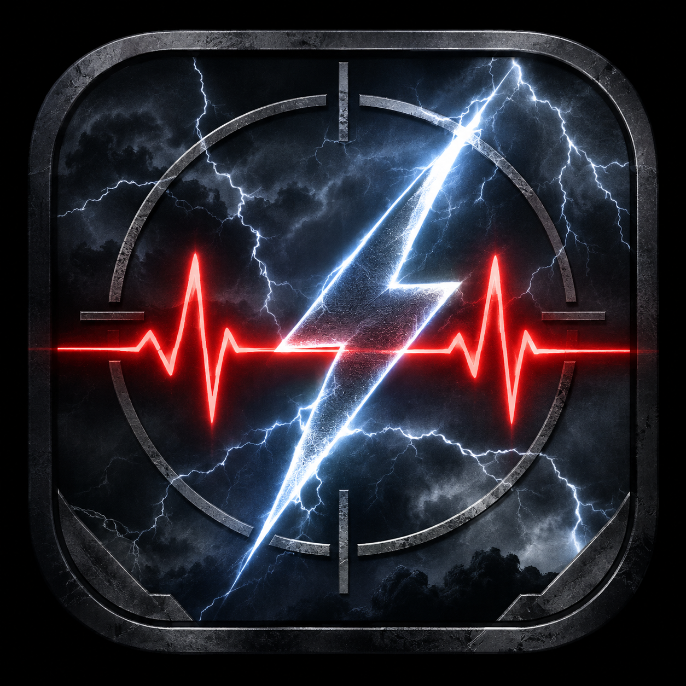

<h1 align="center">Team-13: Drone Search for Lost Subjects</h1>

  Finding a person who is injured, displaced, and <b>not transmitting</b>, in places where GPS may not work.

---

## The problem

Search and rescue usually assumes the lost person has something that emits: a beacon, a radio, a phone. Often they don't. The battery is dead, the device was damaged, it was left behind, or (for a downed pilot evading capture) it is deliberately switched off.

This project plans for that **worst case: no detectable emitter**. Any signal we do pick up is a bonus, never the plan.

We look at two lost-subject profiles:

| | Profile A: Downed pilot | Profile B: Civilian hiker |
|---|---|---|
| Setting | Contested, GPS-denied environment | Wildfire |
| Training | SERE-trained: evade, survive, signal only when safe | No formal survival training |
| Likely behavior | Leave the chute or wreckage, hide, move at night toward a pickup point | Follow trails, head for water or roads, backtrack, shelter, or stay put |
| Possible emitters | Survival radio, 406 MHz PLB, aircraft ELT, satellite radio | Phone, smartwatch, Bluetooth earbuds |
| Why it may be silent | Ejection damage, dead battery, injury, staying quiet while evading | Uncharged, out of coverage, or turned off to save battery |

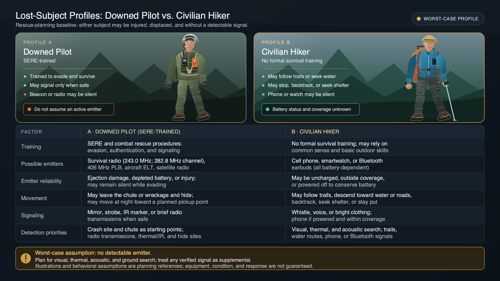

*Profile comparison slide ([4K version](profiles/profile-comparison-4k.png), [PowerPoint](profiles/profile-comparison.pptx), [SVG](profiles/profile-comparison.svg)).*

## The concept

A team of drones searches the area, and a probability model tells them where to look next.

1. **Plan the search on the phone.** An operator draws the search area in ATAK, marks the last known position (LKP), likely places, keep-out zones, and the launch point. The plugin turns that into routes for the linked drones.
2. **Fly and sense.** Each drone carries a sensor stack that does not depend on the subject carrying anything:
   - **Vital-sign radar** picks up breathing and heartbeat from a person who is still, and Doppler motion from one who is moving.
   - **Camera + lidar** for seeing the subject and for navigating without GPS.
   - **Software-defined radio (SDR)** listens for any emitter that happens to be on, including satellite phone bursts.
3. **Navigate without GPS.** Visual-inertial odometry (VIO), checked against lidar-inertial odometry (LIO), keeps the drone localized when GNSS is jammed or unavailable.
4. **Update the map.** After every pass, a Bayesian model updates the probability of where the subject is. Searching a cell and finding nothing lowers its probability (but never to zero), and the next routes go where the remaining probability is highest. A "CLUE" marker in flight raises the map around a find.

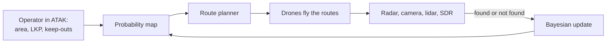

The model is **profile-based**: one shared engine, with a plug-in configuration for each kind of lost person (weight tables, behavior, start anchors, devices, detection modifiers). Adding a new profile, such as a child or an elderly person with dementia, needs no engine changes. Full details are in the [probability model doc](docs/rescue-subject-probability-model.md).

## What we built

### Search planning in ATAK

The phone app links to both drones, walks the operator through drawing the search area and marking the LKP, and pushes the mission. It works with **no GNSS**: the operator can set their location by hand or by MGRS grid.

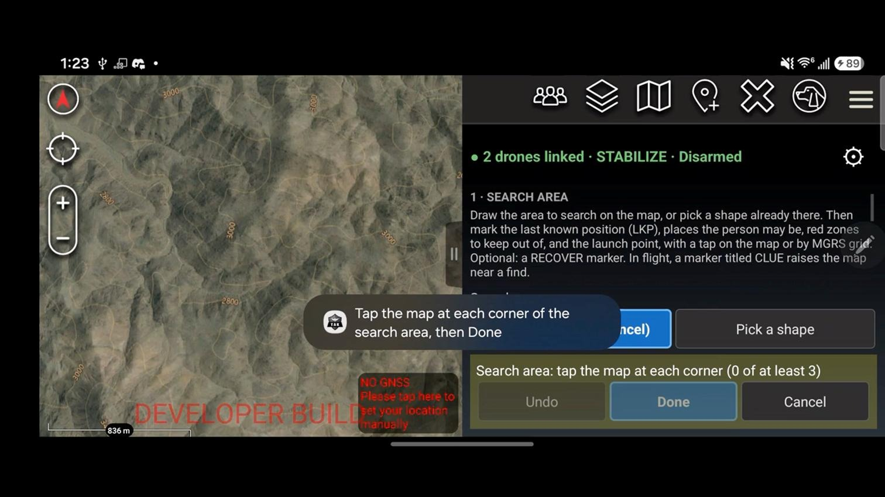

A sample mission exported from ATAK is in [presentation/drone-1-waypoints.txt](presentation/drone-1-waypoints.txt) (58 waypoints, 9.86 km lawnmower pattern).

### Sensor payload

A Raspberry Pi with a camera module and an RPLIDAR, taped together into a first test rig.

  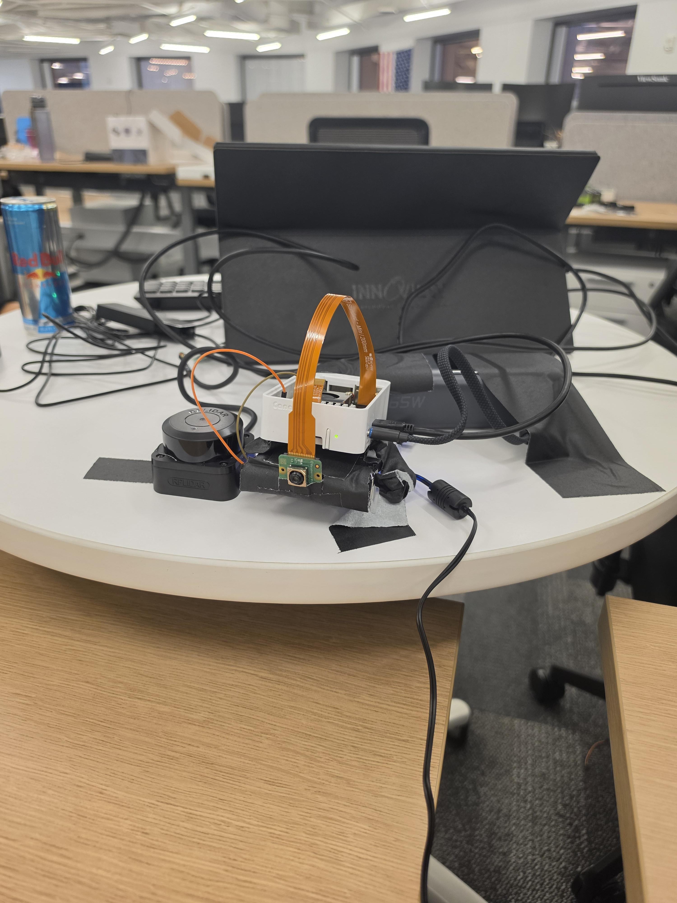
  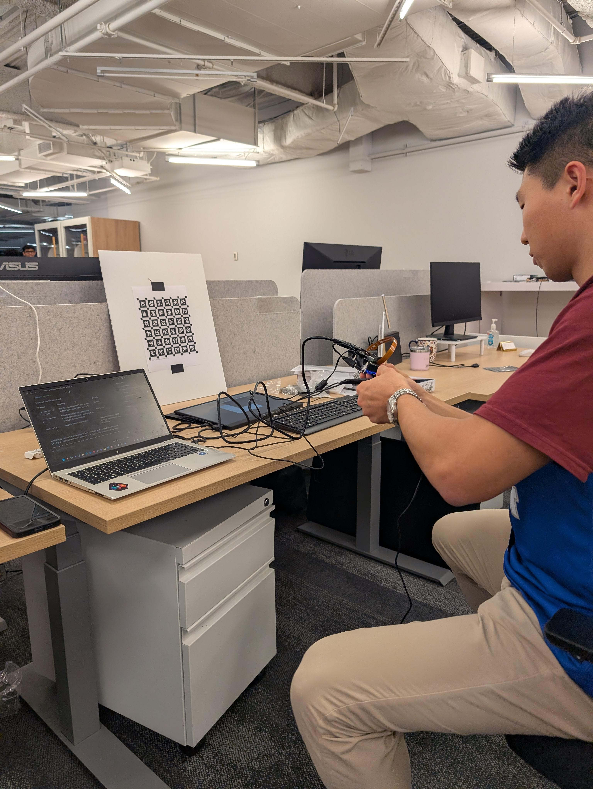

*Left: the sensor rig. Right: calibrating the camera against a ChArUco board.*

<a href="media/signal-2026-11-08-10-55-21-017.mp4">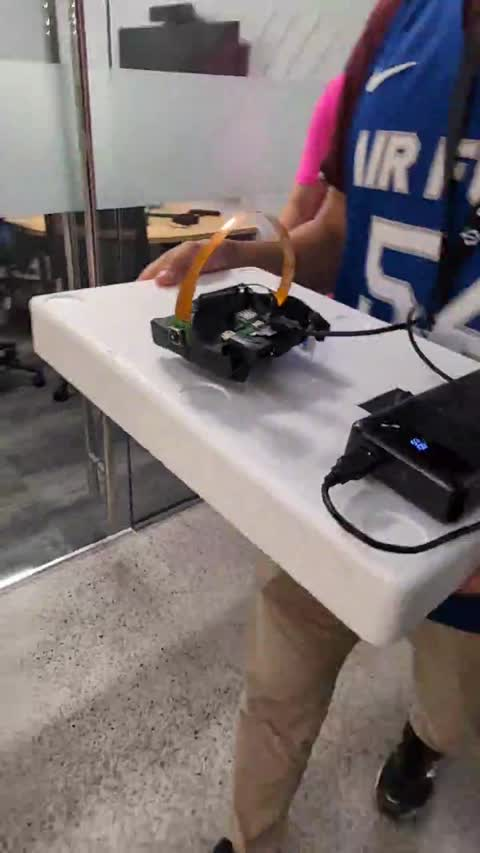</a>

*Walking the rig through the building to collect navigation data ([video](media/signal-2026-11-08-10-55-21-017.mp4), 13 s).*

### Vital-sign radar

The radar reads breathing rate from a person nearby and shows whether they are moving. Heart rate needs the subject to hold still for several seconds, which fits a pilot hiding from drone noise or a hiker who is injured or exhausted.

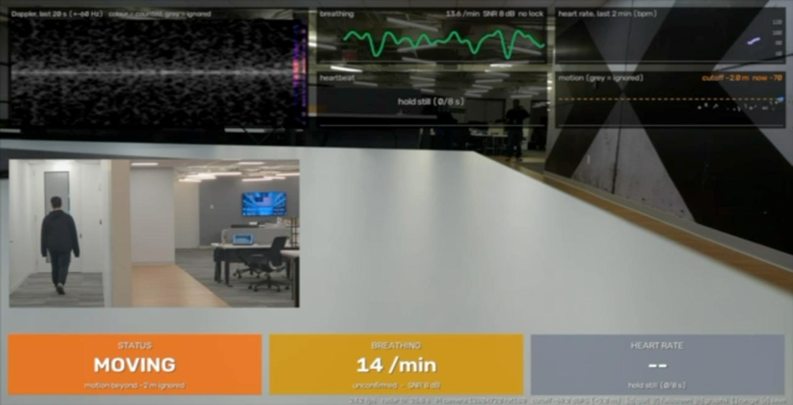

<a href="media/signal-2026-11-08-05-24-35-857.mp4">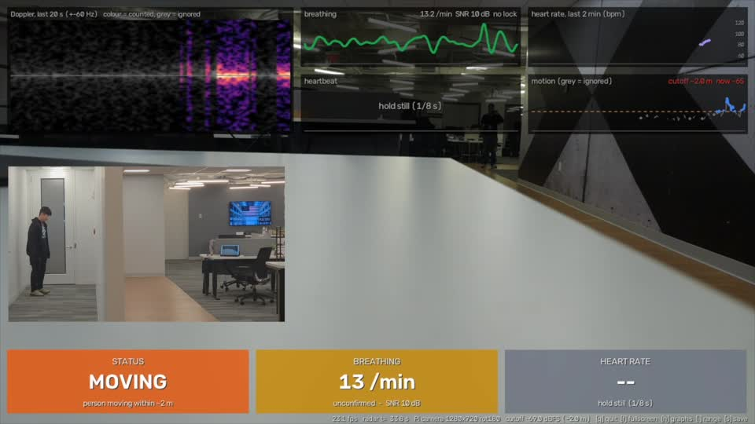</a>

*Radar demo: Doppler, breathing, heartbeat, and motion panels with a live camera view ([video](media/signal-2026-11-08-05-24-35-857.mp4), 26 s).*

### GPS-denied navigation

Visual-inertial odometry from the camera, scored against a lidar-inertial reference. After calibration correction the two indoor runs held about **1.4 m** and **2.1 m** RMSE over roughly 46 m of travel (5.5 m and 3.8 m uncorrected).

<a href="media/signal-2026-11-08-07-51-18-450.mp4">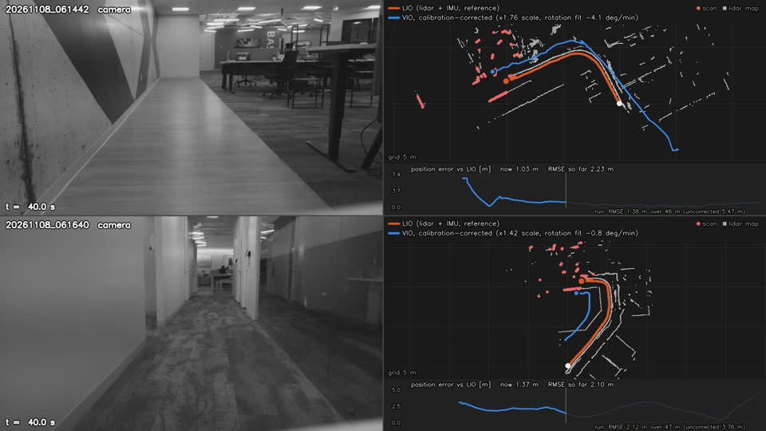</a>

*Two runs side by side: camera view, VIO (blue) vs LIO (orange) track, and position error over time ([video](media/signal-2026-11-08-07-51-18-450.mp4), 90 s).*

### Listening for emitters

If the subject does have a satellite phone or beacon, we want to hear it. We modeled which Iridium satellites are overhead at the search site, then used an SDR and antenna to pick up Iridium bursts near 1626 MHz.

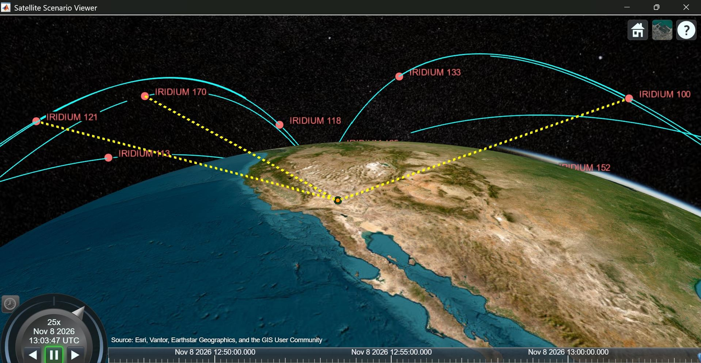

*Iridium satellites in view of the search area (MATLAB Satellite Scenario Viewer).*

  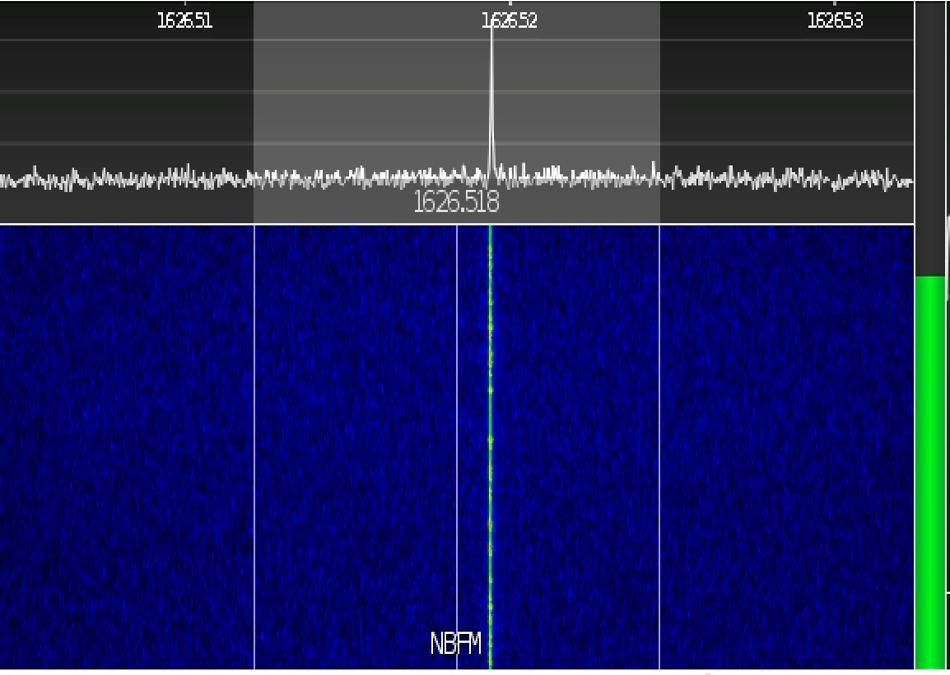
  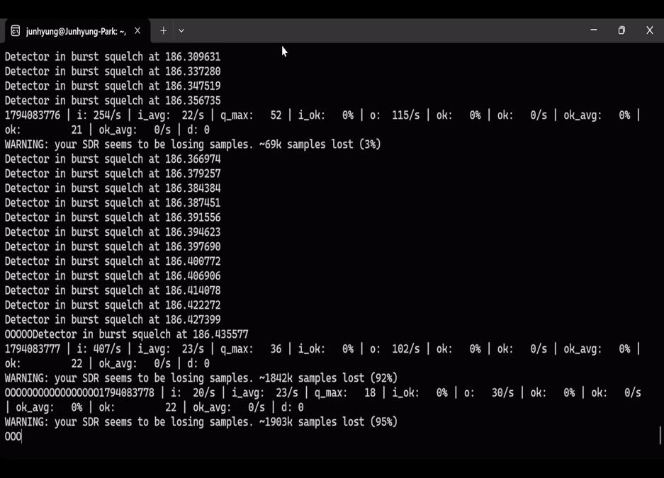

*Left: a carrier at 1626.518 MHz on the SDR waterfall. Right: the burst detector catching bursts (and the sample loss we still need to fix).*

  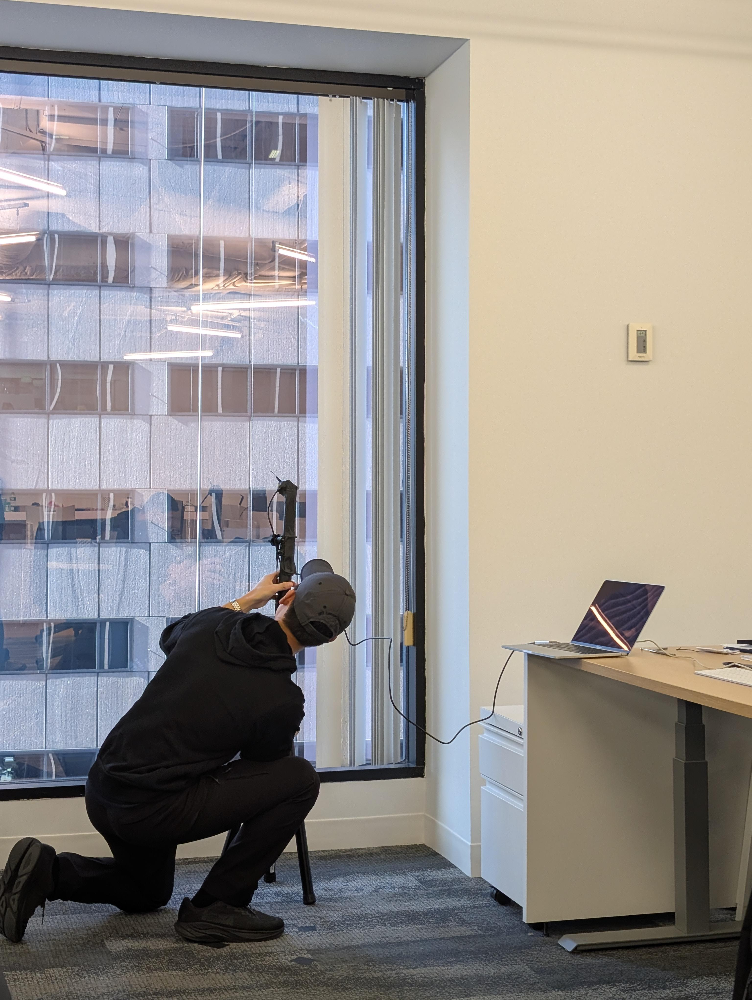
  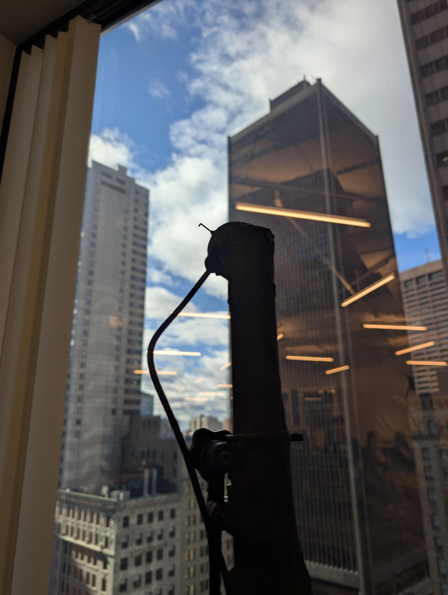

*Aiming the antenna at the sky from the office window.*

## Repository layout

| Path | What's there |
|---|---|
| [docs/rescue-subject-probability-model.md](docs/rescue-subject-probability-model.md) | The probability model: profiles, Bayesian particle filter, weighted-table method, devices, simulation loop, validation, roadmap |
| [profiles/](profiles/) | Lost-subject profile comparison slide (PNG, SVG, PPTX) |
| [presentation/](presentation/) | Sample drone mission waypoints exported from ATAK |
| [drone specifications/](drone%20specifications/) | Spec sheets for the Group 1 (Eagle NXT / eBee) and Group 2 (Redwire Stalker Block 30) platforms |
| [reference/afh10-644.pdf](reference/afh10-644.pdf) | AFH 10-644, *SERE Operations*, the doctrine source for Profile A |
| [media/](media/) | Photos, screenshots, and demo videos |

## Status and next steps

The model is a **draft for team review**. It has no calibrated parameters yet; every number is a placeholder. Next steps, from the [roadmap](docs/rescue-subject-probability-model.md#9-roadmap):

- Interview operators and collect past mission data to fill the weight tables.
- Build the weights-to-map code and calibrate on held-out incidents.
- Close the loop in ArduPilot SITL: subject simulator, detection model, and MAVLink route planner.
- Fill the drone platform inputs (endurance, speed, altitude, sensor field of view) from the spec sheets.

## Responsible use

This is **decision support for search and rescue**. Incident command and trained search planners keep the decisions. It must not be used to target, track, or surveil anyone outside an authorized rescue, and any use of communications data needs lawful authority.

## License

See [LICENSE](LICENSE).
