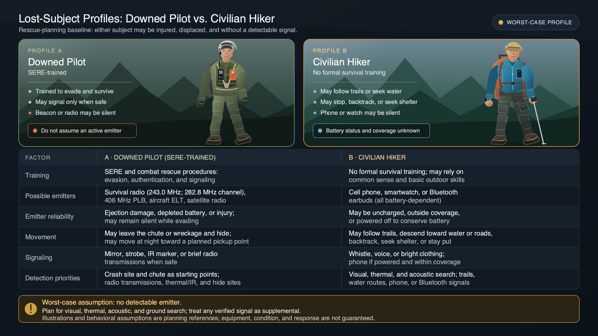
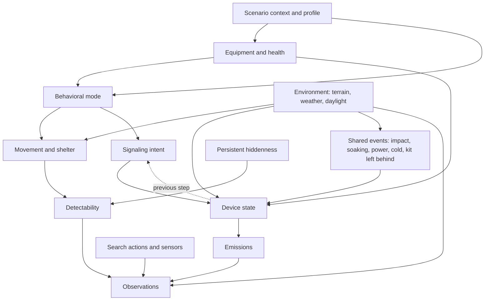
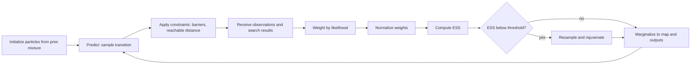
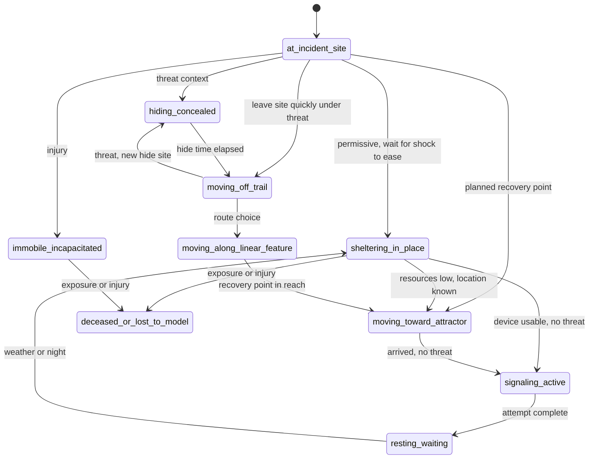
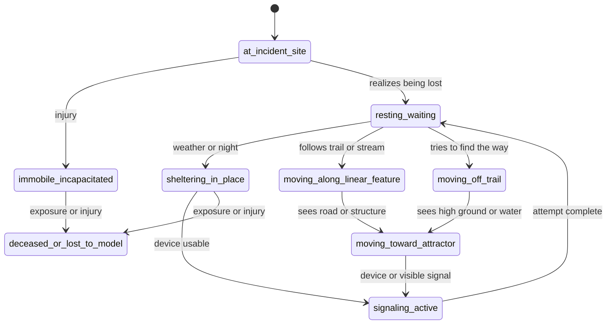
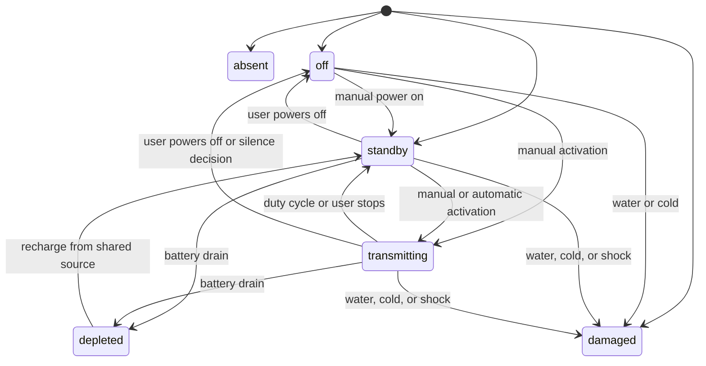
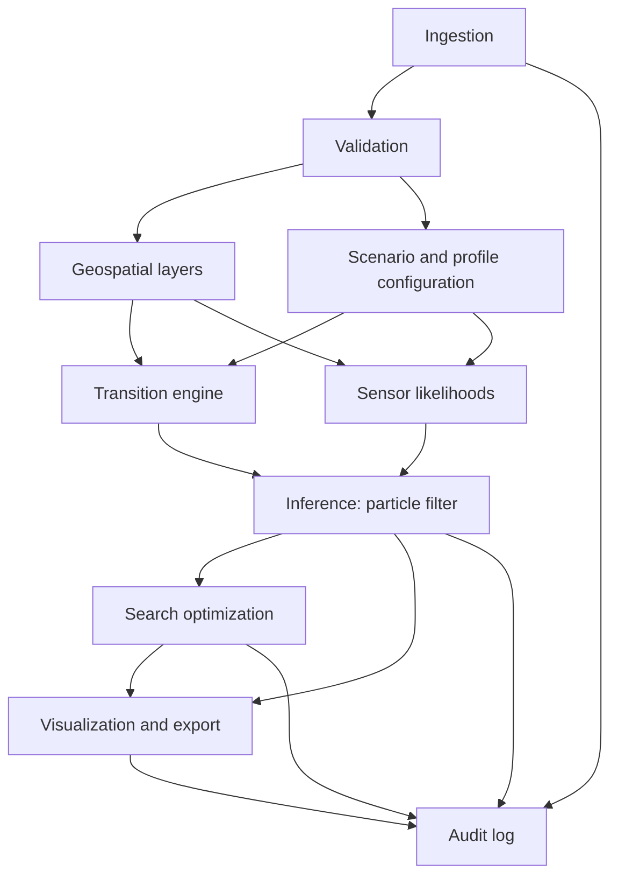
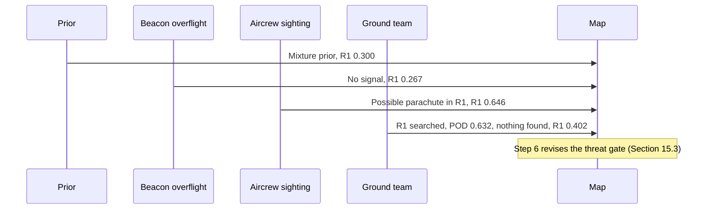
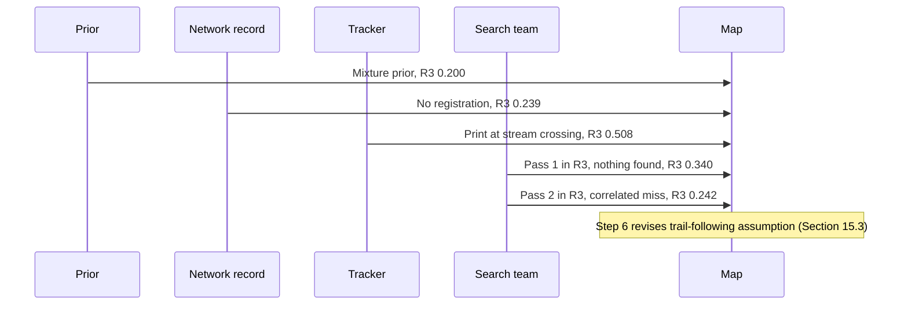

# Rescue Subject Probability Model: Conceptual and Technical Foundation

| Field | Value |
|---|---|
| Status | Draft v0.1 for team review. Not validated. Contains no calibrated parameters. |
| Model version | `rsm-0.1.0-draft` (placeholder) |
| Owner | Team-13 |
| Document date | 2026-11-07 (same date as the web access checks in [Section 19](#19-references-and-afh-10-644-traceability-matrix)) |
| Intended readers | Software engineers, search planners, analysts, domain reviewers |
| Primary doctrine source | Air Force Handbook (AFH) 10-644, *Survival Evasion Resistance Escape (SERE) Operations*, 27 March 2017, as provided in this repository ([`reference/afh10-644.pdf`](../reference/afh10-644.pdf)) |

> **Use and misuse.** This model supports human search and rescue (SAR) decisions. It does not replace incident command or trained search planners. It must not be used to target, track, or surveil a person outside an authorized rescue effort. Passive radio reception cannot decode encrypted content, and a single uncalibrated signal-strength reading cannot locate a device. Any use of communications data requires lawful authority (see [Section 9.4](#94-lawful-access-and-privacy)).

## Abstract

This document defines a probabilistic model for locating a lost subject when the last known location is uncertain and no device is assumed to emit. It covers two subject profiles: (A) a downed pilot with Survival, Evasion, Resistance, and Escape (SERE) training, and (B) a civilian hiker with common sense but no assumed survival doctrine. The model is a Bayesian state-space model (a hidden Markov model, HMM, with continuous space) solved with a spatial particle filter. It keeps probability of area separate from probability of detection, treats every radio, beacon, phone, watch, and satellite device as an uncertain opportunity, and treats failed searches as evidence that reduces probability only in proportion to actual detection capability.

The document is the conceptual and technical foundation for later development. It is not presentation copy and contains no calibrated numbers. Every numeric value shown is symbolic, a placeholder, or labeled illustrative.

## Table of contents

- [Glossary of acronyms](#glossary-of-acronyms)
- [Evidence classes](#evidence-classes)
- [Supporting artifacts](#supporting-artifacts)
- [1. Status, purpose, scope, and constraints](#1-status-purpose-scope-and-constraints)
- [2. Terminology and notation](#2-terminology-and-notation)
- [3. Profile definitions](#3-profile-definitions)
- [4. Shared generative model](#4-shared-generative-model)
- [5. Probabilistic formulation](#5-probabilistic-formulation)
- [6. Prior construction](#6-prior-construction)
- [7. Behavioral-state transition models](#7-behavioral-state-transition-models)
- [8. Emitter and device submodel](#8-emitter-and-device-submodel)
- [9. Sensor and observation models](#9-sensor-and-observation-models)
- [10. Search actions and resource allocation](#10-search-actions-and-resource-allocation)
- [11. Data model and implementation contract](#11-data-model-and-implementation-contract)
- [12. Software architecture](#12-software-architecture)
- [13. Calibration plan](#13-calibration-plan)
- [14. Validation and test strategy](#14-validation-and-test-strategy)
- [15. Worked examples](#15-worked-examples)
- [16. Failure modes and controls](#16-failure-modes-and-controls)
- [17. Implementation roadmap](#17-implementation-roadmap)
- [18. Open questions and decisions](#18-open-questions-and-decisions)
- [19. References and AFH 10-644 traceability matrix](#19-references-and-afh-10-644-traceability-matrix)

## Glossary of acronyms

Each acronym is also expanded at first use in the body text.

| Acronym | Meaning | Acronym | Meaning |
|---|---|---|---|
| AFH | Air Force Handbook | MCMC | Markov chain Monte Carlo |
| BLE | Bluetooth Low Energy | MNAR | missing not at random |
| COSPAS-SARSAT | International satellite-aided search and rescue alerting system | NOAA | National Oceanic and Atmospheric Administration |
| CRS | coordinate reference system | NSARC | National Search and Rescue Committee |
| CSEL | Combat Survivor/Evader Locator | NSS | National Search and Rescue Supplement |
| DEM | digital elevation model | PII | personally identifiable information |
| ELT | emergency locator transmitter | PLB | personal locator beacon |
| EPIRB | emergency position-indicating radio beacon | PLS | place last seen |
| EPSG | European Petroleum Survey Group (registry of CRS codes) | POA | probability of area |
| ESS | effective sample size | POD | probability of detection |
| FAA | Federal Aviation Administration | POS | probability of success |
| FCC | Federal Communications Commission | RF | radio frequency |
| FDOA | frequency difference of arrival | RSSI | received signal strength indicator |
| FLIR | forward-looking infrared | RTL-SDR | low-cost software-defined radio based on the Realtek RTL2832U chip |
| GHz / MHz | gigahertz / megahertz | SAR | search and rescue |
| GIS | geographic information system | SATCOM | satellite communication |
| GPS | Global Positioning System | SDR | software-defined radio |
| HMM | hidden Markov model | SERE | Survival, Evasion, Resistance, Escape |
| IAMSAR | International Aeronautical and Maritime Search and Rescue (Manual) | SI | International System of Units |
| IP | isolated personnel (AFH term) | SIR | sampling importance resampling |
| IR | infrared | SPINS | special instructions |
| ISRID | International Search and Rescue Incident Database | TDOA | time difference of arrival |
| LKP | last known point (or location) | UAS | unmanned aircraft system |
| LPE | Low Probability of Exploitation | UTC | Coordinated Universal Time |
| LUT | Local User Terminal | WGS 84 | World Geodetic System 1984 |
| MCC | Mission Control Center | YAML | YAML Ain't Markup Language |

## Evidence classes

Every substantive claim carries one of five tags. A claim with no tag is a definition or a logical consequence of earlier tagged claims.

| Tag | Class | Meaning | Allowed support |
|---|---|---|---|
| `[DOC]` | Doctrine-supported | A statement of what AFH 10-644 teaches or directs. It describes training, not observed behavior. | AFH 10-644 only, with traceability ID (`D-nn`) |
| `[EMP]` | Empirical SAR finding | A finding from incident data, field experiments, or published analysis. | Public references (`R-nn`) |
| `[ENG]` | Engineering assumption | A modeling choice made for tractability. It can be wrong and should be tested. | Author reasoning, stated openly |
| `[POL]` | Configurable policy choice | A value or rule set by the responsible authority, not by data. | Decision record ([Section 18](#18-open-questions-and-decisions)) |
| `[HYP]` | Hypothesis requiring calibration | A plausible claim with no supporting data in this repository. | Calibration placeholder (`CAL-nnn`) |

SERE doctrine is never used as evidence for civilian hiker behavior. Profile B rows use only `[EMP]`, `[ENG]`, `[POL]`, and `[HYP]`.

## Supporting artifacts

These files summarize the two profiles visually. They are supporting artifacts, not the source of truth. If an artifact and this document disagree, this document governs.

| Artifact | Path from `docs/` | Role |
|---|---|---|
| Profile comparison slide (vector) | [`../profiles/profile-comparison.svg`](../profiles/profile-comparison.svg) | Presentation view of profiles A and B |
| Profile comparison slide (4K image) | [`../profiles/profile-comparison-4k.png`](../profiles/profile-comparison-4k.png) | High-resolution raster copy |
| Profile comparison slide (1920 by 1080) | [`../profiles/profile-comparison-1920x1080.png`](../profiles/profile-comparison-1920x1080.png) | Standard slide raster |
| Profile comparison slide (PowerPoint) | [`../profiles/profile-comparison.pptx`](../profiles/profile-comparison.pptx) | Editable slide |
| AFH 10-644 | [`../reference/afh10-644.pdf`](../reference/afh10-644.pdf) | Primary doctrine source |



---

## 1. Status, purpose, scope, and constraints

### 1.1 Purpose

This document specifies a probability model that estimates where a lost subject may be, and how likely a given search action is to find that subject. It gives software engineers, search planners, analysts, and domain reviewers one shared description they can implement, calibrate, test, and govern.

### 1.2 Intended users and where to start

| Reader | Start with | Then read |
|---|---|---|
| Search planner | [Section 2](#2-terminology-and-notation), [Section 3](#3-profile-definitions) | [Section 10](#10-search-actions-and-resource-allocation), [Section 15](#15-worked-examples), [Section 16](#16-failure-modes-and-controls) |
| Domain reviewer (SERE, SAR, radio) | [Section 3](#3-profile-definitions), [Section 8](#8-emitter-and-device-submodel) | [Section 19](#19-references-and-afh-10-644-traceability-matrix) |
| Analyst or statistician | [Section 5](#5-probabilistic-formulation), [Section 13](#13-calibration-plan) | [Section 14](#14-validation-and-test-strategy) |
| Software engineer | [Section 11](#11-data-model-and-implementation-contract), [Section 12](#12-software-architecture) | [Section 5](#5-probabilistic-formulation), [Section 17](#17-implementation-roadmap) |

| Section group | Sections |
|---|---|
| Concepts | 1 to 4 |
| Mathematics | 5 to 7 |
| Sensing | 8 and 9 |
| Action | 10 |
| Engineering | 11 and 12 |
| Assurance | 13 to 16 |
| Planning | 17 to 19 |

### 1.3 Scope

The model covers two lost-subject profiles:

- **Profile A:** a downed pilot with SERE training.
- **Profile B:** a civilian hiker with common sense and basic outdoor judgment, and no assumed survival doctrine.

The baseline is the worst case: **no detectable emissions**. Radios, beacons, phones, watches, Bluetooth devices, satellite equipment, and aircraft systems are uncertain opportunities, never guarantees. The location is initially uncertain, but a last known point or location (LKP) and contextual information are available.

### 1.4 Non-goals

- Not a command, dispatch, or tasking system.
- Not a medical triage or prognosis tool.
- Not a tool for targeting, tracking, or surveilling people.
- Not a source of operational parameter sets. This document contains no calibrated values.
- Not a replacement for local knowledge, trained search planners, or the incident commander.

### 1.5 Operational, ethical, and legal constraints

- `[POL]` The model is decision support. Incident command and trained search planners retain authority over every search decision. Model output is advice that a human may accept, modify, or reject, and overrides are logged ([Section 12](#12-software-architecture)).
- `[POL]` Ethical constraints: use the minimum personal data needed, retain it for the shortest period the incident requires, avoid stereotyping, and state uncertainty in every output.
- `[POL]` Legal constraints: any interception, location lookup, or metadata request requires lawful authority. This document names no statute as verified. Counsel must review before any data source is connected ([Section 18](#18-open-questions-and-decisions)).
- `[ENG]` Outputs must always show uncertainty and the active assumptions. Output that shows only a single best point is non-conforming.

---

## 2. Terminology and notation

### 2.1 Terms

| Term | Definition used in this document |
|---|---|
| Last known point or location (LKP) | A position where the subject was known to be at a stated time, with an error model (for example a covariance). It is a time-stamped distribution, not a single truth. |
| Place last seen (PLS) | An LKP that comes from a human sighting. It is a special case of LKP with its own error model. |
| Search origin | The reference point and time from which the prior is built. It often equals the LKP, but may differ (for example the planned route start, a crash point estimated from radar, or a vehicle location). |
| Time since last contact, $\Delta t$ | Elapsed time from the LKP timestamp to the current analysis time, in seconds. |
| Subject | The person being sought. For a group, each member is a subject unless modeled as a unit. |
| Scenario branch | One discrete hypothesis about what happened (for example "stayed near the LKP"). Branches form a mixture. |
| Probability of area (POA) | The probability that the subject is inside a given area or cell, given all evidence so far. Also written $\pi_t(c)$ for cell $c$. |
| Probability of detection (POD) | The probability that a search action finds the subject, given that the subject is in the searched area and the subject is detectable. Always in $[0,1]$. |
| Probability of success (POS) | The probability that a search action finds the subject. For one area, $\text{POS} = \text{POA} \times \text{POD}$. |
| False positive | A reported detection when no subject-related signal or object is present. |
| False-positive rate | The expected number of false positives per unit of search effort, time, or sensor dwell. It is defined per sensor in [Section 9](#9-sensor-and-observation-models). |
| False alarm vs. false lead | A false alarm is a spurious sensor event. A false lead is a real object or sign that is unrelated to the subject (for example another hiker's footprint). Both enter the likelihood as clutter. |
| Negative evidence | An observation of "not found" from a search action with known coverage. It is informative in proportion to POD, and never proves absence. |
| Censoring | A case where the true value is only partly known. Right censoring: the subject was not found before the observation period ended. Interval censoring: an event happened between two checks. |
| Uncertainty | Aleatoric uncertainty is natural variability (for example where a person decides to walk). Epistemic uncertainty is lack of knowledge (for example unknown parameters). The model represents both and reports them separately where practical. |
| Effort | The amount of search resource spent in a segment (for example track length times time). |
| Effective sweep width, $W$ | A summary of detection capability. It equals the width of a strip, centered on the searcher's track, such that the number of subjects missed inside the strip equals the number detected outside it. It depends on sensor, platform, target, and environment. |
| Coverage, $C$ | Swept area (effective sweep width times track length) divided by segment area. |
| Track spacing | Distance between adjacent search tracks. |

### 2.2 Notation

This table is the single source for symbols. Later equations use only these symbols or define new ones locally. The letter $c$ always denotes a cell or segment index, $b$ always the clutter density, and $\mathbf{y}_t$ the hazard covariates.

| Symbol | Meaning | Type and units |
|---|---|---|
| $t$ | Discrete time index; step length $\delta$ seconds | integer |
| $\Delta t$ | Time since last contact | seconds |
| $\mathbf{s}_t$ | Full latent state at time $t$ | vector |
| $x_t$ | Position | 2D point in a declared coordinate reference system (CRS), meters |
| $r_t$ | Route and terrain context (on trail, off trail, road edge, water edge, slope class, land cover) | categorical plus attributes |
| $h_t$ | Mobility and health | categorical and ordinal |
| $m_t$ | Behavioral mode | categorical |
| $s_t$ | Shelter and concealment | categorical |
| $g_t$ | Signaling intent | categorical |
| $e_t^{(k)}$ | State of device $k$ (see [Section 8](#8-emitter-and-device-submodel)) | categorical |
| $v_t$ | Detectability features (size, contrast, movement, emissions) | vector |
| $a_t$ | Survival relevance (alive and able, alive and incapacitated, deceased or lost to the model) | categorical |
| $\tau$ | Threat context gate (profile A only) | $\{0,1\}$ |
| $z_t$ | Observation (possibly a set) at time $t$ | record |
| $u_t$ | Search action at time $t$ | record |
| $\theta$ | Parameter vector | vector |
| $\phi$ | Scenario context (profile, weather, terrain, group, and so on) | record |
| $\Omega$ | Search domain, partitioned into cells | set |
| $c$ | Cell index | element of $\Omega$ |
| $\pi_t(c)$ | Probability of area for cell $c$ | $[0,1]$, $\sum_c \pi_t(c) = 1$ over the domain plus an "outside domain" cell |
| $N$ | Number of particles | integer |
| $w_t^{(i)}$ | Normalized weight of particle $i$ | $[0,1]$, $\sum_i w_t^{(i)} = 1$ |
| $\text{pd}(\mathbf{s}, u)$ | Detection probability for state $\mathbf{s}$ under action $u$ | $[0,1]$ |
| $\text{POD}_c$ | Probability of detection for cell $c$ under the chosen action | $[0,1]$ |
| $\lambda_{\text{fp}}$ | False-positive rate | events per unit effort or time |
| $W$ | Effective sweep width | meters |
| $C$ | Coverage | dimensionless |
| $\alpha_j$ | Mixture weight of branch $j$ | $[0,1]$, $\sum_j \alpha_j = 1$ |
| $\boldsymbol{\eta}_t$ | Shared event vector $(\eta^{\text{imp}}, \eta^{\text{soak}}, \eta^{\text{pwr}}, \eta^{\text{cold}}, \eta^{\text{kit}})$: impact, soaking, shared power source, cold exposure, kit left behind | five booleans |
| $\rho$ | Persistent hiddenness of the subject, drawn at $t=0$ | real in a configured support |
| $K_d$ | Number of devices in the inventory | integer |
| $n_\ell$ | Number of looks (passes) at one segment | integer |
| $\epsilon_{\min}$ | Minimum (floor) weight of a prior branch | $[0,1]$ |
| $\kappa_j$ | Dirichlet concentration for branch $j$ | positive real |
| $\mathbf{y}_t$ | Covariate vector for hazards (injury, daylight, weather, terrain, threat, group, device state, time since event) | vector |
| $\lambda_{ab}$, $\Lambda_a$, $\beta_{ab}$ | Hazard from state $a$ to $b$, total hazard out of $a$, covariate effects | per second; per second; dimensionless |
| $\omega_k$, $\psi_k$ | Signed weight and feature field for movement attractors and repellers | dimensionless; field over space |
| $q$, $d$ | Probability a device is transmitting; probability its transmission is received and decoded given transmission (region-specific forms $q_c$, $d_c$) | $[0,1]$ |
| $f$, $b$ | Density of a reported observation given a true detection; density of clutter (false positives and false leads) | per unit of observation space |
| $E_u$ | Effort or dwell of action $u$, in the units of $\lambda_{\text{fp}}$ | seconds or meters |
| $A_c$, $L_c$, $W_c$, $Z_c$ | Segment area, track length, effective sweep width, and swept area of segment $c$ | m$^2$, m, m, m$^2$ |
| $\gamma_c$, $\xi_c$ | Travel or transit cost, and rescuer risk cost, of segment $c$ | cost units |
| $p_{\text{conf}}$ | Confidence level used for the displayed error ellipse | $(0,1)$ |

### 2.3 Conventions

- `[ENG]` All timestamps use Coordinated Universal Time (UTC) in ISO 8601 form. Local time appears only in display layers.
- `[ENG]` Distances use meters and durations use seconds. Display layers may convert.
- `[ENG]` Per search segment, $\text{POS} = \text{POA} \times \text{POD}$. Total success probability sums this product over segments.
- `[ENG]` The domain includes an explicit "outside the modeled area" cell so that probabilities normalize even when the subject may have left the map.

---

## 3. Profile definitions

A profile is a set of priors and conditional branches. It is not a prediction about any individual. Both profiles are mixtures of behaviors with weights that evidence can move ([Section 15](#15-worked-examples) shows revision).

### 3.1 Common traits

| Trait | Statement | Class |
|---|---|---|
| Worst-case emission baseline | The subject emits nothing detectable unless evidence shows otherwise. | `[POL]` |
| Partial equipment | Equipment may be lost, damaged, wet, or uncharged. | `[ENG]`, and `[DOC]` for profile A (D-07, D-14, D-16) |
| Injury uncertainty | Injury state is unknown and may change over time. | `[ENG]` |
| Finite endurance | Survival relevance declines with time, cold, water exposure, and injury. | `[ENG]` |
| Possible incapacitation | The subject may be unable to move or signal. | `[ENG]` |
| Unknown starting location | The true location is uncertain even at $t = 0$. | `[ENG]` |

### 3.2 Profile A: downed pilot with SERE training

AFH 10-644 describes what isolated personnel (IP) are taught. It does not describe what every pilot does. The rows below say "training teaches" for that reason.

| Trait or tendency | Statement (paraphrased) | Class and source |
|---|---|---|
| Goal state | Training aims at returning to friendly control early and in good condition. | `[DOC]` D-01 |
| Decision-driven outcome | The IP's decisions and actions shape the outcome. | `[DOC]` D-02 |
| Early crisis, then coping | An early crisis period can impair judgment, followed by coping. Crises can recur in long events. | `[DOC]` D-06 |
| Delay before a travel decision | Training advises avoiding major decisions right after the event and waiting for shock to ease. | `[DOC]` D-18 |
| Stay or travel | In permissive areas staying near the site has helped recovery of most IP, and leaving needs strong justification. In non-permissive areas, travel is planned before the mission. | `[DOC]` D-17 |
| Needs vocabulary | Needs include travel, communications, recovery, and evasion. | `[DOC]` D-10 |
| Signaling knowledge | IP are expected to know signaling procedures and devices. Site choice affects visibility. | `[DOC]` D-11, D-21, D-22 |
| Equipment care and degradation | Electronic signaling devices are called the most important signaling devices. Cold, moisture, and heat degrade them. | `[DOC]` D-14 |
| Kit may be left behind | Shock and fear have led IP to leave survival kits behind. | `[DOC]` D-16 |
| Parachute and wreckage | A parachute can serve as shelter, signal, and cordage. A parachute caught in a tree is itself a signal. Wreckage and parachute draw attention. | `[DOC]` D-15, D-30, D-41 |
| Threat-driven concealment | In non-permissive settings some devices reveal the IP to the adversary as well as to friends, so devices are used per special instructions (SPINS). Hiding and movement choices follow threat. | `[DOC]` D-23, D-34, D-36 |
| Road and line-of-communication avoidance | In threat settings, training says to avoid roads, waterways, power lines, and cell towers. | `[DOC]` D-36, D-39 |
| Planned recovery point | Training advises picking high, clear terrain accessible to rescuers. | `[DOC]` D-33 |

### 3.3 Profile B: civilian hiker

No AFH 10-644 row applies to profile B. Rows below are hypotheses to be examined against incident data such as the International Search and Rescue Incident Database (ISRID, R-08) and the lost-person behavior literature (R-07). The model does not copy numbers from those sources. Category names such as "hiker" are priors to examine, not facts.

| Candidate behavior | Statement | Class |
|---|---|---|
| Follows trails and linear features | May follow trails, roads, or streams, with a nonzero chance of leaving them (rate `CAL-009`). | `[HYP]` (examine against R-07, R-08) |
| Stays put or keeps moving | May stay in place after realizing they are lost, or keep moving. | `[HYP]` |
| Disorientation | May be disoriented, especially in low visibility or dense vegetation. | `[HYP]` |
| Seeks high ground or water | May move toward visible high ground, drainages, or water. | `[HYP]` |
| Shelter quality | May shelter poorly, or well if experienced. | `[HYP]` |
| Carries devices of uncertain state | May carry a phone, a watch, or Bluetooth headphones whose charge and service are unknown. | `[ENG]` |
| Travels in a group | May be alone or with others, who may split. | `[ENG]` |
| Avoids people for unusual reasons | A small branch for hikers who avoid contact for reasons other than threat. Kept at a floor weight. | `[HYP]` |

### 3.4 Conditional branches

Each profile responds to the conditions below. The table states the direction of influence, not the size.

| Condition | Effect on behavior hazards and speed | Effect on detectability | Effect on device state | Applies to | Class |
|---|---|---|---|---|---|
| Injury | Lowers speed, raises incapacitation hazard, may raise stay hazard | Immobile subjects move less, so lower movement cue | Impact may damage devices | A, B | `[ENG]`; A also `[DOC]` D-05, D-18 |
| Mobility | Limits route choice and distance bound | Fewer cues when immobile | None directly | A, B | `[ENG]` |
| Weather | Slows travel, raises shelter-seeking, changes signaling choice | Reduces visual and acoustic range | Cold and moisture drain or damage batteries | A, B | `[ENG]` generic physics; A also `[DOC]` D-14, D-29 |
| Daylight | Changes travel and signaling timing | Night lowers visual detection and may favor thermal infrared (IR) | None directly | A, B | `[ENG]` |
| Terrain | Shapes route, speed, barriers | Canopy and relief mask the subject and radio paths | Relief blocks line of sight | A, B | `[ENG]`; `[HYP]` for B route effects |
| Threat and evasion context ($\tau$) | Raises hide and silence hazards, shifts movement toward concealment | Lowers deliberate signaling | Devices may be left off | A only | `[DOC]` D-23, D-34 |
| No-threat context | Allows signaling and staying near site | Raises signaling probability | Devices may be on | A, B | `[ENG]`; A also `[DOC]` D-17 |
| Group size | May change decisions, speed, and splitting | Groups are larger visual targets | More devices, shared events | A (crew), B | `[ENG]`; B group splitting `[HYP]` |
| Equipment state | Determines shelter, signaling, navigation | Bright gear raises visual detectability | Determines inventory | A, B | `[ENG]`; A also `[DOC]` D-07 |
| Time since event | Raises hazard of incapacitation and of changing mode (crisis to coping) | Cues decay or accumulate | Batteries drain | A, B | `[ENG]`; crisis-to-coping direction is `[DOC]` D-06 for A and `[HYP]` for B |

`[HYP]` For profile B, "avoiding people for other reasons" is an unusual sub-branch, so it must hold a floor weight (see [Section 6.4](#64-preserving-low-probability-alternatives)) and not drive the main map.

### 3.5 Anti-stereotype rules

- `[POL]` A profile never excludes a branch that evidence has not excluded.
- `[POL]` Profile selection (for example "pilot with SERE training") is a prior setting, not a verdict. The user can change it, and evidence can shift branch weights ([Section 15.3](#153-profile-revision)).
- `[POL]` A pilot with SERE training can behave like a novice under stress (D-06 supports this). A hiker can be highly experienced. Both are inside the mixture.

---

## 4. Shared generative model

### 4.1 Latent state

Both profiles use the same latent state, so one engine serves both. Profile-specific content lives in the priors and transition parameters. Two components, $\tau$ and $\rho$, are drawn once at $t=0$ and then held constant, so they are not transition factors. The time-varying components are sampled in this fixed order within each step, as shown below the table, which removes any within-step cycle.

| Component | Symbol | Meaning | Type | Depends on |
|---|---|---|---|---|
| Position | $x_t$ | Where the subject is | 2D point, meters | $x_{t-1}$, $m_t$, $h_t$, $r_{t-1}$ |
| Route and terrain context | $r_t$ | Trail, off trail, road edge, water edge, slope class, land cover at $x_t$ | categorical plus attributes | $x_t$, geospatial layers |
| Mobility and health | $h_t$ | Ability to move, injury level | ordinal | $h_{t-1}$, environment, time |
| Behavioral mode | $m_t$ | See [Section 7](#7-behavioral-state-transition-models) | categorical | $m_{t-1}$, $h_{t-1}$, profile, context |
| Shelter and concealment | $s_t$ | Exposed, sheltered, concealed | categorical | $m_t$, $r_t$, $\tau$ |
| Shared events | $\boldsymbol{\eta}_t$ | Impact, soaking, shared power source, cold exposure, kit left behind (see [Section 8.5](#85-shared-causes-and-conditional-dependence)) | five booleans | $\boldsymbol{\eta}_{t-1}$, environment, $h_t$ |
| Signaling intent | $g_t$ | Wants to be found, undecided, deliberately silent | categorical | $m_t$, $h_t$, $\tau$, $\mathbf{e}_{t-1}$ (previous device states) |
| Device states | $e_t^{(k)}$ | See [Section 8](#8-emitter-and-device-submodel) | categorical per device | $e_{t-1}^{(k)}$, $g_t$, $\boldsymbol{\eta}_t$ |
| Threat context gate (profile A only) | $\tau$ | Whether an adversary threat applies | boolean, fixed over time unless revised by new information | drawn at $t=0$ from $p(\tau)$ (`CAL-020`); profile B always 0 |
| Persistent hiddenness | $\rho$ | How hard this subject is to detect, for a reason that persists across repeated looks ([Section 10.4](#104-repeated-passes-and-correlated-misses)) | real in a configured support, fixed over time | drawn at $t=0$ from a profile prior (`CAL-051`); constant afterward |
| Visibility and detectability | $v_t$ | Cues that sensors can observe | vector | $x_t$, $s_t$, $m_t$, $\rho$, environment, equipment |
| Survival relevance | $a_t$ | Alive and able, alive and incapacitated, deceased or lost to the model | categorical | $a_{t-1}$, $h_t$, environment, time |

$$m_t \;\rightarrow\; h_t \;\rightarrow\; x_t \;\rightarrow\; \boldsymbol{\eta}_t \;\rightarrow\; g_t \mid (m_t, h_t, \tau, \mathbf{e}_{t-1}) \;\rightarrow\; \mathbf{e}_t \mid (\mathbf{e}_{t-1}, g_t, \boldsymbol{\eta}_t) \;\rightarrow\; a_t$$

The derived components $r_t$ (from $x_t$ and the layers), $s_t$ (from $m_t$, $r_t$, $\tau$), and $v_t$ (from $x_t$, $s_t$, $m_t$, $\rho$, environment, equipment) are computed after $x_t$ and are not sampled separately. Signaling intent depends on the device states from the previous step, so a change in device state affects intent one step later. Device state then depends on the new intent. This ordering makes the dependence acyclic.

`[DOC]` for profile A, the idea that condition, material, duration, and environment shape the outcome comes from D-03, D-05, D-07, D-08. The remaining structure is `[ENG]`.

### 4.2 Causal diagram

The diagram shows influence direction within a step. The dotted edge is a dependence on the previous step's device state, so the diagram has no within-step cycle. Search actions affect observations only through detectability and sensor geometry.



### 4.3 Dependencies and assumptions

- `[ENG]` The latent state is Markov: $\mathbf{s}_t$ depends on $\mathbf{s}_{t-1}$, the environment, and parameters, not on earlier states.
- `[ENG]` Observations at time $t$ are conditionally independent given $\mathbf{s}_t$ and $u_t$, **only** when the dependence runs through named latent variables. Where two sensors share a cause, the cause must be a latent variable in the state.
- `[ENG]` Shared causes: battery pack, a single damage event, a single soaking event, weather, and terrain masking.

### 4.4 Avoiding double-counting correlated evidence

Correlated evidence must be combined through the shared latent variable. Never multiply separate "independent" likelihoods for evidence that shares a cause.

Example: a phone and a smartwatch in the same pocket share the same impact and soak events. If both are silent, that is one event (for example "the pocket was soaked") seen twice, not two independent confirmations of absence. The device submodel ([Section 8.5](#85-shared-causes-and-conditional-dependence)) therefore carries shared event variables, and the likelihood sums over them once.

Similarly, two search passes of the same area share the subject's persistent hiddenness, so repeated misses are correlated ([Section 10.4](#104-repeated-passes-and-correlated-misses)).

---

## 5. Probabilistic formulation

### 5.1 Model choice

`[ENG]` The model is a Bayesian state-space model: a hidden Markov model (HMM) with a continuous spatial component, solved by a spatial particle filter (sequential Monte Carlo). Each particle is one complete hypothesis about the latent state $\mathbf{s}_t$ and carries a weight. The probability of area for a cell is the weighted share of particles inside it.

### 5.2 Equations

**Equation 1: prior.** The initial state is drawn from a mixture over scenario branches ([Section 6](#6-prior-construction)).

$$p(\mathbf{s}_0, \tau, \rho \mid \phi) = \sum_{j=1}^{J} \alpha_j \, p_j(\mathbf{s}_0 \mid \phi)\, p(\tau \mid \phi)\, p(\rho \mid \phi), \qquad \sum_{j} \alpha_j = 1,\quad \alpha_j \ge 0$$

Each branch $j$ is one story (for example "stayed near the LKP"). The weight $\alpha_j$ says how much belief that story gets before any search evidence arrives. The constants $\tau$ and $\rho$ are drawn once per particle, here written as independent of the branch for brevity. A branch may instead condition them (for example evasion branches require $\tau = 1$).

**Equation 2: transition.** The state evolves one step at a time under the environment $\mathcal{E}_t$ (terrain, weather, daylight).

$$\begin{aligned}
p(\mathbf{s}_t \mid \mathbf{s}_{t-1}, \mathcal{E}_t, \theta) \;=\;& p(m_t \mid m_{t-1}, h_{t-1}, \mathcal{E}_t, \theta)\; p(h_t \mid h_{t-1}, \mathcal{E}_t, \theta)\; p(x_t \mid x_{t-1}, m_t, h_t, \mathcal{E}_t, \theta)\\
& \cdot\, p(\boldsymbol{\eta}_t \mid \boldsymbol{\eta}_{t-1}, h_t, \mathcal{E}_t, \theta)\; p(g_t \mid m_t, h_t, \tau, \mathbf{e}_{t-1}, \theta)\\
& \cdot\, p(\mathbf{e}_t \mid \mathbf{e}_{t-1}, g_t, \boldsymbol{\eta}_t, \mathcal{E}_t, \theta)\; p(a_t \mid a_{t-1}, h_t, \mathcal{E}_t, \theta)
\end{aligned}$$

`[ENG]` This factorization is an assumption. It follows the sampling order in [Section 4.1](#41-latent-state). Here $\mathbf{e}_t = (e_t^{(1)}, \dots, e_t^{(K_d)})$ is the joint device state, which is not split per device, because devices share damage, soaking, and power events ($\boldsymbol{\eta}_t$, [Section 8.5](#85-shared-causes-and-conditional-dependence)). The threat gate $\tau$ and hiddenness $\rho$ are drawn once from the prior in Equation 1 and held constant, so they appear as conditioning variables and not as factors. The remaining components ($r_t$, $s_t$, $v_t$) are deterministic functions of the components shown and of $\rho$, computed in the same step, and are omitted from the equation for brevity.

In words: the behavioral mode may change first, then health changes, then the subject moves according to the new mode, then shared events occur, then the subject decides whether to signal given what the devices were doing, and finally device and survival states update.

**Equation 3: observation likelihood.** For a positive observation $z$ (a reported detection or clue):

$$L_+(z \mid \mathbf{s}, u) = \text{pd}(\mathbf{s}, u)\, f(z \mid \mathbf{s}, u) + \lambda_{\text{fp}}\, E_u\, b(z \mid u)$$

Here $f$ is the density of the reported observation given a true detection, $b$ is the density of clutter (false positives and false leads), $E_u$ is the effort or dwell of action $u$ in the units of $\lambda_{\text{fp}}$, and so $\lambda_{\text{fp}} E_u$ is the expected number of false reports during the action. The first term is a true detection; the second term is a false positive. This form is a first-order approximation that is valid when $\lambda_{\text{fp}} E_u$ is small. In the worked examples ([Section 15](#15-worked-examples)) the factors 0.5 and 0.1 are illustrative values chosen directly for the combined terms, not computed from this formula. For a negative observation (nothing reported by a sensor with known coverage):

$$L_-(\mathbf{s}, u) = 1 - \text{pd}(\mathbf{s}, u), \qquad \text{pd} \in [0,1]$$

Where the sensor did not look, $\text{pd} = 0$ and $L_- = 1$, so those hypotheses keep their weight before renormalization.

**Equation 4: posterior recursion.**

$$p(\mathbf{s}_t \mid z_{1:t}, u_{1:t}) \;\propto\; p(z_t \mid \mathbf{s}_t, u_t) \int p(\mathbf{s}_t \mid \mathbf{s}_{t-1})\, p(\mathbf{s}_{t-1} \mid z_{1:t-1}, u_{1:t-1})\, d\mathbf{s}_{t-1}$$

In words: predict forward with the transition model, then weight each hypothesis by how well it explains the new observation. The integral marginalizes over the previous state. Discrete components are summed rather than integrated.

**Equation 5: weights and normalization.** For particle $i$:

$$\tilde w_t^{(i)} = w_{t-1}^{(i)}\, p(z_t \mid \mathbf{s}_t^{(i)}, u_t), \qquad w_t^{(i)} = \frac{\tilde w_t^{(i)}}{\sum_{l=1}^{N} \tilde w_t^{(l)}}$$

After division, $\sum_i w_t^{(i)} = 1$. If the denominator is zero or below a configured tolerance, every hypothesis contradicts the observation. The system must raise a model-conflict event ([Section 16](#16-failure-modes-and-controls)) instead of dividing.

**Equation 6: marginalization to the map.**

$$\pi_t(c) = \sum_{i=1}^{N} w_t^{(i)}\, \mathbb{1}\!\left[x_t^{(i)} \in c\right]$$

The same weighted sum over other components gives marginals for mode, device state, and survival relevance, for example $P(m_t = \text{signaling}) = \sum_i w_t^{(i)}\, \mathbb{1}[m_t^{(i)} = \text{signaling}]$.

**Equation 7: effective sample size (ESS).**

$$\text{ESS}_t = \frac{1}{\sum_{i=1}^{N} \left(w_t^{(i)}\right)^2}$$

ESS ranges from 1 (one particle holds all the weight) to $N$ (equal weights). `[POL]` The resampling threshold is a configured fraction of $N$. Resampling, as in sampling importance resampling (SIR), duplicates heavy particles and drops light ones. Small random perturbation afterward (rejuvenation) restores diversity.

**Equation 8: cumulative detection of repeated looks.** For $n_\ell$ looks at one segment whose misses are conditionally independent given the subject's state:

$$\text{POD}_{\text{cum}} = 1 - \prod_{k=1}^{n_\ell} \left(1 - \text{POD}_k\right)$$

Misses are often correlated. [Section 10.4](#104-repeated-passes-and-correlated-misses) gives the correlated form.

**Equation 9: probability of success.**

$$\text{POS}_c = \pi_c \cdot \text{POD}_c, \qquad \text{POS} = \sum_{c} \pi_c\, \text{POD}_c$$

Here $\pi_c$ is the probability of area before the action. `[POL]` A survival-weighted variant replaces $\pi_c$ with $\pi_c \cdot P(a = \text{alive} \mid c)$ when the authority chooses to weight cells by the chance that the subject is alive.

**Equation 10: posterior after a failed search of one cell.** Let $p_i = \text{POD}_i$ be the detection probability of the search of cell $i$. The prior $\pi_i$ is multiplied by $(1 - p_i)$, and all cells are renormalized:

$$\pi_i^{+} = \frac{\pi_i\,(1 - p_i)}{1 - \pi_i\, p_i}, \qquad \pi_j^{+} = \frac{\pi_j}{1 - \pi_i\, p_i} \quad (j \ne i)$$

The denominator $1 - \pi_i p_i$ is the prior probability that the search fails (one minus the POS of that action). Check: $\pi_i^{+} + \sum_{j \ne i} \pi_j^{+} = \dfrac{\pi_i(1-p_i) + (1 - \pi_i)}{1 - \pi_i p_i} = 1$. A cell with $p_i = 0$ keeps its probability. A cell with $p_i = 1$ goes to zero, which is valid only if detection was certain, and that is never assumed ([Section 10.5](#105-probability-of-area-versus-probability-of-detection)).

### 5.3 Why particles rather than a single Gaussian

- Terrain is nonlinear. Ridges, lakes, cliffs, and roads create hard barriers and long, thin, or curved shapes. A single Gaussian cannot follow a trail or stop at a river.
- Behavior is multi-modal. "Stayed near the LKP" and "walked to the road" form separate clusters. A single Gaussian would center between them, in terrain nobody visited.
- Hard constraints (reachable distance, barriers) are enforced by redirecting or rejecting a particle.
- Mixed discrete and continuous state (mode, device state, position) fits naturally into one particle.

Costs: sample impoverishment (few particles carry the weight), tuning of $N$ and the resampling policy, run-to-run Monte Carlo variability, and the need for diagnostics (ESS, mass held by each branch).

### 5.4 Filter cycle



The block below is pseudocode, not an implementation.

```text
for each time step t:
    for each particle i:
        sample s_t[i] from transition(s_{t-1}[i], environment_t, params)
        if s_t[i] violates a hard constraint: redirect or redraw
    if observations or search results exist for step t:
        for each particle i:
            w[i] = w[i] * likelihood(observations_t, s_t[i], actions_t)
        total = sum(w)
        if total <= tolerance: raise model_conflict; keep previous weights; stop update
        w = w / total
    ess = 1 / sum(w[i]^2)
    if ess < threshold: resample, then rejuvenate
    write marginals (map, mode, device, survival) and diagnostics to output and audit log
```

### 5.5 Alternatives considered

| Approach | Strength | Weakness | When acceptable |
|---|---|---|---|
| Grid-based Bayesian map | Simple, transparent, exact arithmetic for negative evidence | Resolution and memory limits; weak at behavior over time | Stage 0 baseline ([Section 17](#17-implementation-roadmap)) |
| HMM on a graph (trail and road network) | Fast; interpretable for linear movement | Poor for off-network travel | Corridor-dominated terrain |
| Kalman filter variants | Cheap; closed form | Unimodal and Gaussian; no hard barriers | Short-term tracking of a reported moving subject |
| Agent-based simulation | Rich behavior | Hard to calibrate and to condition on evidence | Generating prior samples (R-23) |
| Spatial particle filter (chosen) | Handles nonlinear, multi-modal, mixed state | Tuning, Monte Carlo variance, diagnostics | Stage 3 and later |

`[ENG]` Decision: a grid model is the transparent baseline, the spatial particle filter is the full model, and agent-based simulation is allowed only as a prior generator. Reason: the grid gives auditable negative-evidence arithmetic, and the particle filter adds behavior and device coupling. Markov chain Monte Carlo (MCMC) is reserved for offline calibration ([Section 13](#13-calibration-plan)), not for live updates. Search theory foundations for this approach are in R-03, R-06, R-20, and R-21.

---

## 6. Prior construction

### 6.1 Inputs

- LKP position, timestamp, and error model.
- Elapsed time $\Delta t$.
- Terrain, trail, road, and water networks from geographic information system (GIS) layers, plus a digital elevation model (DEM).
- Profile, condition (injury, equipment), environment (weather, daylight), and threat context $\tau$.
- Scenario branches and their weights.

### 6.2 LKP error ellipse

`[ENG]` The LKP is a two-dimensional distribution. The default is a Gaussian with mean $\mu$ and covariance $\Sigma$:

$$p(x_0) = \frac{1}{2\pi\sqrt{\det \Sigma}} \exp\!\left(-\tfrac{1}{2}(x_0 - \mu)^\top \Sigma^{-1} (x_0 - \mu)\right)$$

The error ellipse comes from the eigenvectors of $\Sigma$ (axis directions) and the square roots of its eigenvalues (axis lengths), scaled to a chosen confidence level. For two dimensions the scale factor is $\sqrt{\chi^2_{2}(p_{\text{conf}})}$ for confidence level $p_{\text{conf}}$. `[POL]` The confidence level used for display is configured. If the LKP error is not Gaussian (for example an aircraft track with large along-track uncertainty), a line-segment or empirical kernel replaces the Gaussian.

### 6.3 Reachable-distance constraint

A position $x$ receives prior mass only if the minimum travel time from the search origin satisfies:

$$T_{\min}(x_{\text{origin}} \to x) \le \Delta t$$

`[ENG]` $T_{\min}$ is computed by cost-distance over terrain, using an upper bound on speed per terrain class and mobility state. The bound is deliberately generous: it rules out the impossible, not the unlikely. Positions that fail the test get zero mass, except through the "outside the modeled area" cell and through explicit transport branches (for example a ride from a road).

### 6.4 Preserving low-probability alternatives

`[ENG]` The prior is a mixture ([Equation 1](#52-equations)). The table lists the branches and their spatial kernels.

| Branch | Spatial kernel | Data needed | Profiles and class |
|---|---|---|---|
| Stayed near LKP | Narrow kernel around the LKP, scaled by $\Sigma$ | LKP error model | A: `[DOC]` D-17; B: `[HYP]` |
| Moved along a linear feature | Mass concentrated on trail, road, stream, or ridge corridors within cost-distance | Network layers, speed bounds | A: `[DOC]` D-20 (trained route finding); B: `[HYP]` |
| Moved to an attractor | Mass near water, high ground, a planned recovery point, or visible structures | Layers, line-of-sight analysis | A: `[DOC]` D-33; B: `[HYP]` |
| Drifted off route | Broad kernel inside the reachable region, biased by slope and cover | DEM, land cover | A, B: `[HYP]` |
| Incapacitated near the incident or en route | Kernel near the LKP and along the likely route | Injury hazard | A, B: `[ENG]` |
| Deliberate evasion | Displacement away from the incident point, toward concealment, away from roads and waterways | Threat context, cover layers | A only, gated by $\tau$: `[DOC]` D-34, D-36, D-37 |
| Transported or left the map | "Outside the modeled area" cell | Roads, vehicles, other transport | A, B: `[ENG]` |

Branch weights $\alpha_j$ are `[POL]` or `[HYP]`, with placeholders `CAL-001` (profile A) and `CAL-002` (profile B). Uncertainty about the weights can be expressed as $\alpha \sim \text{Dirichlet}(\kappa_1, \dots, \kappa_J)$ with concentration parameters $\kappa_j$ (`CAL-003`).

**Floor rule.** `[POL]` Every branch keeps at least a minimum weight $\epsilon_{\min}$ (`CAL-004`) unless hard evidence excludes it. After applying floors, weights are renormalized to sum to 1. Reason: the detection probability of an optimal search plan depends on the prior (R-24), and a prior that has excluded the truth cannot recover through evidence. A floor costs a little search attention and protects against a wrong assumption.

**Empirical distance statistics.** For profile B, distance-from-LKP statistics from lost-person data (R-07, R-08) may be loaded from calibration data as an optional prior component. This document hard-codes none of them.

---

## 7. Behavioral-state transition models

### 7.1 Common state vocabulary

Both profiles share one vocabulary. A profile changes which transitions are allowed and their rates, not what states mean.

| State | Meaning | Notes |
|---|---|---|
| `at_incident_site` | At or close to the incident location | Initial state for most branches |
| `immobile_incapacitated` | Unable to move | Absorbing unless recovery of mobility is modeled |
| `sheltering_in_place` | Staying and sheltering | Main stay branch |
| `hiding_concealed` | Concealed from observers | Profile A when $\tau = 1$; otherwise floor weight only |
| `moving_along_linear_feature` | Traveling on a trail, road, stream, or ridge line | |
| `moving_off_trail` | Traveling cross-country | |
| `moving_toward_attractor` | Traveling toward water, road, high ground, or a planned recovery point | |
| `signaling_active` | Actively trying to be found | Depends on device state and context |
| `resting_waiting` | Stopped, not necessarily sheltered | |
| `deceased_or_lost_to_model` | Absorbing; no longer a moving search subject | Also reported through survival relevance $a_t$ |

### 7.2 Allowed transitions

The diagrams show allowed transitions and their main drivers. They carry no probabilities. Any transition not drawn has zero rate for that profile, apart from floor branches. Every non-absorbing state may also transition to `immobile_incapacitated` and `deceased_or_lost_to_model`; these edges are drawn only from selected states to keep the diagrams readable.

Profile A, downed pilot:



Profile B, civilian hiker:



### 7.3 Hazard formulation

`[ENG]` Two equivalent forms are allowed. In continuous time, with covariates $\mathbf{y}_t$ (injury, daylight, weather, terrain, threat, group, device state, time since event):

$$\lambda_{ab}(t) = \lambda_{ab}^{0}\, \exp\!\left(\beta_{ab}^\top \mathbf{y}_t\right)$$

Here $\lambda_{ab}$ is the instantaneous rate of moving from state $a$ to state $b$, $\lambda_{ab}^0$ is a baseline rate, and $\beta_{ab}$ are covariate effects. For a discrete step of length $\delta$, the exact form for competing hazards is:

$$P_{ab}(\mathbf{y}_t) = \frac{\lambda_{ab}}{\Lambda_a}\left(1 - e^{-\Lambda_a \delta}\right) \ (a \ne b), \qquad P_{aa} = e^{-\Lambda_a \delta}, \qquad \Lambda_a = \sum_{b \ne a} \lambda_{ab}$$

This form keeps every entry in $[0,1]$ and each row summing to 1 for any step length. The symbolic matrix below uses calibration placeholders and no universal percentages. "Move" groups the three moving states.

| From \ To | Stay in current state | Move | Signal | Hide | Incapacitated |
|---|---|---|---|---|---|
| `at_incident_site` | $1 - \sum$ (row remainder) | $p_{\text{site}\to\text{move}}(\mathbf{y})$ `CAL-010` | $p_{\text{site}\to\text{signal}}(\mathbf{y})$ `CAL-011` | $p_{\text{site}\to\text{hide}}(\mathbf{y}, \tau)$ `CAL-012` | $p_{\text{inj}}(\mathbf{y})$ `CAL-013` |
| `sheltering_in_place` | $1 - \sum$ | $p_{\text{shelter}\to\text{move}}(\mathbf{y})$ `CAL-014` | $p_{\text{shelter}\to\text{signal}}(\mathbf{y})$ `CAL-015` | floor only | $p_{\text{inj}}(\mathbf{y})$ `CAL-019` |
| moving states | $1 - \sum$ | change between moving states, other than leaving a linear feature `CAL-016` | $p_{\text{move}\to\text{signal}}(\mathbf{y})$ `CAL-017` | $p_{\text{move}\to\text{hide}}(\mathbf{y}, \tau)$ `CAL-018` | $p_{\text{inj}}(\mathbf{y})$ `CAL-021` |

Each placeholder has a separate parameter set for profile A and profile B. The incapacitation hazard has one ID per origin state (`CAL-013`, `CAL-019`, `CAL-021`) because its covariate dependence differs by state. For profile B, hide transitions carry only the floor weight of the "avoids people for other reasons" branch.

### 7.4 Drivers per profile

| Driver | Profile A | Profile B |
|---|---|---|
| Early crisis, then coping | `[DOC]` D-06: early judgment may be impaired; coping follows | `[HYP]` the same direction may hold |
| Delay before a travel decision | `[DOC]` D-18 | `[HYP]` |
| Stay near the site when permissive | `[DOC]` D-17 | `[HYP]` |
| Leave quickly when non-permissive | `[DOC]` D-34, D-41 | Not applicable |
| Movement is the period of highest detection risk to an adversary | `[DOC]` D-34 | Not applicable |
| Deliberate silence | `[DOC]` D-23, only if $\tau = 1$ | Not applicable |
| Time at first hiding place | `[DOC]` D-37: depends on enemy activity, condition, supplies, rescue capability, patience | Not applicable |
| Injury and mobility | `[DOC]` D-05, D-18 | `[ENG]` |
| Weather and daylight | `[ENG]` | `[ENG]` |
| Trail and road following | `[DOC]` D-20 (trained route choice), D-39 (avoid roads under threat) | `[HYP]` examine against R-07, R-08 |

### 7.5 Deliberate silence and evasion (profile A only)

`[POL]` A threat-context gate $\tau \in \{0,1\}$ has a prior $p(\tau)$ (`CAL-020`) set from the operational situation by the responsible authority. When $\tau = 0$, `hiding_concealed` and deliberate silence keep only the floor weight $\epsilon_{\min}$. When $\tau = 1$, doctrine supports lower signaling, favoring concealment, and movement away from the incident point (D-23, D-34, D-36). New information can revise $p(\tau)$ ([Section 15.3](#153-profile-revision)). Deliberate silence is never assumed for profile B.

### 7.6 Movement model and landscape features

`[ENG]` Each step draws a displacement from a step kernel whose speed depends on terrain class, slope, mode, and health: $v \sim \mathcal{D}\big(\theta_{\text{speed}}(\text{terrain}, \text{slope}, m_t, h_t)\big)$ (`CAL-030`). Features act as attractors or repellers through weights $\omega_k$:

$$p(x_t \mid x_{t-1}, m_t) \propto k_{\text{base}}(x_t - x_{t-1}) \cdot \exp\!\Big(\sum_k \omega_k(m_t, \text{profile})\, \psi_k(x_t)\Big) \cdot \mathbb{1}[\text{no barrier between } x_{t-1} \text{ and } x_t]$$

Here $\psi_k$ are feature fields (for example a decreasing function of distance to the nearest trail), and $\omega_k$ are signed weights (`CAL-031`). The indicator removes steps that cross impassable barriers.

| Feature | Effect on movement | Effect on observability |
|---|---|---|
| Wreckage | Attracts (shelter, resources) or repels (fire hazard, adversary attention) | Large visual and thermal cue; first search point under threat (`[DOC]` D-41) |
| Parachute | Resource for shelter and signals (`[DOC]` D-15) | Large visual cue; a parachute in a tree is itself a signal (`[DOC]` D-30) |
| Planned recovery point | Attracts (`[DOC]` D-33) | Predictable meeting place |
| Trails | Easy travel (`[DOC]` D-20 for A; `[HYP]` for B) | More passersby; tracks left in soft ground |
| Water | Attracts for need; barrier when deep or fast | Natural search corridor; crossing hazard |
| Roads | Attract for B (`[HYP]`); avoided by A under threat (`[DOC]` D-36, D-39) | High chance of passersby |
| Shelters and structures | Attract in bad weather | Concealment from air; search target for ground teams |
| Hazards (drainages, steep slopes, avalanche terrain) | Repel; raise injury hazard (`[DOC]` D-13 for shelter siting) | Can hide an incapacitated subject |

---

## 8. Emitter and device submodel

The baseline assumes no detectable emission. This section models when a radio frequency (RF) device may change that, and how much its silence means.

### 8.1 Device inventory

Whether a device is carried is uncertain and has its own symbol $q^{\text{carry}}_k$ (`CAL-040`). Bands and receivers below are general and must be confirmed per device model.

| Device class | Typical profile | Emission type and band | Who can receive | Class and source |
|---|---|---|---|---|
| Military survival radio | A | Voice and data on military and emergency channels; some models include Global Positioning System (GPS) receivers and multiple frequencies | Rescue aircraft and forces with compatible equipment, within line of sight or over the horizon depending on the system | `[DOC]` D-24; specific frequencies not verified against AFH 10-644 |
| Military beacon or locator, including COSPAS-SARSAT-compatible devices, Combat Survivor/Evader Locator (CSEL), and satellite communication (SATCOM) | A | Satellite-relayed distress and data; Low Probability of Exploitation (LPE) modes exist | Satellite system, then mission centers, then rescue forces | `[DOC]` D-25, D-26; capabilities not verified |
| Aircraft emergency locator transmitter (ELT) | A | 406 MHz distress beacon; many ELTs also emit a 121.5 MHz homing signal (confirm per installed model) | COSPAS-SARSAT for 406 MHz; direction-finding receivers in range for 121.5 MHz | `[EMP]` R-09, R-15 for the 406 MHz and reliability points; `[ENG]` for the 121.5 MHz homing role, not verified in this document |
| Personal locator beacon (PLB) | A, B | 406 MHz distress beacon, digitally coded; often with a low-power 121.5 MHz homing signal | COSPAS-SARSAT, then rescue coordination | `[EMP]` R-09, R-10, R-13 for the 406 MHz and registration points; `[ENG]` for the 121.5 MHz homing signal, not verified in this document |
| Satellite messenger or satellite-capable phone | A, B | Commercial satellite messages; behavior depends on the service | Service provider, then emergency services by provider procedure | `[ENG]` generic class; not verified |
| Smartphone | B (A possible) | Cellular uplink to networks; Wi-Fi (2.4 and 5 GHz bands); Bluetooth (2.4 GHz band) | Network operators (metadata only with lawful access); nearby compatible receivers for Wi-Fi and Bluetooth | `[ENG]` not verified against public references in this document |
| Smartwatch | B | Bluetooth Low Energy (BLE); some models have cellular or satellite features | Nearby receivers; networks if cellular | `[ENG]` not verified |
| Bluetooth headphones | B | BLE or classic Bluetooth, mainly when paired and powered | Nearby receivers only | `[ENG]` not verified |
| Global Positioning System (GPS) receiver | A, B | Receive-only; emits nothing useful | None (stored track may be recovered later) | `[ENG]` |
| Vehicle at a trailhead | B | Not an emitter in most cases | Ground search finds it | `[ENG]` |

### 8.2 Correct terminology and facts

- `[EMP]` 406 MHz distress beacons (ELTs for aircraft, emergency position-indicating radio beacons, EPIRBs, for vessels, and PLBs for persons) send digitally coded messages that the COSPAS-SARSAT satellite system processes (R-09). U.S.-coded beacons must be registered with the National Oceanic and Atmospheric Administration (NOAA), and registration data helps identify the owner (R-10, R-13).
- `[EMP]` The COSPAS-SARSAT chain consists of beacons, satellites in several orbit types (the current constellation is described in R-09; confirm the orbit types there), ground receiving stations called Local User Terminals (LUTs), and Mission Control Centers (MCCs) that forward alerts to rescue coordination centers (R-09; also described in doctrine, `[DOC]` D-25).
- `[EMP]` Satellite processing of 121.5 MHz and 243.0 MHz beacons ended on 1 February 2009 (R-11, R-12). Poor accuracy and numerous false alerts motivated the change (R-11). 
- `[ENG]` (not verified in this document) A 121.5 MHz signal can still be heard by aircraft and direction-finding equipment within radio range, which is why many 406 MHz beacons also carry a 121.5 MHz homing transmitter. Whether a specific beacon model has one, and whether a given asset monitors 121.5 MHz, must be confirmed per model and per operating authority. 243.0 MHz is a military emergency frequency; whether a given asset monitors it is also a question for the operating authority.
- `[EMP]` ELT survival and function after impact has been a recognized problem (R-15). The model therefore never assumes an ELT transmitted.
- `[EMP]` A brief inadvertent beacon activation can produce a false alert (R-09).
- `[DOC]` (profile A only) Radio and beacon range varies with receiving-aircraft altitude, terrain, forest density, weather, battery strength, device type, and interference. Grounding the antenna against the body, clothing, or ground reduces range, and a null along the antenna axis matters (D-24). For profile B the same physical effects are `[ENG]` (any antenna, including a phone antenna, loses efficiency when held against the body or shadowed by terrain); the doctrine does not support a hiker's handling of devices.
- `[DOC]` (profile A only) In threat settings, emitting devices can reveal the user to the adversary, and doctrine directs their use per special instructions (SPINS) (D-23).
- `[ENG]` A phone transmits to a cellular network only when powered, within coverage, and registered. Location information about a phone exists in the network only under conditions set by the operator and the law, and is available to searchers only through lawful process ([Section 9.4](#94-lawful-access-and-privacy)). Not verified against public references in this document.
- `[ENG]` Wi-Fi and Bluetooth emissions are short range and depend on device settings and state. Randomized hardware addresses limit attribution to a specific device. Not verified against public references in this document.

### 8.3 Receiver hardware constraint: RTL-SDR and 2.4 GHz

`[EMP]` Common RTL-SDR dongles (low-cost software-defined radio, SDR, receivers built on the Realtek RTL2832U chip) that use the R820T or R820T2 tuner cover roughly 24 MHz to 1766 MHz (R-17). They cannot tune directly to the 2.4 GHz band used by Wi-Fi and Bluetooth. Observing 2.4 GHz requires suitable hardware or a downconverter that shifts the band into the tuner's range (R-18). An experimental driver modification that uses harmonic mixing exists (R-19). It is non-standard and must not be assumed in any capability estimate.

> **Hard limits.**
> - Passive reception cannot decode encrypted content. The model uses only detection events and permitted metadata, never message content.
> - A single uncalibrated received signal strength indicator (RSSI) reading cannot locate a device. Signal strength depends on transmit power, antenna orientation, body loss, terrain, and multipath, so one reading constrains distance only loosely.
> - Localization requires calibrated geometry: several receivers or a moving receiver with a calibrated path-loss model, direction finding with known error, or timing and frequency methods such as time difference of arrival (TDOA) and frequency difference of arrival (FDOA). Every localization output carries an explicit error model.
> - Interception and monitoring require lawful authority ([Section 9.4](#94-lawful-access-and-privacy)).

### 8.4 Factors that affect detection

| Factor | Why it matters | Model input |
|---|---|---|
| Detector capability | Band, sensitivity, decoding support, antenna | Receiver profile per asset |
| Legal authority | Determines which receivers and data may be used | Authority record ([Section 11](#11-data-model-and-implementation-contract)) |
| Protocol behavior | Burst timing, advertising intervals, network registration | Duty-cycle parameters `CAL-041` |
| Propagation | Path loss, multipath, line of sight | Propagation model over DEM and land cover |
| Terrain | Masking by relief; canyons and drainages block paths | Line-of-sight raster per receiver position |
| Battery | Charge at the start, drain rate, cold effects. Profile A: `[DOC]` D-14 (cold, moisture, and heat degrade signaling electronics). Profile B: `[ENG]` that cold and moisture reduce usable battery capacity, with the initial charge a `[HYP]` | Battery state in $\mathbf{e}_t$ |
| Antenna condition | Damage, grounding, orientation. Profile A: `[DOC]` D-24. Profile B: `[ENG]` physical effects only | Antenna factor `CAL-042` |
| Duty cycling | Transmitter sleeps between bursts | On-fraction per state |
| Device state | Absent, off, standby, transmitting, depleted, damaged | State machine (Section 8.6) |
| Search dwell | Time the receiver listens with a usable path | Action record |

### 8.5 Shared causes and conditional dependence

`[ENG]` Devices are not independent. The model carries the shared event vector $\boldsymbol{\eta}_t$ in the latent state ([Section 4.1](#41-latent-state)). Event probabilities and the conditional damage and depletion probabilities given each event are calibration placeholders (`CAL-049`):

| Shared event | Symbol | Devices affected | Effect |
|---|---|---|---|
| Impact or shock | $\eta^{\text{imp}}$ | All devices on the person or in the aircraft | Raises damaged-state probability for each device |
| Soaking or immersion | $\eta^{\text{soak}}$ | Devices in the same pocket, bag, or immersion | Raises damaged and depleted probabilities |
| Shared battery or power bank | $\eta^{\text{pwr}}$ | Devices charged from one source | Depletion of the source removes recharge for all |
| Cold exposure | $\eta^{\text{cold}}$ | All batteries | Faster depletion. Profile A: `[DOC]` D-14. Profile B: `[ENG]` |
| Kit left behind | $\eta^{\text{kit}}$ | All kit-carried devices. Profile A: `[DOC]` D-16 reports that shock and fear have led isolated personnel to leave kits behind. Profile B: `[HYP]` that a hiker may leave a pack or vehicle-stowed items behind | Sets them to `absent` together |

Given the shared events, device transitions are conditionally independent. Marginally they are correlated. The joint probability that devices $k$ and $l$ are both damaged is:

$$P(e^{(k)} = \text{damaged},\, e^{(l)} = \text{damaged}) = \sum_{d \in \{0,1\}} P(\eta^{\text{imp}} = d)\, P(e^{(k)} = \text{damaged} \mid \eta^{\text{imp}} = d)\, P(e^{(l)} = \text{damaged} \mid \eta^{\text{imp}} = d)$$

This exceeds the product of the marginals whenever damage is more likely after impact. Silence from two such devices must not be counted as two independent pieces of evidence ([Section 4.4](#44-avoiding-double-counting-correlated-evidence)).

### 8.6 Device state machine



| From | To | Driver | Class |
|---|---|---|---|
| Initial | `absent` | Not carried or kit left behind ($\eta^{\text{kit}}$) | `[ENG]`; `[DOC]` D-16 supports the kit-left-behind cause for A only; `[HYP]` for B |
| Initial | `damaged` | Impact ($\eta^{\text{imp}}$) or immersion ($\eta^{\text{soak}}$) at the event | `[ENG]`, `[EMP]` R-15 for ELTs |
| `off` | `standby` or `transmitting` | Manual activation; requires signaling intent $g_t$ and ability $h_t$ | `[ENG]` |
| `standby` | `transmitting` | Manual activation, automatic activation (for example an ELT impact switch), or a network event | `[ENG]` |
| `transmitting` | `standby` | Duty cycle, end of a message, user stops | `[ENG]` |
| `transmitting` | `off` | User decision. For A: deliberate silence when $\tau = 1$ (`[DOC]` D-23) or a low-exploitation mode (`[DOC]` D-26). For B: the user switches the device off to save power (`[HYP]`) | `[DOC]` for A only; `[HYP]` for B |
| `standby`, `transmitting` | `depleted` | Battery drain, faster in cold | `[ENG]` rates `CAL-043`; `[DOC]` D-14 supports the cold effect for A only |
| `depleted` | `standby` | Recharge from a shared source ($\eta^{\text{pwr}}$) | `[ENG]` |
| any powered state | `damaged` | Water, cold, shock | `[ENG]` for both profiles |
| `absent`, `damaged` | none | Absorbing in this model | `[ENG]` |

### 8.7 Activation and detection probability

`[ENG]` Manual activation depends on profile, mode, and signaling intent. Automatic activation depends on device design and impact. The probability that an emission is detected during an action $u$ factors as:

$$\text{pd}_{\text{RF}}(\mathbf{s}, u) = P(\text{transmitting in window} \mid \mathbf{e}) \cdot P(\text{link closes} \mid x, u) \cdot P(\text{decoded} \mid \text{link}) \cdot P(\text{dwell sufficient} \mid u)$$

Each factor is symbolic: transmitting in the window (`CAL-044`), link closes (`CAL-045`), decoded given a closed link (`CAL-046`), and sufficient dwell (`CAL-047`). The link factor uses the propagation and terrain inputs in Section 8.4. Satellite coverage windows enter through the link and dwell factors.

False alarms come from interference, inadvertent activation (R-09), another party's beacon, and hoax or adversarial emissions. Their rate $\lambda_{\text{fp,RF}}$ (`CAL-048`) enters Equation 3. In non-permissive settings, authentication is part of confirming contact (`[DOC]` D-40).

### 8.8 What "no signal" means

For one hypothesis $\mathbf{s}$ with device $k$, the probability of hearing nothing is:

$$P(\text{no detection} \mid \mathbf{s}, u) = 1 - \text{pd}_{\text{RF}}(\mathbf{s}, u)$$

Averaged over device states, the likelihood factor for a region $c$ is $1 - q_c\, d_c$, where $q_c$ is the probability the device is transmitting and $d_c$ is the probability the link closes and is decoded given transmission.

- **Weak evidence:** when $q_c$ is small (device likely absent, off, or depleted) or $d_c$ is small (no receiver in range, terrain masking, short dwell), the factor is close to 1 and the map barely changes.
- **Strong evidence:** when the device was likely transmitting and a compatible receiver had a clear path with enough dwell, the factor is small, and hypotheses that place the subject there lose weight.

The worked examples ([Section 15](#15-worked-examples)) show both cases with illustrative values.

---

## 9. Sensor and observation models

### 9.1 Sensor matrix

Each row gives what the sensor reports, what it needs, what its detection likelihood depends on, and how positive and negative results update the posterior. "Negative update" always means multiplying by $1 - \text{pd}$ only for hypotheses inside the sensor's actual coverage.

| Sensor | Likely observation | Requirements | Detection likelihood inputs | False positives | Localization uncertainty | Positive update | Negative update |
|---|---|---|---|---|---|---|---|
| Visual (ground or air) | Sighting of person, signal, clothing, gear | Line of sight, daylight or illumination, trained observers | Sweep width $W$, range, contrast, size, movement (`[DOC]` D-38), canopy, weather (D-29) | Animals, debris, other people | Observer position error plus range and bearing error | Mixture likelihood, then verification | $1 - \text{pd}_{\text{vis}}$ in covered cells |
| Thermal infrared (IR), including forward-looking infrared (FLIR) | Warm object against background | Temperature contrast, sensor resolution, altitude | Time of day, canopy, clothing insulation, shelter, ground temperature | Animals, rocks warmed by sun, fires | Pixel footprint plus platform position error | Mixture likelihood | $1 - \text{pd}_{\text{IR}}$; low pd under canopy |
| Acoustic | Voice, whistle, signal device | Quiet conditions, listening stops | Wind, rain, snow, foliage (`[DOC]` D-27 reports most contacts within a short range, anecdotally) | Animals, water noise, other parties | Large; bearing only, or rough range | Wide kernel around listener | Weak; pd small and uncertain |
| Tracks and sign | Footprints, broken vegetation, discarded items, left messages (`[DOC]` D-19 for A in permissive settings) | Suitable substrate, trained trackers | Substrate, weather since passage, age, tracker skill | Other people's sign | Good position, poor time; constrains $x$ at an earlier time | Updates past position through the transition model | Weak; absence of sign is common |
| Wreckage and parachute | Aircraft parts, parachute canopy | Visual or IR sensor over site | Size, contrast, canopy, burn state; a chute in a tree is a signal (`[DOC]` D-30) | Unrelated debris | Good for the object; does not locate the subject | Raises incident-site branches; subject may have moved | Reduces site-centered prior only in covered area |
| Beacon or radio | Distress alert, homing signal, voice contact | Compatible receiver, link, dwell, authority | Section 8.7 factors | Inadvertent activation, interference, hoax, adversarial emission | 406 MHz: system-provided location estimate with its error; homing: bearing lines | Location kernel from the system error model; authenticate where required (D-40) | $1 - \text{pd}_{\text{RF}}$ (Section 8.8) |
| Cellular metadata (only when lawfully available) | Network registration or location record | Lawful process, operator cooperation | Coverage, device on, registration | Wrong device, stale record | Coverage-area scale unless the operator provides finer data; never one-tower precision by default | Kernel over the reported area at the reported time | Weak; absence of a record says little when coverage is poor |
| Satellite messages | Timestamped position or text | Device, service, sky view | Device state, sky view, service delivery | Delayed or replayed messages | Device-reported fix with its error | Strong constraint on $x$ at message time | Weak; depends on whether the device was expected to send |
| Wi-Fi | Detection of a device's emissions near a receiver | Suitable 2.4 or 5 GHz receiver (Section 8.3), proximity, lawful authority | Device state and settings, range, dwell | Many unrelated devices; randomized identifiers limit attribution | Short-range disk around the receiver; no single-reading localization | Small kernel around receiver path, weighted by attribution confidence | Weak to moderate, only within short range |
| Bluetooth | BLE advertising or connection activity near a receiver | Suitable 2.4 GHz receiver, proximity, lawful authority | Device state, advertising interval, range, dwell | Many unrelated devices; randomized addresses | Short-range disk; no single-reading localization | As Wi-Fi | As Wi-Fi |

Wi-Fi, Bluetooth, and cellular rows are `[ENG]` and not verified against public references in this document. AFH 10-644 does not mention them ([Section 19.3](#193-afh-10-644-traceability-matrix)).

### 9.2 Positive observations

1. **Mixture likelihood.** Use Equation 3. The clutter term keeps a false report from collapsing the map.
2. **Localization kernel.** Choose the kernel that matches the sensor: Gaussian for a reported position, ring for a range-only report, wedge for a bearing line.
3. **Verification gate.** `[POL]` A high-impact positive report triggers a confirmation request before resources shift to it. The update is applied with its false-positive term, so the map shifts but does not collapse to one point until confirmed.

### 9.3 Negative observations and staleness

- **Negative observations.** Multiply the weight of each hypothesis inside the covered area by $1 - \text{pd}(\mathbf{s}, u)$; hypotheses outside coverage get a factor of 1. Then renormalize.
- **Staleness.** An observation at time $t_c$ constrains $x_{t_c}$, not the current position. `[ENG]` Late observations (event time $t_c$ earlier than the current filter time) are handled by rollback and replay: the engine restores the latest stored particle snapshot at or before $t_c$, inserts the observation, and replays all events from there in the order given in [Section 12.4](#124-deterministic-replay). The transition model then carries the effect forward. Snapshots are stored at every resampling step and at a configured interval (`snapshot_interval_s`, [Section 11.2](#112-input-tables)). Fixed-lag smoothing is out of scope for the minimum viable model ([Section 17.2](#172-minimum-viable-model)). Replay changes the posterior, so the previous output is kept in the audit log and marked superseded. `[POL]` Observations whose age exceeds a configured limit require explicit operator acceptance.

### 9.4 Lawful access and privacy

- `[POL]` Any use of cellular metadata, interception of radio emissions beyond public distress channels, or Wi-Fi and Bluetooth monitoring requires documented lawful authority before data enters the system. This document names no statute. Counsel must confirm the authorities for each jurisdiction ([Section 18](#18-open-questions-and-decisions)).
- `[POL]` Data minimization: collect only what bears on locating the subject. Discard unrelated device identifiers.
- `[POL]` Retention: delete personal data at the end of the incident according to the configured retention policy, except records required for audit.
- `[POL]` Purpose limit: no use of incident data for any purpose other than the rescue and its after-action review.
- `[POL]` Every access to personal data or personally identifiable information (PII) is recorded in the audit log with the authority reference.

---

## 10. Search actions and resource allocation

### 10.1 Segments and effort

`[EMP]` A search segment is a bounded area that one resource can search in one assignment. Effort, coverage, and probability of detection follow the land search definitions in R-04 and R-05.

| Quantity | Symbol | Definition | Units |
|---|---|---|---|
| Segment area | $A_c$ | Area of segment $c$ | square meters |
| Track length | $L_c$ | Total distance traveled by searchers in the segment | meters |
| Effective sweep width | $W_c$ | Detection capability for this sensor, platform, target, and environment ([Section 2.1](#21-terms)) | meters |
| Effort (area effectively swept) | $Z_c = W_c L_c$ | Sweep width times track length | square meters |
| Coverage | $C_c = Z_c / A_c$ | Area effectively swept divided by segment area | dimensionless |

### 10.2 Detection functions

Two POD-versus-coverage models are used in this document:

- `[EMP]` **Exponential (random search):** $\text{POD} = 1 - e^{-C}$. The sweep-width literature (R-04, R-06) uses this form for randomly placed tracks or small navigational errors. It gives diminishing returns as coverage grows.
- `[ENG]` **Definite range or parallel sweep with an idealized sensor:** $\text{POD} = \min(C, 1)$. It is an upper bound and is optimistic in practice. This form is written from general search-theory knowledge and was not located in R-04 or R-06 for this document. Confirm it in R-03 or R-20 before relying on it.

`[ENG]` Classical search theory also describes an inverse cube detection law (attributed to R-20, which was not verified for this document). Where it sits relative to the two forms above was not verified, so no ordering is claimed. `[ENG]` The default is the exponential model because it does not overstate POD relative to the upper bound. All sweep widths are `[HYP]` (`CAL-050`) until fitted to sweep-width experiments for the terrain, sensor, and target in use (R-04).

### 10.3 Modifiers and sensor-platform geometry

`[ENG]` Sweep width is modified by terrain, vegetation density, weather, daylight, searcher fatigue, and target state (moving, signaling, concealed). For aircraft and unmanned aircraft systems (UAS), geometry matters: altitude, sensor field of view, ground speed, look angle, and dwell over each point determine the footprint and the per-pass detection probability (R-25). The repository's [`../drone specifications/`](../drone%20specifications/) folder holds platform specifications for later parameterization; this document does not use them yet.

### 10.4 Repeated passes and correlated misses

Equation 8 holds only when misses are independent. In practice the same subject is often hard to see for a persistent reason: concealment, an unresponsive subject, dense canopy at that exact spot. `[ENG]` A persistent hiddenness variable $\rho$ captures this:

$$\text{POD}_{\text{cum}} = 1 - \mathbb{E}_{\rho}\!\left[\prod_{k=1}^{n_\ell} \big(1 - \text{pd}_k(\rho)\big)\right]$$

Because the expectation of a product of correlated terms exceeds the product of expectations when the terms rise and fall together, the correlated $\text{POD}_{\text{cum}}$ is lower than the independent formula gives. In the filter, $\rho$ is drawn once per particle at $t=0$ ([Section 4.1](#41-latent-state)) and held constant, so each particle carries its own value and repeated misses shift weight toward "hidden" particles automatically. [Section 15.2](#152-example-b-civilian-hiker) shows the arithmetic.

### 10.5 Probability of area versus probability of detection

The two quantities answer different questions and change for different reasons.

| Quantity | Question | What changes it | What does not change it |
|---|---|---|---|
| Probability of area (POA) | Is the subject in this segment? | Prior, movement, all evidence including failed searches elsewhere | The sensor that will search this segment next |
| Probability of detection (POD) | If the subject is here, will this search find them? | Sensor, platform, terrain, weather, effort, subject detectability | Where the subject probably is |

**Why a zero-observation pass does not zero out an area.** After an unsuccessful search of segment $i$, Equation 10 gives $\pi_i^{+} = \pi_i(1 - \text{POD}_i) / (1 - \pi_i \text{POD}_i)$. Probability of area falls to zero only if $\text{POD}_i = 1$, which no real search achieves. With a low POD, most of the probability remains. Other segments gain relative probability because the total must stay 1. [Section 15.1](#151-example-a-downed-pilot), step 5, tabulates the same failed search at several illustrative POD values.

### 10.6 Objectives and allocation

`[POL]` The responsible authority chooses the objective. Options:

| Objective | Form | Notes |
|---|---|---|
| Maximize probability of success for a given effort budget | $\max \sum_c \pi_c\, \text{POD}_c(Z_c)$ subject to $\sum_c Z_c \le Z_{\text{total}}$ | Classical search planning (R-21) |
| Cost-aware | Same, with costs $\gamma_c$ for travel time and transit | Effort budget becomes a cost budget |
| Risk-aware | Add rescuer risk cost $\xi_c$ per segment; exclude segments above a risk limit | `[POL]` risk limit set by incident command |
| Survival-weighted | Replace $\pi_c$ with $\pi_c\, P(a = \text{alive} \mid c)$ | Prioritizes segments where a live find is more likely |
| Minimize expected time to detection | Order segment assignments over time | Needs travel model |

**Greedy rule.** `[ENG]` Assign the next unit of effort to the segment with the largest marginal return per unit cost:

$$\text{gain}_c = \frac{\pi_c\, \partial \text{POD}_c / \partial Z_c}{\gamma_c}, \qquad \text{with exponential POD: } \frac{\partial \text{POD}_c}{\partial Z_c} = \frac{e^{-C_c}}{A_c}$$

Diminishing returns follow directly: each extra unit of effort in a segment adds less POD than the one before, so effort spreads across segments as their marginal returns equalize. The optimal plan depends on the prior (R-24), which is why prior branches keep floors ([Section 6.4](#64-preserving-low-probability-alternatives)).

`[POL]` The optimizer proposes. A planner approves, edits, or rejects each assignment, and the decision is logged.

---

## 11. Data model and implementation contract

### 11.1 Conventions

- `[ENG]` Coordinates: every spatial field declares a coordinate reference system (CRS) by European Petroleum Survey Group (EPSG) code. Exchange uses World Geodetic System 1984, WGS 84 (EPSG:4326, latitude and longitude in degrees). Distance and area calculations use a declared projected CRS in meters, for example the appropriate Universal Transverse Mercator zone.
- `[ENG]` Time: UTC, ISO 8601, with an explicit `Z` or offset. Naive timestamps are rejected.
- `[ENG]` Units: International System of Units (SI) unless stated.
- `[ENG]` Null semantics use an explicit status field, not an empty value:

| Status | Meaning |
|---|---|
| `unknown` | Applies but the value is not known |
| `not_applicable` | Does not apply in this case |
| `not_measured` | Could be measured but was not |
| `zero` | Measured and equal to zero (stored as a value, not a null) |

- `[ENG]` Uncertainty: every probabilistic field stores a distribution type and parameters (for example `{dist: normal, mean, sd}`, `{dist: beta, a, b}`, `{dist: categorical, probs}`) or a point value marked `exact`.

### 11.2 Input tables

| Name | Type and unit | Allowed values | Null semantics | Provenance | Timestamp rule | Uncertainty | Validation |
|---|---|---|---|---|---|---|---|
| `incident.id` | string | unique | never null | system | not applicable | exact | unique, immutable |
| `incident.profile` | enum | `pilot_sere`, `civilian_hiker`, `mixture` | never null | operator | set time recorded | categorical weights if `mixture` | weights sum to 1 |
| `lkp.position` | point, CRS declared | inside domain or flagged | `unknown` forbidden; at least one origin needed | source record | `lkp.time` required | covariance or kernel | covariance positive definite |
| `lkp.time` | timestamp, UTC | not after analysis time | never null | source record | ISO 8601 with offset | interval allowed | start not after end |
| `lkp.source` | enum | `radar`, `witness`, `device_fix`, `plan`, `vehicle`, `other` | never null | operator | not applicable | not applicable | enum check |
| `environment.layer` | raster or vector reference | DEM, land cover, trails, roads, water, hazards | `not_measured` allowed with warning | dataset id, version, hash, license | layer date required | resolution and accuracy stated | CRS present; extent covers domain |
| `weather.series` | time series | temperature (K), wind (m/s), precipitation (mm/h), visibility (m) | `unknown` allowed | source id | per sample | per-sample error | times monotonic |
| `device_hypothesis` | record per device | class from Section 8.1 | `unknown` for carry and charge | operator, family, records | report time | carry probability, charge distribution | probabilities in $[0,1]$ |
| `sensor_asset` | record | sensor type, platform, receiver bands, sweep-width table | never null | asset owner | availability window | sweep width distribution | bands consistent with Section 8.3 |
| `authority_record` | record | authority type, scope, issuer, expiry | must exist before any restricted data source is enabled | legal or command | issue and expiry times | not applicable | not expired at data time |

**Run configuration.** These items are set by the team or the responsible authority (`[POL]`). None has a default number in this document. A run cannot start with an unset item, and the full table is stored with every run record ([Section 11.7](#117-reproducibility-fields)).

| Name | Symbol | Type and unit | Allowed values | Validation | Default |
|---|---|---|---|---|---|
| `particle_count` | $N$ | integer | $\ge 1$ | positive; tested for stability in [Section 14](#14-validation-and-test-strategy) | none; must be set |
| `resample_ess_fraction` | | real | $(0,1]$ | in range | none; must be set |
| `step_length_s` | $\delta$ | seconds | $> 0$ | positive | none; must be set |
| `grid_resolution_m` | | meters | $> 0$ | not finer than the coarsest input layer without a warning | none; must be set |
| `weight_tolerance` | | real | $\ge 0$ | used for weight-sum checks | none; must be set |
| `model_conflict_tolerance` | | real | $\ge 0$ | total unnormalized weight at or below this value raises a model-conflict event | none; must be set |
| `observation_age_limit_s` | | seconds | $> 0$ | older observations need operator acceptance | none; must be set |
| `snapshot_interval_s` | | seconds | $> 0$ | at least one snapshot per interval | none; must be set |
| `prior_floor` | $\epsilon_{\min}$ | real | $[0, 1/J]$ | $J \epsilon_{\min} \le 1$ | placeholder `CAL-004` |
| `display_confidence` | $p_{\text{conf}}$ | real | $(0,1)$ | in range | none; must be set |
| `random_seed` | | integer | any | recorded in every run | none; must be set |

### 11.3 Latent-state tables

| Name | Type and unit | Allowed values | Null semantics | Provenance | Timestamp rule | Uncertainty | Validation |
|---|---|---|---|---|---|---|---|
| `particle.id` | integer | 0 to $N-1$ | never null | engine | not applicable | exact | unique per step |
| `particle.step_time` | timestamp | filter step times | never null | engine | UTC | exact | monotonic |
| `particle.position` | point, projected CRS, meters | inside domain or `outside` flag | never null | engine | step time | represented by the ensemble | reachable-distance check |
| `particle.mode` | enum | Section 7.1 states | never null | engine | step time | ensemble | allowed transition from previous step |
| `particle.health` | ordinal | `able`, `impaired`, `immobile` | never null | engine | step time | ensemble | not applicable |
| `particle.device_states` | map device to enum | Section 8.6 states | `absent` is a state, not a null | engine | step time | ensemble | transitions allowed by Section 8.6 |
| `particle.shared_events` | record | $\eta^{\text{imp}}$, $\eta^{\text{soak}}$, $\eta^{\text{pwr}}$, $\eta^{\text{cold}}$, $\eta^{\text{kit}}$ booleans (the vector $\boldsymbol{\eta}_t$) | never null | engine | event time | ensemble | not applicable |
| `particle.threat_gate` | boolean | $\tau$ | profile B always false | engine | drawn at $t=0$, changes only through a logged revision | ensemble | profile B check |
| `particle.hiddenness` | real | $\rho$ in configured support | never null | engine | drawn at $t=0$, constant | ensemble | in support; unchanged across steps |
| `particle.survival` | enum | `alive_able`, `alive_incapacitated`, `deceased_or_lost` | never null | engine | step time | ensemble | absorbing state respected |
| `particle.branch` | enum | Section 6.4 branches | never null | engine | set at $t=0$ | ensemble | not applicable |
| `particle.weight` | real | $[0,1]$ | never null | engine | step time | not applicable | weights sum to 1 within tolerance |
| `cell_marginal` | grid of reals | $[0,1]$ per cell plus `outside` | never null | engine | step time | optional interval from bootstrap | sums to 1 within tolerance |

### 11.4 Observation table

| Name | Type and unit | Allowed values | Null semantics | Provenance | Timestamp rule | Uncertainty | Validation |
|---|---|---|---|---|---|---|---|
| `obs.id` | string | unique | never null | system | not applicable | exact | unique |
| `obs.type` | enum | Section 9.1 sensor rows | never null | reporter | not applicable | not applicable | enum check |
| `obs.result` | enum | `positive`, `negative`, `ambiguous` | never null | reporter | not applicable | confidence field | not applicable |
| `obs.event_time` | timestamp | time of the observed event or interval | `unknown` allowed for sign age, with interval | reporter | UTC; not after `obs.received_time` | interval or distribution | ordering check |
| `obs.received_time` | timestamp | time entered into the system | never null | system | UTC | exact | not after processing time |
| `obs.location` | geometry, CRS declared | point, polygon, bearing, ring | `not_applicable` for pure negatives tied to an action | reporter | event time | kernel parameters | CRS present |
| `obs.action_id` | reference | search action | required for negatives | system | not applicable | not applicable | referenced action exists |
| `obs.false_positive_rate` | real, per unit effort | $\ge 0$ | `unknown` forces default from sensor profile | sensor profile | not applicable | distribution | non-negative |
| `obs.authority_ref` | reference | authority record | required for restricted data types | system | not applicable | not applicable | authority valid at event time |
| `obs.verified` | enum | `unverified`, `confirmed`, `rejected` | never null | operator | change time logged | not applicable | not applicable |

### 11.5 Search-action table

| Name | Type and unit | Allowed values | Null semantics | Provenance | Timestamp rule | Uncertainty | Validation |
|---|---|---|---|---|---|---|---|
| `action.id` | string | unique | never null | system | not applicable | exact | unique |
| `action.segment` | polygon, CRS declared | inside domain | never null | planner | not applicable | not applicable | valid geometry |
| `action.resource` | reference | sensor asset | never null | planner | not applicable | not applicable | asset exists |
| `action.start`, `action.end` | timestamps | start before end | never null after completion | resource report | UTC | exact or interval | ordering |
| `action.track` | line geometry | recorded track | `not_measured` allowed; then planned track with warning | device log | per vertex | position error | inside segment buffer |
| `action.track_length` | meters | $\ge 0$ | derived | engine | not applicable | from track error | non-negative |
| `action.sweep_width` | meters | $\ge 0$ | `unknown` forces default with warning | sensor profile | not applicable | distribution | non-negative |
| `action.coverage` | dimensionless | $\ge 0$ | derived | engine | not applicable | propagated | non-negative |
| `action.pod` | probability | $[0,1]$ | derived | engine | not applicable | interval | in range |
| `action.conditions` | record | weather, light, terrain modifiers | `unknown` allowed | resource report | action time | not applicable | not applicable |

### 11.6 Output tables

| Name | Type and unit | Allowed values | Null semantics | Provenance | Timestamp rule | Uncertainty | Validation |
|---|---|---|---|---|---|---|---|
| `out.probability_map` | grid plus `outside` cell | $[0,1]$ | never null | engine run id | analysis time | per-cell interval | sums to 1 |
| `out.mode_marginals` | categorical | Section 7.1 states | never null | engine run id | analysis time | interval | sums to 1 |
| `out.device_marginals` | categorical per device | Section 8.6 states | never null | engine run id | analysis time | interval | sums to 1 per device |
| `out.survival_marginals` | categorical | survival states | never null | engine run id | analysis time | interval | sums to 1 |
| `out.recommendations` | list | segment, resource, expected POS, rationale | empty list allowed | optimizer run id | analysis time | POS interval | POS in $[0,1]$ |
| `out.diagnostics` | record | ESS, branch masses, conflicts, warnings | never null | engine | analysis time | not applicable | not applicable |
| `out.audit_entry` | record | Section 12.3 | never null | system | write time | not applicable | append-only |

### 11.7 Reproducibility fields

Every run record carries: `model_version`, `parameter_set_version`, `random_seed`, `crs` (exchange and computation codes), `source_lineage` (dataset id, version, content hash, license for each input), `software_build_id`, `config_hash` (hash of the run configuration table in [Section 11.2](#112-input-tables), which is also stored in full), and `analysis_time`.

### 11.8 Illustrative scenario

> **Example data only. Not operational. All coordinates, times, and values are fictional and chosen only to show structure.**

```yaml
# EXAMPLE ONLY - NOT OPERATIONAL - fictional values
run:
  model_version: rsm-0.1.0-draft
  parameter_set_version: example-0
  random_seed: 12345
  crs: {exchange: "EPSG:4326", compute: "EPSG:<projected-code>"}  # placeholder; choose per region
  source_lineage:
    - {id: dem-example, version: "0", sha256: "<hash>", license: "<license>"}
incident:
  id: EXAMPLE-0001
  profile: {dist: categorical, probs: {pilot_sere: 1.0}}
  threat_gate_prior: {dist: bernoulli, p: "CAL-020"}
lkp:
  position: {lat: 0.0, lon: 0.0}            # fictional point in open ocean
  covariance_m2: [["CAL-060", 0], [0, "CAL-061"]]
  time: "2000-01-01T00:00:00Z"
  source: plan
devices:
  - {class: plb, carry: {dist: beta, a: "CAL-040a", b: "CAL-040b"}, charge: unknown}
  - {class: military_radio, carry: unknown, charge: unknown}
shared_events: [impact, immersion, cold]
observations:
  - id: OBS-1
    type: beacon_radio
    result: negative
    event_time: "2000-01-01T02:00:00Z"
    received_time: "2000-01-01T02:05:00Z"
    action_id: ACT-1
actions:
  - id: ACT-1
    resource: example_aircraft
    segment: SEG-R1
    start: "2000-01-01T01:30:00Z"
    end: "2000-01-01T02:00:00Z"
    sweep_width_m: {dist: lognormal, mu: "CAL-050a", sigma: "CAL-050b"}
authority:
  - {type: "<to be decided>", scope: "<to be decided>", expiry: "<to be decided>"}
```

### 11.9 Validation rules

- Probabilities are in $[0,1]$; categorical distributions sum to 1 within a configured tolerance.
- Particle weights are non-negative and sum to 1 within tolerance after each update.
- Timestamps carry offsets; `obs.event_time` is not after `obs.received_time`, which is not after processing time.
- Every spatial field has a CRS; reprojection round trips stay within a configured tolerance.
- Negative observations reference a completed search action with a track or an explicit planned-track warning.
- Restricted data types reference a valid authority record.
- Placeholders (`CAL-nnn`) must be resolved before any run is labeled anything other than "example".

---

## 12. Software architecture

The architecture is language-neutral. Modules exchange the tables defined in [Section 11](#11-data-model-and-implementation-contract).

### 12.1 Module diagram



### 12.2 Module responsibilities and interfaces

| Module | Responsibility | Inputs | Outputs | Failure behavior |
|---|---|---|---|---|
| Ingestion | Receive incident data, observations, actions, authority records | External records | Raw tables with provenance | Reject malformed records; log at warning; nothing silently dropped |
| Validation | Apply Section 11.9 rules | Raw tables | Validated tables, rejection reports | Fatal for missing CRS, naive timestamps, missing authority on restricted data; record rejected, operator notified |
| Geospatial layers | Load and reproject DEM, land cover, networks, hazards; compute cost-distance and line of sight | Layer references | Rasters and graphs in the computation CRS | Missing layer: run continues with warning and a wider prior; CRS mismatch: fatal |
| Scenario and profile configuration | Hold profile, branches, weights, floors, parameter set | Configuration files, operator edits | Versioned parameter set | Unresolved placeholder in operational mode: fatal |
| Transition engine | Sample Equation 2 and Section 7 transitions | Particles, layers, parameters | Propagated particles | Constraint violation: redirect or redraw; repeated failure logged at error |
| Sensor likelihoods | Evaluate Equation 3 and negative factors per observation | Observations, actions, particles | Likelihood per particle | Unknown sensor type: reject observation; parameters out of range: fatal |
| Inference | Weighting, normalization, ESS, resampling, marginals | Particles, likelihoods | Posterior ensemble and marginals | Zero total weight: model-conflict event, previous posterior kept, escalation ([Section 16](#16-failure-modes-and-controls)) |
| Search optimization | Section 10.6 objectives | Marginals, assets, costs | Ranked recommendations with rationale | Infeasible constraints: empty recommendation list with reason |
| Visualization and export | Maps, timelines, reports in agreed formats | Outputs | Files and displays | Export failure logged; no partial files marked complete |
| Audit log | Append-only record of inputs, runs, decisions, overrides, data access | Events from all modules | Immutable log | Write failure halts the run |

### 12.3 Audit log entries

Each entry records: entry id, UTC time, actor (system or user role), action type (ingest, run, override, accept, reject, data access), affected records, authority reference where relevant, configuration hash, and run id.

### 12.4 Deterministic replay

- `[ENG]` A run is fully determined by its inputs, configuration hash, parameter-set version, random seed, and software build id.
- `[ENG]` Inputs are immutable after ingestion and identified by content hash.
- `[ENG]` Events are processed in a defined order: by event time, then by received time, then by id.
- `[ENG]` Parallel reductions use a fixed order (or exact summation) so that floating-point sums repeat bit for bit on the same build. Cross-platform replay is expected to match within a stated tolerance, not bit for bit.
- `[ENG]` Random numbers: each particle draws from its own counter-based stream keyed by (seed, particle id, step), so parallel scheduling or thread count cannot change any draw. Resampling uses a separate stream keyed by (seed, step).
- `[ENG]` Late observations trigger rollback to the latest stored snapshot at or before the event time and a replay of all events from there in the order above ([Section 9.3](#93-negative-observations-and-staleness)). Snapshots are taken at every resampling and at the configured interval.
- `[ENG]` Replay of any past run must reproduce its outputs. A replay mismatch is a defect.

### 12.5 Explainability outputs

- Per-cell contribution by branch: how much of each cell's probability comes from each scenario branch.
- Evidence timeline: every observation and action, with its effect on the map (change in probability by region).
- "Why not here" report: for a selected cell, the factors that lowered its probability (reachable distance, searches with their POD, observations).
- Sensitivity view: change in top-ranked segments when key parameters move across their ranges (a tornado chart).
- Parameter provenance: the evidence class and source of every parameter used.
- Operator overrides and confirmations, shown on the timeline and stored in the audit log.

---

## 13. Calibration plan

### 13.0 Parameter registry

Every calibration placeholder used in this document is listed here. "Default until calibrated" is "none" for every row: no value is supplied, and an operational run needs a resolved value (or an explicit sensitivity range) for each. Dataset numbers refer to rows of [Section 13.1](#131-datasets-needed). Identifiers are grouped by tens (00x priors, 01x and 02x transitions and threat, 03x movement, 04x devices, 05x detection, 06x LKP). Numbers inside a block that do not appear below were never assigned. Dataset names are short forms of the [Section 13.1](#131-datasets-needed) rows: "tracks" and "trip records" belong to incident records, and "receiver", "propagation", and "exercise" data belong to the device activation and reception logs and the exercise and training data rows. Suffixes `a` and `b` name the two shape parameters of one distribution.

| ID | Symbol | Meaning | Unit or support | Profile | Evidence class | Dataset (13.1) | Default until calibrated |
|---|---|---|---|---|---|---|---|
| `CAL-001` | $\alpha_j$ | Prior branch weights | simplex over $J$ branches | A | `[POL]`, `[HYP]` | Incident records; expert elicitation | none |
| `CAL-002` | $\alpha_j$ | Prior branch weights | simplex over $J$ branches | B | `[HYP]` | Incident records; expert elicitation | none |
| `CAL-003` | $\kappa_j$ | Dirichlet concentration of branch weights | positive real | A, B | `[HYP]` | Expert elicitation | none |
| `CAL-004` | $\epsilon_{\min}$ | Minimum branch weight (floor) | $[0, 1/J]$ | A, B | `[POL]` | Not data driven; decision record | none |
| `CAL-009` | $\lambda_{\text{leave}}$ | Rate of leaving a linear feature (for example a trail) | per second | B (A uses `[DOC]` D-20 for direction only) | `[HYP]` | Incident records; tracks | none |
| `CAL-010` | $p_{\text{site}\to\text{move}}$ | Hazard from `at_incident_site` to a moving state | per step, from per-second rate | A, B | `[HYP]` | Incident records | none |
| `CAL-011` | $p_{\text{site}\to\text{signal}}$ | Hazard from `at_incident_site` to `signaling_active` | per step | A, B | `[HYP]` | Exercise data; incident records | none |
| `CAL-012` | $p_{\text{site}\to\text{hide}}$ | Hazard from `at_incident_site` to `hiding_concealed` | per step | A (gated by $\tau$); B floor only | `[HYP]` | Exercise data; expert elicitation | none |
| `CAL-013` | $p_{\text{inj}}$ | Incapacitation hazard from `at_incident_site` | per step | A, B | `[ENG]` | Incident records | none |
| `CAL-014` | $p_{\text{shelter}\to\text{move}}$ | Hazard from `sheltering_in_place` to a moving state | per step | A, B | `[HYP]` | Incident records | none |
| `CAL-015` | $p_{\text{shelter}\to\text{signal}}$ | Hazard from `sheltering_in_place` to `signaling_active` | per step | A, B | `[HYP]` | Exercise data | none |
| `CAL-016` | $\lambda_{ab}$ | Hazard between moving states, other than leaving a linear feature | per step | A, B | `[HYP]` | Incident records; tracks | none |
| `CAL-017` | $p_{\text{move}\to\text{signal}}$ | Hazard from a moving state to `signaling_active` | per step | A, B | `[HYP]` | Exercise data | none |
| `CAL-018` | $p_{\text{move}\to\text{hide}}$ | Hazard from a moving state to `hiding_concealed` | per step | A (gated by $\tau$); B floor only | `[HYP]` | Exercise data; expert elicitation | none |
| `CAL-019` | $p_{\text{inj}}$ | Incapacitation hazard from `sheltering_in_place` | per step | A, B | `[ENG]` | Incident records | none |
| `CAL-020` | $p(\tau)$ | Prior probability that the threat gate is on | $[0,1]$ | A only | `[POL]` | Operational situation; decision record | none |
| `CAL-021` | $p_{\text{inj}}$ | Incapacitation hazard from a moving state | per step | A, B | `[ENG]` | Incident records | none |
| `CAL-030` | $\theta_{\text{speed}}$ | Speed distribution by terrain class, slope, mode, health | meters per second | A, B | `[HYP]` | Incident records; tracks; terrain layers | none |
| `CAL-031` | $\omega_k$ | Signed attraction weights for feature fields | dimensionless | A, B | `[HYP]` | Incident records; terrain layers | none |
| `CAL-040` | $q^{\text{carry}}_k$ | Probability that device $k$ is carried (prior Beta($\texttt{CAL-040a}$, $\texttt{CAL-040b}$)) | $[0,1]$ | A, B | `[HYP]` | Device logs; trip records | none |
| `CAL-041` | | Duty-cycle parameters per device class | on-fraction, interval in seconds | A, B | `[ENG]`, `[HYP]` | Device logs | none |
| `CAL-042` | | Antenna factor (condition, grounding, orientation) | dimensionless gain factor | A, B | `[ENG]`, `[HYP]` | Device and exercise logs | none |
| `CAL-043` | | Battery depletion rates by device class and temperature | per second | A, B | `[ENG]`, `[HYP]` | Device logs | none |
| `CAL-044` | | $P(\text{transmitting in window} \mid \mathbf{e})$ | $[0,1]$ | A, B | `[HYP]` | Device logs | none |
| `CAL-045` | | $P(\text{link closes} \mid x, u)$ | $[0,1]$ | A, B | `[ENG]`, `[HYP]` | Propagation tests; terrain layers | none |
| `CAL-046` | | $P(\text{decoded} \mid \text{link})$ | $[0,1]$ | A, B | `[HYP]` | Receiver test data | none |
| `CAL-047` | | $P(\text{dwell sufficient} \mid u)$ | $[0,1]$ | A, B | `[HYP]` | Receiver and exercise logs | none |
| `CAL-048` | $\lambda_{\text{fp,RF}}$ | False-positive rate of RF detections | events per unit effort | A, B | `[HYP]` | Receiver and exercise logs | none |
| `CAL-049` | $P(\boldsymbol{\eta})$ | Shared-event probabilities and the conditional damage and depletion probabilities given each event | $[0,1]$ | A, B | `[HYP]` | Device logs; expert elicitation | none |
| `CAL-050` | $W_c$ (`CAL-050a`, `CAL-050b`: lognormal location and scale) | Effective sweep width by sensor, platform, target, environment | meters | A, B | `[HYP]` | Sweep-width experiments | none |
| `CAL-051` | $p(\rho)$ | Prior of persistent hiddenness | configured support | A, B | `[HYP]` | Sweep-width and exercise data | none |
| `CAL-060` | $\Sigma_{11}$ | LKP covariance, first axis (example only) | square meters | A, B | `[ENG]` | LKP source record | none |
| `CAL-061` | $\Sigma_{22}$ | LKP covariance, second axis (example only) | square meters | A, B | `[ENG]` | LKP source record | none |

### 13.1 Datasets needed

| Dataset | Use | Source candidates | Notes |
|---|---|---|---|
| Incident records with outcomes (find location, time, condition) | Movement, branch weights, distance statistics | ISRID (R-08), agency records | Access terms to confirm; reporting bias |
| Terrain, land cover, trail, road, water networks | Covariates, barriers, cost-distance | National and open geodata | Versions and accuracy recorded |
| Weather archives | Covariates | National weather services | Matched to incident times |
| Sweep-width experiments | Detection models | R-04, new field trials | Per sensor, target, terrain |
| Device activation and reception logs | Device and RF models | Beacon program data, exercise logs | Release terms to confirm |
| Exercise and training data | Detection and behavior under known truth | Planned exercises | Known ground truth |
| Military recovery data | Profile A parameters | Releasable data only | AFH 10-644 provides no probabilities |
| Structured expert elicitation | Priors where data are absent | SAR planners, SERE specialists | Documented protocol |

### 13.2 Fitting

- **Movement.** Fit step-selection or hazard models to found-location data and tracks, with terrain covariates. Distances and times are right-censored for subjects not yet found at the end of observation.
- **Detection.** Fit sweep widths and POD curves by logistic or sweep-width regression on experiment data with known target placement.
- **Hierarchical structure.** Use partial pooling across terrain classes, regions, and profile categories, so sparse categories borrow strength without being forced equal.
- **Censoring.** Model time-to-find with survival likelihoods; never drop unresolved incidents.
- **Missing not at random (MNAR).** Device state and behavior are more often missing for subjects not found or found deceased. Model the missingness mechanism or run sensitivity analyses over plausible mechanisms.
- **Survivorship and reporting bias.** Found cases dominate datasets; incidents that ended quickly may go unreported. Weight or model the selection process and report the assumption.
- **Expert elicitation.** Use a structured protocol: defined quantities, calibration questions with known answers, independent elicitation before discussion, aggregation as a mixture, and recorded rationale. Elicited values are tagged `[HYP]` until data confirm them.
- **Uncertainty.** Report posterior intervals (from MCMC or variational fits) or bootstrap intervals for every fitted parameter, and propagate them into run outputs.

### 13.3 Safeguards against leakage

| Risk | Safeguard |
|---|---|
| Same incident in training and test | Split by incident; one incident appears in one split only |
| Geographic leakage | Hold out whole regions for evaluation |
| Tuning on the test set | Locked, version-controlled test set opened only for final evaluation |
| Reuse of exercises | Each exercise assigned to one split |
| Temporal leakage | Evaluate on incidents later than the training period where data allow |
| Overfitting to one region | Report performance per region; flag regions outside the training range |

---

## 14. Validation and test strategy

### 14.1 Test layers

| Layer | What it checks | Examples |
|---|---|---|
| Unit and property tests | Arithmetic and invariants | Weights non-negative and sum to 1; map sums to 1 including `outside`; zero-coverage action leaves the distribution unchanged; negative observation never raises a covered cell's share relative to uncovered cells; marginalization over any component preserves total mass; transition rows sum to 1 |
| Coordinate and time tests | Geospatial and temporal handling | CRS round trips; datum and axis order; dateline and pole handling; offset parsing; ordering of late-arriving observations |
| Simulation-based calibration | Inference recovers known truth | Simulate subjects from the model, run the filter, check that the true position's rank among particles is uniform across many runs |
| Backtesting | Real performance | Held-out incidents replayed with only the information available at each time |
| Ablation | Contribution of components | Remove a sensor model, a branch, or the device submodel; measure change |
| Sensitivity analysis | Dependence on uncertain parameters | Vary branch weights, speeds, POD, false-positive rates over their ranges; report rank stability of top segments |
| Cross-validation | Generalization | Split by incident and by geography |
| Proper scoring and calibration | Probability quality | Brier score and log score on held-out finds; calibration curves of predicted versus observed frequency |
| Localization metrics | Map usefulness | Distance from find location to highest-probability cell; rank of the true cell; probability mass within a radius of the find |
| Search-allocation metrics | Plan usefulness | Cumulative POS versus effort; simulated time to find; comparison with a baseline plan |
| Tabletop exercises | Human use | Planners use outputs in scripted scenarios; record decision quality, misunderstanding, and overrides |

### 14.2 Conceptual acceptance criteria

The team sets numerical tolerances at each decision gate ([Section 17](#17-implementation-roadmap)). This document sets none.

1. All property tests pass on every build.
2. Simulation-based calibration shows no systematic deviation from uniform rank beyond the team-agreed tolerance.
3. Calibration curves on held-out incidents show no systematic overconfidence beyond the team-agreed tolerance.
4. Proper scores beat a documented baseline (for example a distance-ring prior with no updates) on held-out incidents and regions.
5. Rankings of top segments are stable across the agreed sensitivity ranges, or instability is reported with the output.
6. Replay of archived runs reproduces outputs.
7. Tabletop participants can explain why the model ranks segments as it does, using the explainability outputs.

---

## 15. Worked examples

> **Illustrative values only.** Every number in this section was chosen to make the arithmetic easy to follow. None is a calibrated parameter, a doctrine value, or an empirical estimate. Do not reuse them in any operational setting.

Both examples use six regions R1 to R6, with R6 the "outside the modeled area" cell. Each table shows the prior for that step, the likelihood factor, the unnormalized product (prior times factor), and the posterior (unnormalized value divided by the column sum). Each step starts from the rounded posterior of the step before. Values are rounded to three or four decimals, so a posterior column can sum to 0.999 or 1.001.

`[ENG]` Simplification: Step 2 folds elapsed time into the prior. Later steps assume the steps are close enough in time that movement between regions can be ignored. A real run applies the transition model between steps.

### 15.1 Example A: downed pilot

**Step 0, setup.** A pilot ejected over forested hills. The LKP is a fictional point with an error ellipse from the last radar return. Elapsed time is a few hours. Threat context is unclear, so $p(\tau = 1)$ starts at an illustrative 0.5. No device has been heard.

**Step 1, prior.** Regions map to branches: R1 near the parachute landing area (stay branch, D-17), R2 a clear hilltop suitable for pickup (recovery-point attractor, D-33), R3 a drainage below the site (drifted or injured branch), R4 dense woods away from the road (evasion branch, D-34 and D-36, weighted by $p(\tau = 1)$), R5 the rest of the reachable area, R6 outside.

| Region | Branch | Prior (illustrative) |
|---|---|---|
| R1 | Stayed near landing area | 0.300 |
| R2 | Moved to a recovery point | 0.200 |
| R3 | Drifted downslope or injured | 0.150 |
| R4 | Evasion into concealment | 0.150 |
| R5 | Elsewhere within reach | 0.150 |
| R6 | Outside the modeled area | 0.050 |
| | Total | 1.000 |

**Step 2, time passes.** The reachable-distance mask ([Section 6.3](#63-reachable-distance-constraint)) is already applied: R5 covers only reachable terrain.

**Step 3, no emitter detection.** A rescue aircraft with compatible receivers flew the area and heard no beacon. The factor is $1 - q\,d_c$ ([Section 8.8](#88-what-no-signal-means)). Illustrative $q = 0.3$ is the probability the beacon was transmitting during the overflight. Link probabilities $d_c$ are 0.9 for R1 and R2 (open), 0.3 for R3 (masked drainage), 0.2 for R4 (canopy), 0.5 for R5, and 0 for R6 (not covered).

| Region | Prior | Factor $1 - 0.3\,d_c$ | Unnormalized | Posterior |
|---|---|---|---|---|
| R1 | 0.300 | 0.730 | 0.2190 | 0.267 |
| R2 | 0.200 | 0.730 | 0.1460 | 0.178 |
| R3 | 0.150 | 0.910 | 0.1365 | 0.166 |
| R4 | 0.150 | 0.940 | 0.1410 | 0.172 |
| R5 | 0.150 | 0.850 | 0.1275 | 0.155 |
| R6 | 0.050 | 1.000 | 0.0500 | 0.061 |
| Sum | 1.000 | | 0.8200 | 0.999 |

Silence moves probability toward regions where a transmission would have been hard to hear (R3, R4, R6). It removes nothing.

For comparison, if the beacon was probably not transmitting (illustrative $q = 0.05$, for example because the kit was likely left behind), the same overflight is weak evidence:

| Region | Prior | Factor $1 - 0.05\,d_c$ | Unnormalized | Posterior |
|---|---|---|---|---|
| R1 | 0.300 | 0.955 | 0.2865 | 0.295 |
| R2 | 0.200 | 0.955 | 0.1910 | 0.197 |
| R3 | 0.150 | 0.985 | 0.1477 | 0.152 |
| R4 | 0.150 | 0.990 | 0.1485 | 0.153 |
| R5 | 0.150 | 0.975 | 0.1462 | 0.151 |
| R6 | 0.050 | 1.000 | 0.0500 | 0.052 |
| Sum | 1.000 | | 0.9699 | 1.000 |

R1 moves from 0.300 to 0.295 instead of 0.267. The example continues with the $q = 0.3$ case.

**Step 4, visual clue.** An aircrew reports possible parachute fabric in R1. The factor follows Equation 3: 0.5 in R1 (true detection plus clutter) and 0.1 elsewhere (clutter only, because a false report can occur wherever the subject is).

| Region | Prior | Factor | Unnormalized | Posterior |
|---|---|---|---|---|
| R1 | 0.267 | 0.500 | 0.1335 | 0.646 |
| R2 | 0.178 | 0.100 | 0.0178 | 0.086 |
| R3 | 0.166 | 0.100 | 0.0166 | 0.080 |
| R4 | 0.172 | 0.100 | 0.0172 | 0.083 |
| R5 | 0.155 | 0.100 | 0.0155 | 0.075 |
| R6 | 0.061 | 0.100 | 0.0061 | 0.030 |
| Sum | 0.999 | | 0.2067 | 1.000 |

The clue raises R1 strongly but does not collapse the map, because the clutter term keeps the other regions alive. A parachute also locates the landing, not necessarily the person ([Section 9.1](#91-sensor-matrix)).

**Step 5, search pass.** A ground team searches R1 with illustrative coverage $C = 1.0$. With the exponential model, $\text{POD} = 1 - e^{-1} \approx 0.632$, so the factor for R1 is $1 - 0.632 = 0.368$. Other regions were not searched (factor 1).

| Region | Prior | Factor | Unnormalized | Posterior |
|---|---|---|---|---|
| R1 | 0.646 | 0.368 | 0.2377 | 0.402 |
| R2 | 0.086 | 1.000 | 0.0860 | 0.145 |
| R3 | 0.080 | 1.000 | 0.0800 | 0.135 |
| R4 | 0.083 | 1.000 | 0.0830 | 0.140 |
| R5 | 0.075 | 1.000 | 0.0750 | 0.127 |
| R6 | 0.030 | 1.000 | 0.0300 | 0.051 |
| Sum | 1.000 | | 0.5917 | 1.000 |

The check from Equation 10: $0.646 \times 0.368 / (1 - 0.646 \times 0.632) = 0.2377 / 0.5917 \approx 0.402$. R1 stays the most probable region after a failed search because POD was well below 1.

**Same search, different POD.** Equation 10 applied to the same prior (R1 = 0.646, the other regions summing to 0.354) with three illustrative POD values shows how far the map moves. The 0.632 row matches the table above.

| Illustrative POD of the R1 search | $1 - \pi_{R1}\,\text{POD}$ | R1 after the failed search | R2 after | All other regions together after |
|---|---|---|---|---|
| 0 (nothing was searched) | 1.000 | 0.646 | 0.086 | 0.354 |
| 0.100 (poor search) | 0.935 | 0.622 | 0.092 | 0.378 |
| 0.632 (coverage 1.0, exponential model) | 0.592 | 0.402 | 0.145 | 0.598 |
| 0.900 (very good search) | 0.419 | 0.154 | 0.205 | 0.846 |

A poor search barely moves the map, a very good search moves it a lot, and neither takes R1 to zero. Only a POD of exactly 1, which no real search achieves, would do that. The other regions gain only because the total must stay 1.



### 15.2 Example B: civilian hiker

**Step 0, setup.** A day hiker did not return. The LKP is a trailhead register entry with a time. The hiker probably carried a phone of unknown charge. Weather turned cold in the afternoon.

**Step 1, prior.** R1 near the trailhead, R2 along the main trail, R3 along a stream drainage, R4 an off-trail slope, R5 a ridge with a view, R6 outside. All weights are `[HYP]`.

| Region | Branch | Prior (illustrative) |
|---|---|---|
| R1 | Stayed near the trailhead | 0.200 |
| R2 | Followed the main trail | 0.300 |
| R3 | Followed the stream | 0.200 |
| R4 | Drifted off trail | 0.150 |
| R5 | Went to high ground | 0.100 |
| R6 | Outside the modeled area | 0.050 |
| | Total | 1.000 |

**Step 2, time passes.** The reachable-distance mask is applied.

**Step 3, no emitter detection.** Under lawful process, the network operator reports no registration from the phone in the search period. Illustrative $q = 0.4$ is the probability the phone was on and attempting registration. Coverage probabilities $d_c$ are 0.8 (R1), 0.6 (R2), 0.1 (R3, deep drainage), 0.3 (R4), 0.9 (R5, ridge), and 0 (R6, unknown network).

| Region | Prior | Factor $1 - 0.4\,d_c$ | Unnormalized | Posterior |
|---|---|---|---|---|
| R1 | 0.200 | 0.680 | 0.1360 | 0.170 |
| R2 | 0.300 | 0.760 | 0.2280 | 0.284 |
| R3 | 0.200 | 0.960 | 0.1920 | 0.239 |
| R4 | 0.150 | 0.880 | 0.1320 | 0.165 |
| R5 | 0.100 | 0.640 | 0.0640 | 0.080 |
| R6 | 0.050 | 1.000 | 0.0500 | 0.062 |
| Sum | 1.000 | | 0.8020 | 1.000 |

The ridge (good coverage) loses the most. The drainage (poor coverage) barely changes.

**Step 4, track clue.** A tracker finds a fresh shoe print matching the hiker's reported footwear at a stream crossing in R3. Factors: 0.6 in R3; 0.3 in R4 (the crossing leads onto the slope); 0.15 elsewhere (false lead from another hiker).

| Region | Prior | Factor | Unnormalized | Posterior |
|---|---|---|---|---|
| R1 | 0.170 | 0.150 | 0.0255 | 0.090 |
| R2 | 0.284 | 0.150 | 0.0426 | 0.151 |
| R3 | 0.239 | 0.600 | 0.1434 | 0.508 |
| R4 | 0.165 | 0.300 | 0.0495 | 0.175 |
| R5 | 0.080 | 0.150 | 0.0120 | 0.043 |
| R6 | 0.062 | 0.150 | 0.0093 | 0.033 |
| Sum | 1.000 | | 0.2823 | 1.000 |

The print constrains where the hiker was at the print's age, not where the hiker is now ([Section 9.3](#93-negative-observations-and-staleness)). A real run rolls back to the snapshot at or before the estimated print time, applies the print there, and replays forward ([Section 9.3](#93-negative-observations-and-staleness)).

**Step 5, two search passes with correlated misses.** A team searches R3 twice. Detectability has two illustrative hiddenness levels: responsive and visible (probability 0.6, per-pass pd 0.7) or unresponsive and concealed in brush (probability 0.4, per-pass pd 0.2).

- Pass 1 POD: $0.6 \times 0.7 + 0.4 \times 0.2 = 0.50$.
- Probability of missing on both passes: $0.6 \times 0.3^2 + 0.4 \times 0.8^2 = 0.054 + 0.256 = 0.31$, so the correlated $\text{POD}_{\text{cum}} = 0.69$.
- The independent formula would give $1 - 0.5^2 = 0.75$, which overstates the evidence.
- The pass-2 factor given a pass-1 miss is $0.31 / 0.50 = 0.62$, not 0.5.

Pass 1:

| Region | Prior | Factor | Unnormalized | Posterior |
|---|---|---|---|---|
| R1 | 0.090 | 1.000 | 0.0900 | 0.121 |
| R2 | 0.151 | 1.000 | 0.1510 | 0.202 |
| R3 | 0.508 | 0.500 | 0.2540 | 0.340 |
| R4 | 0.175 | 1.000 | 0.1750 | 0.235 |
| R5 | 0.043 | 1.000 | 0.0430 | 0.058 |
| R6 | 0.033 | 1.000 | 0.0330 | 0.044 |
| Sum | 1.000 | | 0.7460 | 1.000 |

Pass 2, correlated model (correct) versus independent model (overconfident):

| Region | Prior | Factor (correlated) | Posterior (correlated) | Factor (independent) | Posterior (independent) |
|---|---|---|---|---|---|
| R1 | 0.121 | 1.000 | 0.139 | 1.000 | 0.146 |
| R2 | 0.202 | 1.000 | 0.232 | 1.000 | 0.243 |
| R3 | 0.340 | 0.620 | 0.242 | 0.500 | 0.205 |
| R4 | 0.235 | 1.000 | 0.270 | 1.000 | 0.283 |
| R5 | 0.058 | 1.000 | 0.067 | 1.000 | 0.070 |
| R6 | 0.044 | 1.000 | 0.051 | 1.000 | 0.053 |
| Sum | 1.000 | | 1.001 | | 1.000 |

Unnormalized sums are 0.8708 (correlated) and 0.8300 (independent). The independent model would cut R3 to 0.205; the correlated model keeps 0.242. The second pass is worth less than the first because it tends to miss the same hidden subject. The scaling of a negative result with POD is shown directly in the table at the end of Example A, step 5: the same failed search moves the map by an amount that depends on the POD assumed for it.



### 15.3 Profile revision

Profile assumptions are priors, so evidence can and should revise them.

**Example A, step 6.** Intelligence reports no hostile presence in the area. This lowers the threat gate. In this example R4 holds mostly evasion-branch mass, so an illustrative factor of 0.2 applies to R4 (the report is five times less likely if the evasion branch is true).

| Region | Prior | Factor | Unnormalized | Posterior |
|---|---|---|---|---|
| R1 | 0.402 | 1.000 | 0.4020 | 0.453 |
| R2 | 0.145 | 1.000 | 0.1450 | 0.163 |
| R3 | 0.135 | 1.000 | 0.1350 | 0.152 |
| R4 | 0.140 | 0.200 | 0.0280 | 0.032 |
| R5 | 0.127 | 1.000 | 0.1270 | 0.143 |
| R6 | 0.051 | 1.000 | 0.0510 | 0.057 |
| Sum | 1.000 | | 0.8880 | 1.000 |

In a full run, the update applies to the branch label on each particle, not to a region, and the deliberate-silence branch keeps at least its floor weight ([Section 6.4](#64-preserving-low-probability-alternatives)). With a permissive context, a silent beacon now points more strongly to equipment failure than to deliberate silence, which raises the value of visual and ground search near R1 and R2.

**Example B, step 6.** The print showed off-trail travel along the stream. The planner revises the "follows trails" assumption: the transition rate from `moving_along_linear_feature` to `moving_off_trail` is raised within its calibrated range (`CAL-009`), and the stream is treated as the linear feature. R4 already gained probability (0.165 to 0.270) through the evidence alone; the revision affects where particles go next. The revision and its reason are logged in the audit trail.

---

## 16. Failure modes and controls

| Failure mode | How it appears | Control | Review or escalation point | Owner role |
|---|---|---|---|---|
| Overconfidence | Map concentrates mass in a few cells; finds occur in low-probability cells during backtests | Branch floors; correlated-miss modeling; calibration checks ([Section 14](#14-validation-and-test-strategy)) | Concentration above a team-set level triggers review | Analyst |
| False precision | Outputs shown at finer resolution or more digits than the data support | Display rounding and resolution rules; intervals on every output | Display review before release | Software engineer |
| Profile stereotyping | Planners treat the profile as fact; branches ignored | Mixture profiles; floors; revision mechanism ([Section 15.3](#153-profile-revision)) | Periodic profile review during long incidents | Search planner |
| Stale observations | Old clues applied to current position | Event-time handling; age limits requiring operator acceptance ([Section 9.3](#93-negative-observations-and-staleness)) | Age limit exceeded | Search planner |
| Coordinate and time errors | Clues placed in the wrong cell; wrong order | CRS and offset validation; round-trip tests; display of source format | Any validation failure is fatal for that record | Software engineer |
| Correlated sensor evidence | Two related silences counted twice | Shared latent events ([Section 8.5](#85-shared-causes-and-conditional-dependence)); hiddenness variable ([Section 10.4](#104-repeated-passes-and-correlated-misses)) | New sensor type added without a dependence review | Analyst |
| Selection bias in data | Model trained only on found cases | MNAR and survivorship handling ([Section 13.2](#132-fitting)) | Calibration review | Analyst |
| Terrain-data errors | Missing trails, outdated water bodies, wrong barriers | Layer lineage and dates; field reports override layers with logging | Field report contradicts a layer | Search planner |
| Adversarial or misleading emissions | False beacon, spoofed messages | False-positive terms; authentication where required (`[DOC]` D-40); verification gate | Positive RF report with no corroboration | Incident command |
| Missing devices | Model assumes a device that was not carried | Carry probabilities; `absent` state; family and record checks | Inventory changes | Search planner |
| Operator confirmation bias | Evidence for the favored region is accepted; contrary evidence is discounted | All observations logged with effect; "why not here" report; independent review | Large override or repeated rejection of model output | Incident command |
| Unlawful data use | Restricted data used without authority | Authority record required at validation | Any restricted data request | Legal advisor |
| Software defect | Probabilities fail to sum to 1; replay mismatch | Property tests; replay checks; model-conflict events | Any invariant violation halts outputs | Software engineer |
| Prior sensitivity | Rankings change sharply with small prior changes | Sensitivity report with each output (R-24) | Unstable top segments | Analyst |
| Model conflict | All hypotheses contradict evidence (zero total weight) | Keep previous posterior; flag; widen prior or re-examine evidence | Immediate | Analyst and search planner |

**When to widen the prior:** after a model-conflict event, after strong negative evidence across the main branches, or when time since last contact exceeds the period the reachable-distance bound was set for.

**When to request independent review:** before first operational use, after a profile revision, and when an override pattern suggests confirmation bias.

**When to stop using the model:** when validated inputs are unavailable (for example no CRS or timestamps), when replay fails, or when incident command judges the outputs misleading. Planners then continue with standard methods.

---

## 17. Implementation roadmap

### 17.1 Stages and decision gates

| Stage | Content | Data prerequisites | Decision gate to proceed |
|---|---|---|---|
| 0. Transparent baseline | Grid map from the LKP ellipse; reachable-distance mask; symbolic profile mixture with floors; exponential POD from sweep width; Equation 10 updates for negative evidence | Terrain layers; sweep-width defaults marked `[HYP]` | Property tests pass; tabletop shows planners understand the outputs |
| 1. Behavior states | Section 7 modes and linear-feature kernels on the grid | Trail, road, water networks | Ablation shows a behavior gain on simulated cases; domain review of state vocabulary |
| 2. Device submodel | Section 8 state machine and shared events; RF negative evidence | Device and receiver profiles | Domain review of RF assumptions and legal review of data sources |
| 3. Particle filter | Full Section 5 inference with diagnostics | Same as Stage 2 | Simulation-based calibration passes; replay deterministic |
| 4. Calibration | Section 13 fitting; hierarchical models | Incident datasets, sweep-width experiments | Held-out calibration meets team-agreed tolerances |
| 5. Optimization and exercises | Section 10.6 objectives; full explainability outputs | Asset and cost data | Tabletop and field exercises show added decision value over baseline plans |
| 6. Limited operational pilot (only if authorized) | Use beside standard planning, not in place of it | All of the above | Authorization from the responsible authority; legal sign-off; monitoring plan |

### 17.2 Minimum viable model

The Stage 0 model is useful without calibrated numbers. It outputs:

- A probability map from the LKP error ellipse, reachable-distance mask, and branch mixture, labeled with every assumption and placeholder.
- Relative rankings of segments with sensitivity bands across the placeholder ranges, rather than single precise values.
- Transparent negative-evidence updates: each failed search shows its POD assumption and its effect on the map.
- An audit log and replay capability.

Its value comes from consistency and transparency: it applies the same rules to every search result, keeps alternatives alive, and shows planners which assumptions drive the ranking.

---

## 18. Open questions and decisions

| Question | Why it matters | Options | Who decides | Default until decided |
|---|---|---|---|---|
| Terrain and region | Determines layers, speeds, sweep widths | Specific region; generic temperate forest | Team and sponsor | Generic, fictional examples only |
| Operational context | Sets threat gate and legal frame | Peacetime civil SAR; military personnel recovery; training only | Sponsor and authority | Training and research only |
| Available sensors and platforms | Determines observation models | Ground teams, aircraft, UAS, RF receivers | Asset owners | Ground and visual only |
| Update cadence | Affects filter step and compute | On each event; fixed interval | Search planners | On each event |
| Source data | Calibration feasibility | ISRID access; agency records; exercises | Team and data owners | No calibrated data |
| Legal authorities | Restricted data use | Per jurisdiction, confirmed by counsel | Legal advisor | No restricted data sources enabled |
| Acceptable computation time | Particle count and model richness | Interactive; batch | Search planners and engineers | Interactive target to be set |
| Output map format | Integration with planning tools | Raster, vector grid, standard GIS formats | Planners and engineers | Open GIS raster and vector formats |
| Decision-support status | Liability and governance | Advisory only | Sponsor | Advisory only, always |
| Data sharing and retention | Privacy | Retention period; sharing rules | Legal advisor and sponsor | Delete at incident close except audit |
| Military data releasability | Profile A calibration | Releasable summaries; none | Military data owner | None assumed |
| Device inventory sources | Carry probabilities | Family reports; registration data; trip plans | Search planners | Operator entry with `unknown` defaults |
| Regulatory references to verify | Correct legal and technical statements | Cospas-Sarsat specifications; federal rules for beacons and communications | Legal advisor and domain reviewer | Not cited as verified |

---

## 19. References and AFH 10-644 traceability matrix

### 19.1 Primary doctrine source

Department of the Air Force, *Air Force Handbook 10-644, Survival Evasion Resistance Escape (SERE) Operations*, 27 March 2017 (supersedes AFH 10-644 of 21 March 2017), as provided in this repository: [`../reference/afh10-644.pdf`](../reference/afh10-644.pdf). The title page states no releasability restrictions.

Page convention: printed page numbers are cited as "p. N", with the PDF page in parentheses. For the cited body pages, PDF page = printed page + 8. Section numbers are cited because figure numbers in the PDF are inconsistent in places (for example in section 23.17).

AFH 10-644 describes what isolated personnel are taught. It is not evidence of actual behavior, and it is never used for civilian hiker behavior. It contains no probabilities that this model reuses.

### 19.2 Public references

All URLs were accessed on 2026-11-07. Status: V means the search result and its snippet matched the cited use; P means only a snippet was checked; U means not verified online.

| ID | Reference | URL | Status | Use in this document |
|---|---|---|---|---|
| R-01 | U.S. Coast Guard, SAR Publications (National Search and Rescue Supplement, NSS, to the International Aeronautical and Maritime Search and Rescue, IAMSAR, Manual) | <https://www.dco.uscg.mil/Our-Organization/Assistant-Commandant-for-Response-Policy-CG-5R/Office-of-Incident-Management-Preparedness-CG-5RI/US-Coast-Guard-Office-of-Search-and-Rescue-CG-SAR/SAR-Publications/> | V | SAR framework and terminology |
| R-02 | International Civil Aviation Organization and International Maritime Organization, *IAMSAR Manual* (three volumes), edition to be confirmed | Not verified | U | Search planning concepts |
| R-03 | National Search and Rescue Committee (NSARC), *Land Search Methods Review* | <https://www.dco.uscg.mil/Portals/9/CG-5R/nsarc/LandSearchMethodsReview.pdf> | V | Search theory in civil SAR |
| R-04 | NSARC, *Land Sweep Width Demonstration Report* | <https://www.dco.uscg.mil/Portals/9/CG-5R/nsarc/LandSweepWidthDemoReportFinal.pdf> | V | Effective sweep width |
| R-05 | NSARC, *Land Search Analysis "Simple Design", Volume II Appendixes* | <https://www.dco.uscg.mil/Portals/9/CG-5R/nsarc/LSA%20-%20Simple%20Design%20Volume%20II%20Appendixes%205-20-06.pdf> | V | Effort, coverage, POD definitions |
| R-06 | Chiacchia, K. B., "Deriving Objective Probability of Detection for Missing-Person Search: Validating Use of Effective Sweep Width and Associated Mathematical Models", *Journal of Search and Rescue*, vol. 6, no. 1 | <https://journalofsar.com/wp-content/uploads/2023/01/jsar_v6i1-chiaccchia.pdf> | V | POD from sweep width; POS = POA × POD |
| R-07 | Koester, R. J., *Lost Person Behavior: A Search and Rescue Guide on Where to Look for Land, Air, and Water*, dbS Productions, 2008 | <https://dbs-sar.com/LPB/lpb.htm> | V | Civilian lost-person categories (profile B only) |
| R-08 | dbS Productions, International Search and Rescue Incident Database (ISRID) | <https://dbs-sar.com/SAR_Research/ISRID.htm> | V | Calibration dataset candidate |
| R-09 | NOAA SARSAT, 406 MHz emergency beacons; Cospas-Sarsat system overview | <https://www.sarsat.noaa.gov/emergency-406-beacons/> ; <https://www.sarsat.noaa.gov/cospas-sarsat-system-overview/> | V | 406 MHz beacons, system chain, false alerts |
| R-10 | NOAA SARSAT, Register your Beacon | <https://www.sarsat.noaa.gov/beacon.html> | V | Beacon registration |
| R-11 | NOAA SARSAT, 121.5/243 MHz phase-out (archived) | <https://web.archive.org/web/20180209062955/http:/www.sarsat.noaa.gov/phaseout.html> | V | End of satellite processing of 121.5/243.0 MHz |
| R-12 | Federal Aviation Administration (FAA), Notice N7110.500; FAASafety notice 1518 | <https://www.faa.gov/documentLibrary/media/Notice/N7110.500.pdf> ; <https://www.faasafety.gov/SPANS/noticeView.aspx?nid=1518> | V | 1 February 2009 end of 121.5/243.0 MHz satellite processing |
| R-13 | Federal Communications Commission (FCC), Personal Locator Beacons | <https://www.fcc.gov/wireless/bureau-divisions/mobility-division/personal-locator-beacons-plbs> | V | PLB registration requirement |
| R-15 | NOAA SARSAT, ELT reliability after impact (2017 update) | <https://www.sarsat.noaa.gov/wp-content/uploads/2021/08/BMW-2017-ELT-DT-Update-to-Documents_StPierre.pdf> | V | ELT damage uncertainty |
| R-17 | RTL-SDR.com, software-defined radio roundup and store pages (R820T/R820T2 tuning range) | <https://www.rtl-sdr.com/roundup-software-defined-radios/> ; <https://www.rtl-sdr.com/old-estore-shop/> | V | Tuning range of about 24 to 1766 MHz |
| R-18 | RTL-SDR.com, receiving higher frequencies with a downconverter | <https://www.rtl-sdr.com/receive-up-to-4-5-ghz-on-your-rtl-sdr-for-5-using-a-directv-downconverter/> | V | Downconversion for 2.4 GHz |
| R-19 | RTL-SDR.com, harmonic-mixing driver modification | <https://www.rtl-sdr.com/tuning-an-r820t2-rtl-sdr-up-to-6-ghz-via-a-harmonic-mixing-driver-hack/> | V | Experimental exception only |
| R-20 | Koopman, B. O., *Search and Screening: General Principles with Historical Applications*, Pergamon, 1980 | Book; no URL | U (cited through R-03, R-06) | Search theory; detection laws |
| R-21 | Stone, L. D., *Theory of Optimal Search*, 2nd ed., Operations Research Society of America, 1989 | Book; no URL | U (cited through R-03) | Optimal allocation |
| R-23 | Agent-based model of lost person behavior (PubMed 35393443) | <https://pubmed.ncbi.nlm.nih.gov/35393443/> | V (snippet) | Agent-based prior generation precedent |
| R-24 | "On the true detection probability of the uniformly optimal search plan", arXiv 2311.18226 | <https://arxiv.org/abs/2311.18226> | V (snippet) | Prior sensitivity of optimal plans |
| R-25 | NSARC, Unmanned Aircraft Systems SAR Addendum to the NSS, version 1.0 | <https://www.dco.uscg.mil/Portals/9/CG-5R/nsarc/SAR%20UAS%20Addendum%20(Version%201_0)%20-%20Final.pdf> | V (snippet) | Platform context |

Reference IDs R-14, R-16, and R-22 from the project source notes are not cited in this document because they were checked only by snippet or had unclear metadata. They remain candidates for later review. Gaps in the traceability IDs below (D-04, D-09, D-12, D-28, D-31, D-32, D-35) mark candidate rows that were drafted in the source notes and then dropped because the document does not rely on them. Identifiers were left unchanged so that the notes and this matrix stay aligned.

### 19.3 AFH 10-644 traceability matrix

Each row links a model assumption to the doctrine location. Pages are printed page (PDF page). All doctrine points are paraphrased. Status "verified" means the passage was read for this project; it does not mean the doctrine is empirically correct.

| ID | Model assumption (section) | AFH chapter and section | Printed page (PDF page) | Paraphrased doctrine point | Class | Status |
|---|---|---|---|---|---|---|
| D-01 | Profile A goal state (3.2) | Ch. 1, 1.1 IP Mission | p. 2 (PDF 10) | Return to friendly control early and in good condition | `[DOC]` | Verified |
| D-02 | Decision-driven behavior (3.2) | Ch. 1, 1.4 Decisions | p. 3 (PDF 11) | Decisions and actions shape the survival prognosis | `[DOC]` | Verified |
| D-03 | Scenario context variables (4.1) | Ch. 2 introduction | p. 4 (PDF 12) | Five conditions affect every isolating event | `[DOC]` | Verified |
| D-05 | Mobility and health state (4.1, 7.4) | Ch. 2, 2.2.1 Physical | p. 7 (PDF 15) | Fitness and injury affect coping | `[DOC]` | Verified |
| D-06 | Early-time behavior hazard (3.2, 7.4) | Ch. 2, 2.2.2.3 | p. 9 (PDF 17) | Crisis period, then coping; crises can recur | `[DOC]` | Verified |
| D-07 | Equipment inventory (3.1, 4.1) | Ch. 2, 2.2.3 Material | p. 9 (PDF 17) | Starting assets include kit, aircraft, parachute items | `[DOC]` | Verified |
| D-08 | No assumption of quick rescue (4.1) | Ch. 2, 2.3 Duration | pp. 10-11 (PDF 18-19) | Duration depends on rescue capability and locating ability | `[DOC]` | Verified |
| D-10 | Needs vocabulary (3.2) | Ch. 3 introduction | p. 12 (PDF 20) | Three goals and nine needs including travel, communication, recovery | `[DOC]` | Verified |
| D-11 | Signaling intent (3.2) | Ch. 3, 3.3 Returning | p. 17 (PDF 25) | IP expected to know signaling procedures and devices | `[DOC]` | Verified |
| D-13 | Hazard layers (7.6) | Ch. 13, 13.1 | p. 187 (PDF 195) | Avoid drainages, low areas, avalanche zones for shelter | `[DOC]` | Verified |
| D-14 | Battery and damage model (8.4, 8.5) | Ch. 15, 15.1.1 | p. 231 (PDF 239) | Electronic signals most important; cold, moisture, heat degrade | `[DOC]` | Verified |
| D-15 | Parachute as resource and cue (7.6) | Ch. 15, 15.2.4 | pp. 241-242 (PDF 249-250) | Parachute assembly as resource | `[DOC]` | Verified |
| D-16 | Kit left behind (3.2, 8.5) | Ch. 15, 15.5 | p. 270 (PDF 278) | Shock and fear have led IP to leave kits | `[DOC]` | Verified |
| D-17 | Stay or travel branch (3.2, 6.4, 7.4) | Ch. 19, 19.1 | p. 418 (PDF 426) | Staying near site aided most recoveries in permissive areas | `[DOC]` | Verified |
| D-18 | Delayed decision; mobility (3.2, 7.4) | Ch. 19, 19.1.1 and following | pp. 418-419 (PDF 426-427) | Injuries limit travel; wait for shock to ease | `[DOC]` | Verified |
| D-19 | Left-information sign (9.1) | Ch. 19, 19.1.6.1 | p. 419 (PDF 427) | Leave departure information at the site when permissive | `[DOC]` | Verified |
| D-20 | Route choice for trained subjects (6.4, 7.6) | Ch. 19, 19.3.1 | p. 421 (PDF 429) | Experienced travelers follow lines of least resistance | `[DOC]` | Verified |
| D-21 | Low default detectability (3.2) | Ch. 21 introduction, 21.2 | p. 496 (PDF 504) | Self-help in recovery; single person hard to see from air | `[DOC]` | Verified |
| D-22 | Signal site choice (3.2) | Ch. 21, 21.3 | p. 497 (PDF 505) | Choose visible signal sites | `[DOC]` | Verified |
| D-23 | Deliberate silence branch (7.5, 8.2) | Ch. 21, 21.5 | p. 497 (PDF 505) | Devices can reveal IP to adversary; use per SPINS | `[DOC]` | Verified |
| D-24 | RF detection inputs (8.2, 8.4) | Ch. 21, 21.5.1.1.1 to .3 | p. 498 (PDF 506) | Range depends on altitude, terrain, forest, weather, battery, antenna | `[DOC]` | Verified |
| D-25 | Beacon chain (8.2) | Ch. 21, 21.5.1.2.1 | p. 498 (PDF 506) | COSPAS-SARSAT components | `[DOC]` | Verified |
| D-26 | Military device options (8.1) | Ch. 21, 21.5.1.2.2 to .4 | p. 499 (PDF 507) | SATCOM, CSEL, LPE modes exist | `[DOC]` | Verified (existence only; capabilities not verified) |
| D-27 | Acoustic range scale (9.1) | Ch. 21, 21.5.6 | p. 501 (PDF 509) | Weather and foliage limit sound; most contacts at short range | `[DOC]` | Verified (anecdotal in source) |
| D-29 | Visual modifiers (9.1) | Ch. 21, 21.5.11 | pp. 506-507 (PDF 514-515) | Size, contrast, location drive signal effectiveness | `[DOC]` | Verified |
| D-30 | Parachute signal (7.6, 9.1) | Ch. 21, 21.5.11.1 | p. 509 (PDF 517) | A chute in a tree is a signal | `[DOC]` | Verified |
| D-33 | Planned recovery point (3.2, 6.4, 7.6) | Ch. 22, 22.4 | p. 513 (PDF 521) | Pick high, clear, accessible pickup sites | `[DOC]` | Verified |
| D-34 | Evasion phases (3.2, 6.4, 7.4) | Ch. 23, 23.3 | pp. 522-524 (PDF 530-532) | Five phases; movement is highest detection risk | `[DOC]` | Verified |
| D-36 | Evasion displacement; road avoidance (3.2, 6.4, 7.6) | Ch. 23, 23.6.2 | p. 530 (PDF 538) | Expect search at the isolation point; avoid lines of communication | `[DOC]` | Verified |
| D-37 | Dwell-time drivers (6.4, 7.4) | Ch. 23, 23.6.4 to .5 | pp. 531-532 (PDF 539-540) | Hide time depends on threat, condition, supplies | `[DOC]` | Verified |
| D-38 | Visual detectability features (9.1) | Ch. 23, 23.8 to 23.10 | pp. 532-535 (PDF 540-543) | Eight recognition factors; movement easiest to detect | `[DOC]` | Verified |
| D-39 | Road and trail avoidance under threat (3.2, 7.6) | Ch. 23, 23.20 | p. 566 (PDF 574) | Walking on roads or paths contributed to captures | `[DOC]` | Verified |
| D-40 | Authentication of contact (8.7, 16) | Ch. 23, 23.26 | p. 591 (PDF 599) | Contact follows authorities' direction; authentication required | `[DOC]` | Verified |
| D-41 | Leave site under threat; wreckage draws attention (3.2, 7.4, 7.6) | Ch. 24, 24.2.1.1 | p. 601 (PDF 609) | Aircraft or parachute becomes the first search point | `[DOC]` | Verified (urban evasion context) |
| Gap | Cellular, Wi-Fi, Bluetooth detection (8.1, 9.1) | Not found | Not applicable | Keyword search found no mention, apart from cell towers as a line of communication to avoid (D-36) | `[ENG]` | Not found in AFH 10-644 |
| Gap | 121.5, 243.0, 406 MHz facts (8.2) | Not found | Not applicable | Not cited from this handbook; public references R-09 to R-13 used instead | `[EMP]` | Not found in AFH 10-644 |

### 19.4 Not verified against AFH 10-644

- Any frequency, duty cycle, or battery-life figure for military radios or beacons.
- Behavior of downed aircrew in permissive settings beyond D-17.
- Content of chapters 4 to 9, 12, 14, 16 to 18, and 20, apart from headings.
- Section 5.5 (Injury), known only from the contents list.
- Evasion movement techniques, barriers, and evasion aids (sections 23.21, 23.22, 23.24, 23.25), headings only.
- Survival-time values in the chapter 11 table, which were deliberately not copied.
