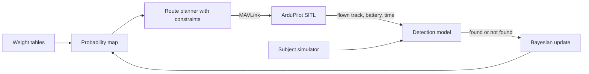

# Rescue Subject Probability Model

| Field | Value |
|---|---|
| Status | Draft v0.2 for team review. Not validated. No calibrated parameters. |
| Owner | Team-13 |
| Doctrine source | Air Force Handbook (AFH) 10-644, *Survival Evasion Resistance Escape (SERE) Operations*, 27 March 2017: [`reference/afh10-644.pdf`](../reference/afh10-644.pdf) |
| Slide | [`profiles/profile-comparison-4k.png`](../profiles/profile-comparison-4k.png) (presentation view; this document governs if they differ) |

> **Decision support only.** This model supports human search and rescue (SAR) decisions. Incident command and trained search planners keep authority. It must not be used to target, track, or surveil anyone outside an authorized rescue effort. Any use of communications data requires lawful authority.

**Evidence tags** (used on key assumptions only): `DOC` = AFH 10-644 (describes training, not observed behavior) · `EMP` = published research · `ENG` = engineering assumption · `HYP` = hypothesis that needs calibration.

## Table of contents

1. [Purpose and scope](#1-purpose-and-scope)
2. [Profiles](#2-profiles)
3. [Core probability model](#3-core-probability-model)
4. [Weighted-table methodology](#4-weighted-table-methodology)
5. [Devices and emitters](#5-devices-and-emitters)
6. [Simulation and search loop](#6-simulation-and-search-loop)
7. [Parameter registry](#7-parameter-registry)
8. [Validation](#8-validation)
9. [Roadmap](#9-roadmap)
10. [AFH 10-644 traceability and references](#10-afh-10-644-traceability-and-references)
- [Appendix A: Operator interview questions](#appendix-a-operator-interview-questions)

---

## 1. Purpose and scope

This document is the engineering foundation for a probability model that estimates **where a lost subject may be** and **how likely a search action is to find them**. Developers can build, calibrate, and test from it.

In scope:

- Two subject profiles (Section 2).
- A weighted-table prior refined with past mission data (Section 4).
- A Bayesian filter that updates the map after each search pass (Section 3).
- A simulation loop built on ArduPilot (Section 6).

Out of scope: command and dispatch, medical triage, tracking people, and any operational parameter values. Every number here is symbolic or a `CAL-xxx` placeholder.

Baseline assumption: the worst case, **no detectable emitter**. Radios, beacons, phones, and watches are uncertain opportunities (Section 5), never guarantees. A last known point (LKP) with an error estimate and a time stamp is available.

Output rules: always show uncertainty and the active assumptions. A single best point is not an acceptable output.

### Profile-based design

The model is **profile-based**. There is one shared probability engine (Section 3) and a pluggable **profile configuration** that tells it who is lost. The engine code is identical for every profile. Only the configuration changes.

| Profile supplies | Profile A: downed pilot | Profile B: civilian hiker |
|---|---|---|
| Weight table (Section 4.2) | Pilot table, with road and trail penalties under threat | Hiker table, with trail, water, and high-ground features |
| Behavioral-state rules and transition settings | Shock then coping, delayed travel, stay near site, hide and evade (`CAL-010` to `CAL-019`, `CAL-021`) | Stay put, follow trails, wander disoriented (`CAL-009`, `CAL-010` to `CAL-019`, `CAL-021`) |
| Prior and start anchors | Crash site, parachute location, planned recovery point | Trail, trailhead, parked vehicle, last known point (LKP) |
| Device inventory (Section 5) | Survival radio, beacon, kit that may be lost | Phone, watch, optional personal locator beacon |
| Threat context flag `τ` | Yes (`CAL-020`) | No, always 0 |
| Detection modifiers (Section 6) | Concealed or hiding pilots are harder to detect; parachute is a cue | Bright clothing helps; canopy and relief hide |

A new profile, such as a child or an elderly person with dementia, is added by supplying a new profile configuration (its weight table, transition settings, anchors, device inventory, and detection modifiers) without changing the engine. Each profile gets its own weight table in Section 4.

---

## 2. Profiles

A profile is a set of priors and weight tables, not a prediction about an individual. Evidence can move belief between branches, and no branch that evidence has not excluded is ever set to zero (a floor weight `CAL-004` is kept).

**Scenarios.** Profile A is a downed pilot in a **contested, GPS-denied environment**. Profile B is a **civilian hiker in a wildfire**. Neither is assumed to carry a working emitter.

**Wildfire factors (profile B).** The fire perimeter and its spread direction act as a repeller and a barrier. Subjects flee fire, avoid running uphill, and head for water, roads, or already-burned ground, and the perimeter can cut off routes (`HYP`). Public fire data: NASA FIRMS (R-26) and NIFC (R-27). Smoke reduces optical detection (Section 4.2 and 6).

**Hide and stay still (`ENG`/`HYP`, team assumption, not doctrine).** A pilot may hide and stay stationary on hearing drone noise. Vital-sign radar needs the subject stationary for about 15 s. This requirement is an engineering assumption to test, supported by the pilot hiding or an injured or exhausted hiker. Treat a moving subject as a Doppler detection instead.

| | Profile A: downed pilot (SERE-trained) | Profile B: civilian hiker |
|---|---|---|
| Training | AFH 10-644 teaches what isolated personnel (IP) should do | Common sense and basic outdoor judgment. No assumed survival doctrine |
| Emitters | None detectable (baseline). Kit may be lost, damaged, or left behind | None detectable (baseline). A phone or watch may exist with unknown charge and service |
| Likely branches | Stay near the site; delayed travel decision; planned move to a recovery point; hide and evade under threat | Stay put; follow trails or streams; wander disoriented; head for high ground or water |
| Key assumptions | Shock then coping, so major decisions are delayed (`DOC` D-06, D-18). Staying near the site aided most recoveries in permissive areas (`DOC` D-17). Choose high, clear pickup terrain (`DOC` D-33) | All behavior is `HYP`, to be checked against lost-person literature (R-07) and incident data (R-08). SERE doctrine is never used as evidence for hikers |
| Detectability | A single person is hard to see from the air (`DOC` D-21). A parachute in a tree is a signal (`DOC` D-30) | Bright clothing helps. Dense canopy and relief hide the subject. All `ENG`. In wildfire, smoke degrades optical detection and lowers pd for camera sensors (`ENG`) |

**Threat context flag (profile A only).** An enemy-presence flag `τ ∈ {0,1}` is drawn once from `p(τ)` (`CAL-020`). When `τ = 1`:

- The pilot's hide and silence hazards rise, signaling falls, and movement shifts toward concealment, away from roads and trails (`DOC` D-23, D-34, D-36, D-39).
- Rescuer risk cost rises in cells near threat sources (Section 6).
- `τ` is a **threat layer**. It is not a third profile and does not predict where enemy personnel are. Profile B always has `τ = 0`.

Conditions that modify both profiles: injury and mobility, weather, daylight, terrain, group size, equipment state, and time since the event. These enter as weight-table factors (Section 4).

---

## 3. Core probability model

### 3.1 Model choice

`ENG` A Bayesian state-space model (a hidden Markov model with continuous space) solved with a spatial particle filter. Each particle is one hypothesis about the subject's state: position, mobility and health, behavior mode, shelter, signaling intent, device states, and survival status. The probability of area (POA) of a cell is the weighted share of particles in it. Particles handle barriers such as rivers and cliffs that a single Gaussian cannot.

### 3.2 Notation

| Symbol | Meaning |
|---|---|
| $c$ | Grid cell. $\Omega$ is the search domain plus one "outside the modeled area" cell |
| $\Delta t$ | Time since the LKP time stamp |
| $\pi_t(c)$ | POA: probability the subject is in cell $c$ at time $t$ given all evidence. $\sum_c \pi_t(c)=1$ |
| $\text{pd}(\mathbf{s},u)$ | Probability that action $u$ detects a subject in state $\mathbf{s}$ |
| $\text{POD}_c$ | Probability of detection: chance the action finds the subject, given the subject is in cell $c$ |
| $\text{POS}_c$ | Probability of success: $\pi_c \cdot \text{POD}_c$ |
| $W$ | Effective sweep width of a sensor, platform, target, and environment (`CAL-050`) |
| $N$, $w^{(i)}$ | Particle count and normalized particle weights |
| $\phi$, $\theta$ | Prior parameters and transition parameters, both drawn from the profile configuration |
| $\epsilon_{\min}$ | Floor on every prior branch weight so no scenario is ruled out (`CAL-004`) |
| $\lambda_{\text{fp}}$, $E_u$ | False-positive rate per unit effort, and search effort spent by action $u$ |

### 3.3 Equations

**Prior.** A mixture over scenario branches $j$ (for example "stayed near the LKP"). The branch weights $\alpha_j$ come from the weight tables (Section 4). The position of each branch starts from the LKP error distribution (default Gaussian, mean $\mu$, covariance $\Sigma$), limited to cells the subject could reach in $\Delta t$ (generous speed bound; the impossible is excluded, the unlikely is not).

$$p(\mathbf{s}_0 \mid \phi) = \sum_{j=1}^{J} \alpha_j\, p_j(\mathbf{s}_0 \mid \phi), \qquad \sum_j \alpha_j = 1,\ \alpha_j \ge \epsilon_{\min}$$

**Movement and transition.** The state advances in fixed steps under terrain, weather, and daylight $\mathcal{E}_t$. Behavior mode changes first, then health, then position under the new mode, then signaling and device state.

$$p(\mathbf{s}_t \mid \mathbf{s}_{t-1}, \mathcal{E}_t, \theta)$$

Movement preference over terrain comes from the subject-location weight table (Section 4), used as an attraction field. Speed distributions are `CAL-030`.

**Observation update.** For a positive report $z$ and for a negative result:

$$L_+(z \mid \mathbf{s}, u) = \text{pd}(\mathbf{s},u)\,f(z \mid \mathbf{s},u) + \lambda_{\text{fp}} E_u\, b(z \mid u), \qquad L_-(\mathbf{s},u) = 1-\text{pd}(\mathbf{s},u)$$

Here $f$ is the density of a report given a true detection, $b$ is clutter density (false alarms and unrelated clues), $\lambda_{\text{fp}}$ is the false-positive rate, and $E_u$ is the search effort. Where the sensor did not look, $\text{pd}=0$.

**Posterior and particle weights.** Predict with the transition model, then reweight by the likelihood and normalize:

$$w_t^{(i)} = \frac{w_{t-1}^{(i)}\,p(z_t \mid \mathbf{s}_t^{(i)},u_t)}{\sum_{l=1}^{N} w_{t-1}^{(l)}\,p(z_t \mid \mathbf{s}_t^{(l)},u_t)}, \qquad \pi_t(c)=\sum_i w_t^{(i)}\,\mathbb{1}\!\left[x_t^{(i)}\in c\right]$$

Resample when the effective sample size $1/\sum_i (w^{(i)})^2$ falls below a configured fraction of $N$. If the normalizer is near zero, every hypothesis contradicts the data: raise a model-conflict event instead of dividing.

**Negative search pass.** A failed search lowers a cell's probability in proportion to the probability of detection, and **never sets it to zero**. For a pass over cell $i$ with $p_i=\text{POD}_i$:

$$\pi_i^{+}=\frac{\pi_i(1-p_i)}{1-\pi_i p_i}, \qquad \pi_j^{+}=\frac{\pi_j}{1-\pi_i p_i}\ \ (j\ne i)$$

A cell with $p_i=0$ keeps its probability. A cell with $p_i=1$ would go to zero, and detection is never assumed certain. Mass moves to unsearched cells.

**Repeated passes.** If misses are independent, $\text{POD}_{\text{cum}} = 1-\prod_k(1-\text{POD}_k)$. Misses are often correlated (a persistently hidden subject), so use a per-subject hiddenness term `CAL-051` instead of assuming independence. Silence from several devices that share a failure cause (impact, soaking, cold) is not independent evidence.

**Search value.** $\text{POS}=\sum_c \pi_c\,\text{POD}_c$. POA and POD are always kept as separate quantities.

---

## 4. Weighted-table methodology

This is the central method. Operators supply the structure and the first weights. Data refines them. The particle filter (Section 3) then carries the result forward in time.

### 4.1 Collect missions and follow doctrine

- Gather previous mission records: last known point, found location, time, terrain, weather, subject condition, and search outcome.
- Interview operators (Appendix A) to learn which factors they consider and how they run the process.
- Use standard operating procedures (SOP), tactics, techniques, and procedures (TTP), and standard doctrine as the baseline. Where operators and doctrine disagree, record both.

### 4.2 Operators assign weights, one table per profile

Operators manually assign a weight to each level of each factor. There is a **separate table for each profile** (downed pilot, civilian hiker). Factors:

- **Terrain and slope** (slope class, land cover, elevation relative to the LKP).
- **Weather** (temperature, precipitation, wind, visibility).
- **Subject physical condition** (injury, mobility, fitness).
- **Features** (trails, water, roads, shelter, high ground, line of sight).

Starter template (copy once per profile). No numbers are supplied; fill every `W-xxx` from operators or data:

| Factor | Level | Weight | Source | Notes |
|---|---|---|---|---|
| Slope | flat / moderate / steep / cliff | `W-001` to `W-004` | operator, SOP, or data | Barriers get low but nonzero weight |
| Land cover | open / light forest / dense forest / water / urban | `W-010` to `W-014` | operator or data | |
| Weather | clear / rain / cold / low visibility | `W-020` to `W-023` | operator or data | Affects speed and shelter-seeking |
| Physical condition | able / injured / incapacitated | `W-030` to `W-032` | operator or data | Drives distance bound |
| Trail or road nearby | on / within `CAL-xxx` m / none | `W-040` to `W-042` | operator or data | Profile A under threat: roads penalized (`DOC` D-39) |
| Water nearby | yes / no | `W-050`, `W-051` | operator or data | |
| Shelter or high ground | yes / no | `W-060`, `W-061` | operator or data | |
| Fire perimeter and spread direction (B in wildfire) | inside / near and downwind / outside / already burned | `W-070` to `W-073` | operator, R-26, R-27 | Repeller and barrier; burned ground attracts. Refresh with fire data each pass |
| Water and roads in wildfire (B) | within `CAL-xxx` m / none | `W-074`, `W-075` | operator or data | Attractors when fleeing fire |
| Interaction: uphill × active fire | uphill & fire below (B) | `W-103` multiplier | operator or data | Subjects avoid uphill runs (`HYP`); fire spreads fast uphill |
| Interaction: slope × injury | steep & injured, etc. | `W-100` multiplier | operator or data | Injured subjects rarely climb |
| Interaction: weather × shelter | cold & sheltered, etc. | `W-101` multiplier | operator or data | |
| Interaction: road × threat | road & `τ = 1` (A only) | `W-102` multiplier | SOP or data | |

Keep the list of interactions short. Add one only when operators or data show that two factors are not independent. Record each operator's weights separately so disagreement can be measured (Section 4.8).

### 4.3 Weights become a probability map

Weights are **relative scores, not probabilities**. A value of 1 means neutral. For each cell $c$, with factor levels $\ell_f(c)$ and active interaction entries $k$:

$$S(c)=K(d_c,\Delta t)\prod_{f} W_f\!\big(\ell_f(c)\big)\prod_{k\in\text{active}} I_k, \qquad \pi_0(c)=\frac{S(c)}{\sum_{c'\in\Omega} S(c')}$$

$K(d_c,\Delta t)$ is the reach term from the LKP (distance and elapsed time; Section 3.3). Normalizing is what turns scores into probabilities. The resulting map is the prior and the movement attraction field for the particle filter. Because weights are relative, a table is only meaningful together with its normalization.

### 4.4 Refine with data, small-data methods first

| Data available | Method |
|---|---|
| Few missions (tens) | Bayesian updating: operator weights act as priors, missions update them |
| Hundreds | Logistic regression on found-location versus background cells; gradient-boosted trees to find interactions |
| Thousands of incidents | Deep learning, only then |

Simulated data may supplement training but must never be the only training source. Incident databases such as the International Search and Rescue Incident Database (ISRID, R-08) are candidate sources for profile B.

### 4.5 Train and test split

- Split **by whole incident**, 80% train and 20% test. Never split by individual data point; cells from one incident are correlated and would leak.
- Also hold out by region or time period when possible, to test transfer.
- With few missions, use k-fold cross-validation, again by whole incident.

### 4.6 Check calibration

Calibration means that when the model says 30% for a group of cells, about 30% of those cells hold the subject. Check with:

- calibration (reliability) curves of predicted versus observed frequency,
- Brier score (mean squared error of predicted probabilities), and
- log score (log probability given to the true location).

Probabilities **cannot be proven true**. They can only be shown to be calibrated on held-out incidents, and recalibrated when they are not.

### 4.7 Two separate layers

| Layer | Question | Factors |
|---|---|---|
| Subject-location weights | Where is the subject? | Profile, terrain, slope, weather, physical condition, features, time since LKP |
| Detection and search-platform factors | If the subject is in the cell and we look, do we see them? | Drone type, payload and sensor, altitude, weather, vegetation |

Battery, payload type, distance, time, and search area are **search-plan constraints**, not subject-location factors. They decide what can be searched, not where the subject is. Mixing them into the location weights biases the map toward places that are easy to fly to. The subject did not move there, so the map would show where we can search rather than where they are. Constraints are applied in the planner (Section 6), after the map is built.

### 4.8 Probability level and confidence level

- **Probability level** (per cell): $\pi_t(c)$, the chance the subject is in cell $c$ given the evidence so far. Values sum to 1 over the domain.
- **Confidence level** (per cell): how trustworthy that $\pi_t(c)$ is. Compute an ensemble of maps by varying (a) each operator's weight table, (b) bootstrap resamples of mission data, (c) particle-filter seeds, and (d) clue age, which widens spread as clues get older (`CAL-072`). The confidence of a cell is based on the width of the credible interval of $\pi_t(c)$ across the ensemble:

$$\text{width}(c)=\pi^{\text{hi}}_t(c)-\pi^{\text{lo}}_t(c), \qquad \text{confidence}\in\{\text{low},\text{medium},\text{high}\}\ \text{by thresholds on width relative to }\pi_t(c)\ (\texttt{CAL-073})$$

High confidence needs good data coverage, recent clues, and operators who agree. A high probability with low confidence is a flag to gather information, not to commit assets.

### 4.9 Iterate

After each backtest and each simulation round, compare predicted to observed outcomes, revise weights or add interactions, re-check calibration, and record the table version. Retire interactions that do not improve the log score.

---

## 5. Devices and emitters

The baseline is no detectable emitter. The device model changes the map only when a device is likely to be emitting and to be received.

| Device | Profile | Signal | Note |
|---|---|---|---|
| Military survival radio, Combat Survivor/Evader Locator (CSEL), satellite communication (SATCOM) | A | Voice and data; satellite-relayed; low-probability-of-exploitation modes | `DOC` D-24 to D-26. Capabilities not verified |
| 406 MHz beacon (emergency locator transmitter (ELT), personal locator beacon (PLB)) | A, B | Digital distress message via COSPAS-SARSAT satellites | `EMP` R-09. Registration and impact damage matter (R-10, R-13, R-15) |
| 121.5 MHz homing | A, B | Local direction finding only; no satellite processing since 2009 | `EMP` R-11, R-12 |
| Phone, smartwatch, Bluetooth | B (A possible) | Cellular, Wi-Fi, Bluetooth | `ENG`. Short range. Network metadata needs lawful access |
| GPS receiver, parked vehicle | A, B | Emits nothing useful | Ground search finds the vehicle |

Acronyms: ELT = emergency locator transmitter; PLB = personal locator beacon; CSEL = Combat Survivor/Evader Locator; SATCOM = satellite communication; COSPAS-SARSAT = international satellite-aided SAR alerting system.

Rules:

- Device states are `carried`, `on`, `transmitting`, `damaged`, `depleted`, `absent`. Probability of carrying is `CAL-040`; battery depletion and damage are `CAL-043` and `CAL-049`.
- Devices fail together (impact, soaking, cold). Treat silence as a joint event, not independent evidence (`CAL-049`).
- Silence is weak evidence: it lowers probability only by the probability that the device would have been heard, `CAL-044` to `CAL-047`.
- **RTL-SDR limit.** Common RTL-SDR dongles (low-cost software-defined radios) tune only about 24 to 1766 MHz (R-17), so 2.4 GHz Wi-Fi and Bluetooth need extra hardware or a downconverter (R-18).

---

## 6. Simulation and search loop

**ArduPilot software-in-the-loop (SITL)**, the default ArduPilot simulator, simulates drone flight, routes, battery, and timing **only**. It does not know about subjects, terrain behavior, or sensors. The project must add:

1. **Subject simulator.** Moves candidate subject positions according to the profile's weight tables and the transition model (Section 3).
2. **Per-sensor detection model.** Produces a detection probability from sensor, altitude, speed, weather, vegetation, and target (`CAL-050`).
3. **Closed loop.** Take the probability map, plan survey routes under battery, distance, time, and area constraints, send them to SITL through MAVLink (the drone communication protocol), read back the flown track, apply the detection model to simulated subjects, update the map with the negative-pass rule, and repeat.

Drone platform inputs come from the specification sheets: [Group 1: Eagle NXT / eBee](../drone%20specifications/Group1_EagleNXT_EBee_Specification.pdf) and [Group 2: Redwire Stalker Block 30](../drone%20specifications/Group2_Redwire_Stalker_Block_30_specification.pdf). Fields to fill (no values entered here):

| Input | Eagle NXT / eBee | Stalker Block 30 |
|---|---|---|
| Endurance | to fill | to fill |
| Cruise speed | to fill | to fill |
| Operating altitude | to fill | to fill |
| Sensor payload and field of view | to fill | to fill |
| Battery or fuel limits | to fill | to fill |

Planner cost terms: travel cost, and rescuer risk cost that rises with `τ` for profile A. Simulation checks the loop and the planner. It does not validate the probabilities; only real incidents do (Section 8).

---

## 7. Parameter registry

Every parameter below is a placeholder. No default is supplied. An operational run needs a resolved value or a sensitivity range for each. Operator-assigned weights are `W-xxx` entries in the Section 4.2 tables.

| ID | Parameter | Profile | Tag | Source |
|---|---|---|---|---|
| `CAL-001`, `CAL-002` | Prior branch weights $\alpha_j$ | A, B | `HYP` | Weight tables, incident records |
| `CAL-003` | Dirichlet concentration of branch weights | A, B | `HYP` | Expert elicitation |
| `CAL-004` | Minimum branch weight $\epsilon_{\min}$ | A, B | policy | Decision record |
| `CAL-009` | Rate of leaving a linear feature | B | `HYP` | Incident records |
| `CAL-010` to `CAL-019`, `CAL-021` | Mode-transition hazards (site, shelter, move, signal, hide, incapacitation) | A, B | `HYP`, `ENG` | Incident and exercise data |
| `CAL-020` | Prior probability of threat flag $p(\tau)$ | A | policy | Operational situation |
| `CAL-030` | Speed by terrain, slope, mode, health | A, B | `HYP` | Tracks, terrain layers |
| `CAL-031` | Attraction weights for feature fields | A, B | `HYP` | Fit from weight tables |
| `CAL-040` | Probability a device is carried | A, B | `HYP` | Trip records |
| `CAL-041` to `CAL-043` | Duty cycle, antenna factor, battery depletion | A, B | `ENG`, `HYP` | Device logs |
| `CAL-044` to `CAL-047` | Transmit, link, decode, and dwell probabilities | A, B | `HYP` | Receiver and propagation tests |
| `CAL-048` | RF false-positive rate | A, B | `HYP` | Receiver logs |
| `CAL-049` | Shared-event (impact, soaking, cold) probabilities | A, B | `HYP` | Device logs, elicitation |
| `CAL-050` | Effective sweep width by sensor, platform, target, environment | A, B | `HYP` | Sweep-width experiments |
| `CAL-051` | Persistent hiddenness prior | A, B | `HYP` | Sweep-width, exercise data |
| `CAL-060`, `CAL-061` | LKP covariance axes | A, B | `ENG` | LKP source record |
| `CAL-070` | Reach term $K(d,\Delta t)$ parameters | A, B | `HYP` | Tracks, incident records |
| `CAL-071` | Interaction multipliers $I_k$ | A, B | `HYP` | Operators, data |
| `CAL-072` | Clue-age widening of ensemble spread | A, B | `HYP` | Backtests |
| `CAL-073` | Confidence thresholds | A, B | policy | Decision record |

---

## 8. Validation

| Check | Method |
|---|---|
| Math | Probabilities sum to 1; a negative pass never zeroes a cell; $\text{POD}=0$ leaves the map unchanged; $\text{POD}\to 1$ lowers the cell to near zero but not exactly zero |
| Particle filter | Effective sample size, mass per branch, run-to-run variation across seeds |
| Backtest | Replay past missions: run the model from the LKP, score the found location by log score and by the area searched before reaching 50% and 90% of the mass |
| Calibration | Reliability curves, Brier score, log score on the 20% held-out incidents (Section 4.5, 4.6) |
| Sensitivity | Vary each `CAL-xxx` and each operator's table; report the change in map and confidence |
| Simulation | Closed-loop runs (Section 6) to test the planner and the update logic. Not evidence of calibration |
| Operator review | Planners judge whether maps look reasonable on known cases |

Failure modes to watch:

| Failure | Control |
|---|---|
| All particles contradict the data | Raise model-conflict event; widen the prior |
| Overconfident map | Floor weights; confidence ensemble; recalibrate |
| Search constraints leak into location weights | Keep the two layers separate (Section 4.7) |
| Train/test leakage | Split by whole incident (Section 4.5) |
| Small data overfitting | Bayesian updating first; cross-validate; cap interactions |
| Stale clue treated as fresh | Clue-age widening (`CAL-072`) |
| Stereotyping a profile | Floor weights; user can change profile |
| Misuse of communications data | Lawful authority review before connecting any source |

---

## 9. Roadmap

The roadmap follows Section 4.

| Step | Work | Done when |
|---|---|---|
| 1 | Collect past missions; run operator interviews (Appendix A); capture SOP and TTP | Mission records and interview notes stored |
| 2 | Operators fill the weight-table template for each profile | Both tables complete, with per-operator copies |
| 3 | Build the weights-to-map code: multiply, add interactions, normalize | Map sums to 1 and reproduces hand-checked cases |
| 4 | Fit and refine weights with small-data methods | Updated tables with documented versions |
| 5 | Run the incident-level 80/20 split, plus region or time hold-out, or k-fold | Test set locked before tuning |
| 6 | Calibration report | Reliability curves, Brier score, and log score published |
| 7 | Detection layer: platform inputs from the drone specification sheets; sensor model | Detection table filled; kept apart from location weights |
| 8 | ArduPilot SITL loop: subject simulator, detection model, MAVLink planner | Closed loop runs end to end |
| 9 | Probability plus confidence output | Both levels defined as in Section 4.8 and shown per cell |
| 10 | Iterate after each backtest and simulation round | Table versions and score trends logged |

Open decisions: how many operators to interview, the cell size, the particle count `N`, confidence thresholds (`CAL-073`), and legal review of any communications source.

---

## 10. AFH 10-644 traceability and references

### 10.1 Doctrine traceability

Pages are printed page (PDF page). All points are paraphrased. These describe training, not observed behavior, and are never applied to civilian hikers. AFH 10-644 contains no probabilities that this model reuses.

| ID | Used for | AFH location | Page | Point |
|---|---|---|---|---|
| D-01 | Goal state | Ch. 1, 1.1 | p. 2 (PDF 10) | Return to friendly control early and in good condition |
| D-05 | Health and mobility | Ch. 2, 2.2.1 | p. 7 (PDF 15) | Fitness and injury affect coping |
| D-06 | Early-time behavior | Ch. 2, 2.2.2.3 | p. 9 (PDF 17) | Crisis then coping; crises can recur |
| D-07 | Equipment | Ch. 2, 2.2.3 | p. 9 (PDF 17) | Starting assets include kit and parachute items |
| D-14 | Device damage | Ch. 15, 15.1.1 | p. 231 (PDF 239) | Cold, moisture, and heat degrade electronic signals |
| D-16 | Kit left behind | Ch. 15, 15.5 | p. 270 (PDF 278) | Shock and fear led IP to leave kits |
| D-17 | Stay or travel | Ch. 19, 19.1 | p. 418 (PDF 426) | Staying near site aided most recoveries (permissive areas) |
| D-18 | Delayed decision | Ch. 19, 19.1.1 | pp. 418-419 (PDF 426-427) | Injuries limit travel; wait for shock to ease |
| D-21 | Low detectability | Ch. 21, 21.2 | p. 496 (PDF 504) | A single person is hard to see from the air |
| D-23 | Deliberate silence | Ch. 21, 21.5 | p. 497 (PDF 505) | Devices can reveal IP to an adversary; use per special instructions |
| D-24 to D-26 | Radio and beacon options | Ch. 21, 21.5.1 | pp. 498-499 (PDF 506-507) | Range factors; beacon chain; SATCOM, CSEL, and low-probability-of-exploitation (LPE) modes exist |
| D-30 | Parachute signal | Ch. 21, 21.5.11.1 | p. 509 (PDF 517) | A parachute in a tree is a signal |
| D-33 | Recovery point | Ch. 22, 22.4 | p. 513 (PDF 521) | Pick high, clear, accessible pickup sites |
| D-34 | Evasion phases | Ch. 23, 23.3 | pp. 522-524 (PDF 530-532) | Movement is the highest detection risk |
| D-36 | Road avoidance | Ch. 23, 23.6.2 | p. 530 (PDF 538) | Avoid lines of communication, including cell towers |
| D-39 | Trails under threat | Ch. 23, 23.20 | p. 566 (PDF 574) | Walking on roads or paths contributed to captures |

Not found in AFH 10-644: cellular, Wi-Fi, or Bluetooth detection (tagged `ENG`), and 121.5 or 406 MHz facts (public references used). Not verified: any frequency, duty-cycle, or battery figure for military devices.

### 10.2 Public references

| ID | Reference | Link |
|---|---|---|
| R-03 | National Search and Rescue Committee (NSARC), *Land Search Methods Review* | [PDF](https://www.dco.uscg.mil/Portals/9/CG-5R/nsarc/LandSearchMethodsReview.pdf) |
| R-04 | NSARC, *Land Sweep Width Demonstration Report* | [PDF](https://www.dco.uscg.mil/Portals/9/CG-5R/nsarc/LandSweepWidthDemoReportFinal.pdf) |
| R-06 | Chiacchia, K. B., "Deriving Objective Probability of Detection for Missing-Person Search", *Journal of Search and Rescue*, vol. 6, no. 1 | [PDF](https://journalofsar.com/wp-content/uploads/2023/01/jsar_v6i1-chiaccchia.pdf) |
| R-07 | Koester, R. J., *Lost Person Behavior*, dbS Productions, 2008 | [site](https://dbs-sar.com/LPB/lpb.htm) |
| R-08 | dbS Productions, International Search and Rescue Incident Database (ISRID) | [site](https://dbs-sar.com/SAR_Research/ISRID.htm) |
| R-09 | NOAA SARSAT, 406 MHz emergency beacons | [site](https://www.sarsat.noaa.gov/emergency-406-beacons/) |
| R-10 | NOAA SARSAT, register your beacon | [site](https://www.sarsat.noaa.gov/beacon.html) |
| R-11 | NOAA SARSAT, 121.5/243 MHz phase-out (archived) | [archive](https://web.archive.org/web/20180209062955/http:/www.sarsat.noaa.gov/phaseout.html) |
| R-12 | FAA Notice N7110.500, end of 121.5/243.0 MHz satellite processing | [PDF](https://www.faa.gov/documentLibrary/media/Notice/N7110.500.pdf) |
| R-13 | FCC, Personal Locator Beacons | [site](https://www.fcc.gov/wireless/bureau-divisions/mobility-division/personal-locator-beacons-plbs) |
| R-15 | NOAA SARSAT, ELT reliability after impact (2017) | [PDF](https://www.sarsat.noaa.gov/wp-content/uploads/2021/08/BMW-2017-ELT-DT-Update-to-Documents_StPierre.pdf) |
| R-17 | RTL-SDR.com, SDR roundup (R820T/R820T2 tuning range) | [site](https://www.rtl-sdr.com/roundup-software-defined-radios/) |
| R-18 | RTL-SDR.com, receiving higher frequencies with a downconverter | [site](https://www.rtl-sdr.com/receive-up-to-4-5-ghz-on-your-rtl-sdr-for-5-using-a-directv-downconverter/) |
| R-25 | NSARC, Unmanned Aircraft Systems SAR Addendum to the National SAR Supplement, v1.0 | [PDF](https://www.dco.uscg.mil/Portals/9/CG-5R/nsarc/SAR%20UAS%20Addendum%20(Version%201_0)%20-%20Final.pdf) |
| R-26 | NASA FIRMS, Fire Information for Resource Management System (active-fire detections; URL checked 2026-11-07) | [site](https://firms.modaps.eosdis.nasa.gov/) |
| R-27 | NIFC, National Interagency Fire Center, fire maps and open data (perimeters; URL checked 2026-11-07) | [site](https://www.nifc.gov/fire-information/maps) |

References were last accessed on 2026-11-07. Links to the doctrine and slide: [AFH 10-644](../reference/afh10-644.pdf), [profile slide (4K)](../profiles/profile-comparison-4k.png).

---

## Appendix A: Operator interview questions

1. Which past missions would you pick to teach this model, and why?
2. When you start a search, what do you look at first (terrain, weather, subject, last known point)?
3. Which factors move the subject's likely location the most, for a downed pilot and for a civilian hiker?
4. How do slope, terrain, and cover change how far and in which direction someone goes?
5. How does injury or poor physical condition change your estimate? Which factors combine (for example slope and injury)?
6. What SOP or TTP do you follow, and where do you deviate from it? Why?
7. How does enemy presence change where a pilot goes and how you accept risk?
8. How much weight do you give clues, and how fast do they lose value with age?
9. What would you want from a drone (sensor, altitude, pattern) and what limits you (battery, range, time)?
10. When have you been surprised by where a subject was found? What did you miss?
11. How do you decide a search area is "done"? How sure are you after one pass?
12. Would you accept a map that shows probability and confidence together? What would make you distrust it?
